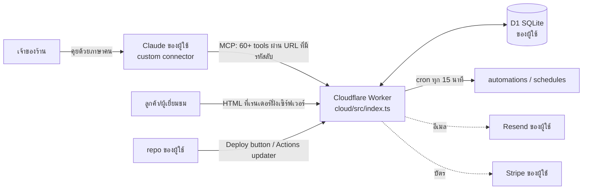
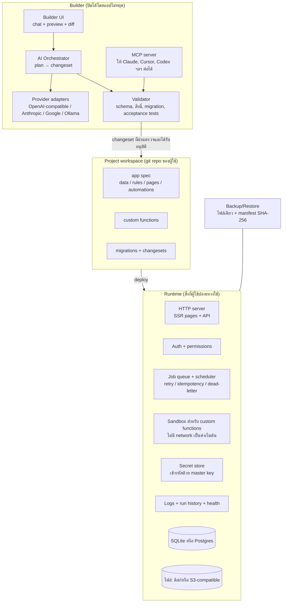
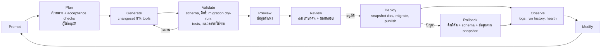

# รายงานวิจัยและออกแบบผลิตภัณฑ์: แพลตฟอร์มสร้างเว็บแอปด้วย AI แบบ Open Source ที่ผู้ใช้เป็นเจ้าของจริง

**คู่เทียบหลัก:** Base44 (base44.com) · **โครงการตั้งต้น:** web-end (github.com/michoder26-cloud/web-end) · **วันที่ตรวจข้อมูลทั้งหมด:** 8 พฤศจิกายน 2026 (เว้นแต่ระบุไว้)

ทีมผู้จัดทำ (บทบาท): Product Strategist, Competitive Intelligence Researcher, Open Source Business Strategist, Software Architect, UX Researcher, Senior Full-stack Engineer

---

## วิธีอ่านรายงานนี้

### ป้ายระดับหลักฐาน

ทุกข้อสรุปสำคัญมีป้ายกำกับ และอ้างแหล่งด้วยรหัส `S01`–`S60` ซึ่งดู URL และวันที่ตรวจได้ใน[ส่วนที่ 12](#12-source-register)

| ป้าย | ความหมาย |
| --- | --- |
| **[ทางการ]** | ยืนยันจากเอกสาร หน้าเว็บ ราคา หรือข้อกำหนดทางการของผู้ให้บริการ |
| **[โค้ด]** | ตรวจพบจากซอร์สโค้ด SDK หรือ repository สาธารณะ (ระบุไฟล์/commit) |
| **[ทดลอง]** | สังเกตจากการเปิดใช้งานจริงในเบราว์เซอร์ (ในรายงานนี้: เฉพาะหน้า `/login` และ `/register` ของ Base44 ในสถานะยังไม่ล็อกอิน) |
| **[ผู้ใช้]** | ความคิดเห็นหรือรายงานของผู้ใช้/บุคคลที่สาม (นักวิจัยความปลอดภัย สื่อ ชุมชน) |
| **[อนุมาน]** | ข้ออนุมานของผู้วิเคราะห์ ไม่ใช่ข้อเท็จจริงที่ยืนยันแล้ว |
| **[ไม่พอ]** | ยังไม่มีหลักฐานเพียงพอจากแหล่งที่เข้าถึงได้ |

### ขอบเขตและข้อจำกัดของการวิจัย (สำคัญ อ่านก่อน)

1. **เราไม่ได้สมัครและสร้างแอปบน Base44 จริง** สิ่งที่ "ทดลอง" ได้คือหน้า login/register แบบยังไม่ล็อกอิน (ถ่ายภาพและอ่านโครงสร้างหน้าเว็บด้วยเบราว์เซอร์ส่วนตัว) ข้อสรุปเรื่องคุณภาพการสร้างแอป ความเร็ว และการใช้เครดิตจริง จึงมาจากเอกสารทางการและรายงานบุคคลที่สาม ไม่ใช่การทดลองของเรา
2. **Reddit และ Trustpilot ตอบ HTTP 403** กับเครื่องมือของเรา จึงยังไม่ได้เก็บรีวิวจำนวนมากอย่างเป็นระบบ สัญญาณผู้ใช้มาจาก Hacker News, GitHub Discussions/Issues ของ Base44 และงานวิจัยความปลอดภัยที่เผยแพร่ ห้ามอ่านส่วนที่ 5 เป็นการวัดความถี่ของปัญหา
3. **ราคารายเดือน (ไม่รายปี) ของ Base44 แผน Builder/Pro/Elite และตัวเลขราคาของ Lovable** ไม่ปรากฏในข้อความ HTML ที่ดึงได้ (หน้าเว็บเรนเดอร์ด้วย JavaScript) ตัวเลขที่ใช้จึงระบุที่มาและวิธีคำนวณกำกับ
4. web-end ตรวจที่ commit `8feec01` (8 พ.ย. 2026) อ่านโค้ดจริง แต่ **ไม่ได้ติดตั้งและรันชุดทดสอบ** ในรอบนี้
5. แนวทาง REA (github.com/morluto/rea) ถูกนำมาใช้ในส่วน "วิธีทำงาน": แยกสิ่งที่สังเกตได้ออกจากข้ออนุมาน แนบหลักฐานและข้อจำกัดกับทุกข้อสรุป และใช้เครื่องมือวิเคราะห์ JavaScript ของเว็บที่ทำงานอยู่ (ผ่าน Craft Anything ซึ่งเป็นเครื่องมือประเภทเดียวกัน) กับหน้า login ของ Base44 เท่านั้น ไม่ได้ทำ reverse engineering ส่วนที่ต้องล็อกอิน และไม่ได้นำโค้ดของ Base44 มาใช้

---

## 1. Executive summary

### ข้อสรุป 8 ข้อ

1. **Base44 ไม่ได้ขาย "AI เขียนโค้ด" เป็นหลัก แต่ขาย "backend ที่รันจริงพร้อมใช้ + การดูแลระบบ + บริการเสริมคิดตามการใช้งาน"** โดย AI builder เป็นทางเข้า ตัวแอปทุกตัวพึ่ง backend ของ Base44 (ฐานข้อมูล NoSQL, auth, backend functions บน Deno, integrations, hosting) **[ทางการ S12, S13]** และค่าใช้จ่ายขณะแอปทำงาน (อีเมล อัปโหลดไฟล์ LLM workflow) หักจาก integration credits ของแผน **[ทางการ S08]**
2. **การล็อกอินอยู่ที่ backend ไม่ใช่ที่ frontend** โค้ด frontend ส่งออกได้ (React + Vite, GitHub 2-way sync ตั้งแต่แผน Builder, API export zip ยังเป็น beta) **[ทางการ S10, S11, S14]** แต่โค้ดเรียก `@base44/sdk` ซึ่งตั้งค่าเริ่มต้นไปที่ `https://base44.app` **[โค้ด S41]** ตัวเซิร์ฟเวอร์ backend ไม่ได้เปิดเป็น open source (organization `base44` บน GitHub มีแค่ CLI, SDK, skills, ตัวอย่าง) **[โค้ด S40]** และการ dev ในเครื่องยังส่งต่อ OAuth, integrations และ custom integrations ไปที่ Base44 ส่วน automations ไม่รันในเครื่อง **[ทางการ S15]** ดังนั้น "export ได้" ไม่เท่ากับ "ย้ายไปรันที่อื่นได้"
3. **ข้อมูลเป็นของผู้ใช้ตามสัญญา แต่การปกป้องข้อมูลขึ้นกับแผน:** backup อัตโนมัติมีเฉพาะแผน Elite (7 วัน) และ Enterprise (28 วัน) **[ทางการ S16]**; ข้อมูลใน workspace ที่ไม่ใช่ Enterprise "อาจถูกใช้ฝึกโมเดล AI" โดยไม่มีตัวเลือกปิด **[ทางการ S23]**; เมื่อสิ้นสุดสัญญา บริษัท "ไม่รับประกันการเข้าถึงข้อมูลต่อ" **[ทางการ S20]**
4. **ตลาดนี้ใหญ่และเติบโตเร็วจริง:** Base44 ถูก Wix ซื้อด้วยเงินสด 80 ล้านดอลลาร์ (มิ.ย. 2025) ขณะมีผู้ใช้ราว 250,000 ราย **[ผู้ใช้/สื่อ S30]** และรายงานว่าเกิน ARR 150 ล้านดอลลาร์ในเดือน พ.ค. 2026 **[ผู้ใช้/สื่อ S31]** ตัวเลขเหล่านี้มาจากสื่อที่อ้างคำบริษัท ไม่ใช่งบการเงินที่ตรวจสอบได้
5. **web-end เป็นจุดตั้งต้นที่ดี แต่เป็นคนละกระบวนทัศน์กับ Base44:** มันคือ "เอนจินเว็บไซต์/แอปแบบประกาศค่า (declarative) ที่รันบน Cloudflare Workers + D1 ของผู้ใช้เอง" โดยให้ Claude ของผู้ใช้สั่งงานผ่าน MCP (มี 60+ tools) **[โค้ด S50, S51]** ไม่ใช่ตัวสร้างโค้ดอิสระ จุดแข็งคือความปลอดภัยและการเป็นเจ้าของ (backup/restore ไฟล์เดียว, undo, test mode, staff roles, PromptPay, ภาษาไทย) จุดอ่อนคือผูกกับ Cloudflare เพียงรายเดียว ไม่มี builder UI ของตัวเอง ใช้ได้กับ AI ที่รองรับ MCP connector เท่านั้น ทดสอบครบวงจรจริงเพียงครั้งเดียว **[โค้ด S50]** และชุดทดสอบไม่ได้รันใน CI **[โค้ด S52]**
6. **ข้อเสนอของเรา:** อย่าสร้าง "Base44 เวอร์ชันฟรี" ที่ให้ AI เขียนโค้ดอะไรก็ได้ ให้สร้าง **"runtime ที่ผู้ใช้เป็นเจ้าของและพกพาได้"** (spec ของแอป + ข้อมูล + auth + automations ในรูปแบบมาตรฐาน) แล้วให้ AI ใดก็ได้แก้ผ่านชุดเครื่องมือที่ตรวจสอบได้ (changeset → validate → preview → approve → deploy → rollback ทั้งโค้ดและข้อมูล) **[อนุมาน]**
7. **กลุ่มเริ่มต้นที่แนะนำ:** ธุรกิจขนาดเล็กในไทย/อาเซียนที่ต้องการระบบหลังบ้านจริง (จอง ขาย อนุมัติ สมาชิก) โดยมี "ผู้ช่วยเทคนิค" (ฟรีแลนซ์/เอเจนซีเล็ก/ไอทีในบริษัท) เป็นคนติดตั้งและเป็นผู้จ่ายเงินหลัก เหตุผลคือ web-end มีฟีเจอร์เฉพาะตลาดนี้แล้ว (ไทย, PromptPay, PDPA-style consent) และคู่แข่งรายใหญ่ทั้งหมดคิดเงินเป็นดอลลาร์ตามเครดิต **[อนุมาน — ต้องทดสอบด้วยการสัมภาษณ์ ดูส่วนที่ 10]**
8. **ข้อได้เปรียบที่มากกว่าคำว่า "ฟรี":** ความเป็นเจ้าของที่ **พิสูจน์ได้ด้วยการทดสอบ** (ส่วนที่ 8), ข้อมูลไม่ถูกนำไปฝึกโมเดล, ต้นทุนคาดเดาได้เพราะจ่ายผู้ให้บริการโดยตรง, rollback ที่พาข้อมูลกลับตามได้, และความปลอดภัยแบบ "AI แก้ได้เฉพาะในกรอบ" สิ่งที่ต้องยอมแพ้ช่วงแรก: ความกว้างของสิ่งที่สร้างได้ ความสวยของงานออกแบบอัตโนมัติ แอปมือถือ จำนวน integrations และความสะดวกแบบ "ไม่ต้องตั้งค่าอะไรเลย"

### คำตอบสั้นสำหรับผู้บริหาร

| คำถาม | คำตอบ |
| --- | --- |
| สร้างอะไรก่อน | "Owned App Runtime" แยกจาก Cloudflare (Docker หนึ่งคำสั่ง + SQLite) ที่รับ app spec ของ web-end, มีชุดทดสอบ export→restore→run-elsewhere อัตโนมัติ และ MCP server ที่ AI ใดก็ต่อได้ |
| ทำไมเลือกเราแทน Base44 | ปิด builder แล้วแอปยังทำงาน, ย้ายเซิร์ฟเวอร์ได้ด้วยไฟล์เดียว, ไม่มีค่าเครดิตตอนแอปรัน, ข้อมูลไม่ถูกฝึกโมเดล |
| ต้องพิสูจน์อะไรก่อนลงทุนเพิ่ม | (1) ผู้ใช้ที่ไม่ใช่นักพัฒนาติดตั้งสำเร็จได้จริง (2) AI ผ่าน acceptance tests ในงานจริงของกลุ่มเป้าหมาย (3) มีคนยอมจ่ายค่า managed hosting/ติดตั้ง |

---

## 2. Base44 product teardown

### 2.1 ภาพรวมผลิตภัณฑ์จากเอกสารทางการ

- **ส่วนประกอบหลัก [ทางการ S03, S12, S13]:** AI chat (โหมด Build/Discuss), app editor (preview, Edit mode, canvas, Dashboard, version history, branches, publish), backend service (entities แบบ NoSQL ที่ "MongoDB compatible", auth, backend functions บน Deno, connectors/integrations, actors สำหรับ realtime), hosting แบบ SPA, CLI และ JavaScript SDK
- **โครงสร้างแอปที่ได้ [ทางการ S14]:** "standard React apps built with Vite" มี `src/pages`, `components`, `entities/` (JSON schema), `functions/` (TypeScript) และ `package.json` ที่รวม `@base44/sdk`
- **โมเดล AI [ทางการ S05]:** โหมด Auto เป็นค่าเริ่มต้น เลือกโมเดลเองได้ตั้งแต่แผน Builder มีโมเดลของตัวเองชื่อ Base 1 (เปิดตัว มิ.ย. 2026 ฝึกจาก "tens of millions of real user interactions" **[ผู้ใช้/สื่อ S31]**) และโมเดลจาก Anthropic, OpenAI, Google ไม่มีตัวเลือกใช้ API key ของผู้ใช้สำหรับ AI ที่สร้างแอป **[ไม่พอ — ไม่พบในเอกสารที่ตรวจ]**
- **สิ่งที่สังเกตจากหน้า login/register [ทดลอง]:** เป็น SPA ที่ bundle ด้วย Vite (209 สคริปต์), ล็อกอินด้วย Google/Apple/GitHub หรืออีเมล (login แบบ "Continue with email" ไม่ถามรหัสผ่านในหน้าแรก), หน้าสมัครมี Cloudflare Turnstile และแบนเนอร์คุกกี้ Accept/Reject/Manage พบโมดูลชื่อ `FiverrChatContext` ในโค้ดฝั่งหน้า login ซึ่ง **[อนุมาน]** น่าจะเกี่ยวกับบริการ "Hire a Partner" (ยังไม่ยืนยัน)

### 2.2 เส้นทางผู้ใช้ (customer journey) ทีละขั้น

| ขั้น | ผู้ใช้ต้องการ | Base44 ลดความยุ่งยากตรงไหน | จุดเห็นคุณค่า / เหตุให้กลับมา | ข้อจำกัด / จุดติดขัด | เหตุให้อัปเกรด / ย้ายออกยาก | เราควร |
| --- | --- | --- | --- | --- | --- | --- |
| รู้จักสินค้า | รู้ว่าทำได้จริงไหม | ข้อความ "The whole stack. No setup slowdown" และตัวอย่างแอป/เทมเพลต **[ทางการ S01]** โฆษณาวิดีโอปริมาณมาก **[ผู้ใช้ S35]** | เห็นตัวอย่างใกล้ธุรกิจตัวเอง | ผู้ใช้บางส่วนรำคาญโฆษณา **[ผู้ใช้ S35]** | – | **ปรับปรุง:** ขายด้วยการสาธิต "ย้ายออกได้จริง" และกรณีศึกษาที่วัดผล ไม่ใช่โฆษณาจำนวนมาก |
| ทดลองใช้ | ลองฟรีโดยไม่ต้องตั้งค่า | ล็อกอินด้วยบัญชีโซเชียล 1 คลิก **[ทดลอง]** แผนฟรีมี 25 message credits/เดือน (สูงสุด 5/วัน) และสร้างได้ 5 แอป **[ทางการ S02, S08]** | ได้แอปแรกในเบราว์เซอร์ทันที | เครดิตรายวันจำกัดทำให้ลองต่อเนื่องไม่ได้ **[ทางการ S08]** | เครดิตหมดกลางงาน | **ทำเหมือน (ในโหมด managed):** มี demo ที่ไม่ต้องติดตั้ง แต่ทำให้โหมด local ติดตั้งได้ในคำสั่งเดียว |
| สร้างแอปแรก | บอกความต้องการแล้วได้แอปที่ใช้ได้ | Plan mode, เริ่มจาก URL/Figma, แนบไฟล์ **[ทางการ S04]** AI ตรวจผลและแก้ error อัตโนมัติเบื้องหลัง **[ทางการ S05]** | เห็นหน้าจอ + ฐานข้อมูล + login ทำงานพร้อมกัน | คุณภาพจริงไม่ได้ทดสอบ **[ไม่พอ]** | – | **ทำเหมือนและเพิ่ม:** แผนงานต้องมี acceptance checks ที่ผู้ใช้อ่านเข้าใจก่อนสร้าง |
| แก้ไข | แก้จุดเดียวโดยไม่พังส่วนอื่น | Discuss mode (~0.3 เครดิต/ข้อความ), Edit mode แก้ด้วยมือไม่เสียเครดิต, ล็อกไฟล์ที่ห้าม AI แตะ, กฎประจำแอป **[ทางการ S05]** | แก้เร็ว | ใช้เครดิตไม่แน่นอน คำนวณหลังทำเสร็จ **[ทางการ S08]** | ซื้อเครดิตเพิ่ม/อัปเกรด | **ปรับปรุง:** แสดงขอบเขตการเปลี่ยนแปลง (diff ของ schema/สิทธิ์/หน้า) และทดสอบ regression ก่อน apply |
| เผยแพร่ | ออนไลน์ด้วยโดเมนตัวเอง | Publish 1 คลิก, HTTPS อัตโนมัติ, ต่อโดเมนตั้งแต่แผน Starter, โดเมนฟรี 1 ปีในแผนรายปี **[ทางการ S02, S12]** | แอปมี URL จริง | hosting รองรับเฉพาะ SPA ไม่รองรับ SSR **[ทางการ S12]** แอป private ใช้ได้เฉพาะแผนจ่ายเงิน **[ทางการ S21]** | ต้องจ่ายเพื่อใช้โดเมน/แอปส่วนตัว | **ทำเหมือน:** publish 1 คลิกบนเซิร์ฟเวอร์ของผู้ใช้ โดเมนและ private app ฟรี |
| มีผู้ใช้จริง | ระบบสมาชิกและสิทธิ์ถูกต้อง | auth หลายแบบ, RLS/FLS, roles, SSO (Enterprise) **[ทางการ S17, S18]** | ไม่ต้องเขียน auth เอง | ช่องโหว่ auth bypass ปี 2025 (แก้ใน 24 ชม.) **[ผู้ใช้ S32]** ฟังก์ชันที่ใช้ service role ข้าม RLS ทั้งหมด **[ทางการ S17]** | – | **ปรับปรุง:** สิทธิ์เป็นค่าเริ่มต้นแบบปฏิเสธ และมีชุดทดสอบสิทธิ์อัตโนมัติก่อน deploy |
| จ่ายเงิน | จ่ายตามคุณค่า | แผน Starter–Elite, ส่วนลดรายปี 20%, ใช้เครดิตร่วมทีม **[ทางการ S02]** | ได้เครดิตและฟีเจอร์เพิ่ม | ค่าใช้จ่ายขณะแอปทำงานผูกกับเครดิต **[ทางการ S08]** | GitHub sync, เลือกโมเดล, workflows, sandbox ให้ agent ภายนอก ต้อง Builder+ **[ทางการ S10, S05, S19, S22]** | **ไม่ทำตาม:** ไม่คิดเงินกับฟีเจอร์ความเป็นเจ้าของ |
| ขยายระบบ | ทีม หลายแอป ระบบอัตโนมัติ | branches, comments, workflows, in-app agents, superagents **[ทางการ S06, S19, S03]** | ทำงานเป็นทีมได้ | branches ใช้ข้อมูลจริงร่วมกัน (test data ตั้งแต่ Builder) **[ทางการ S06]** audit log ระดับ workspace เฉพาะ Enterprise **[ทางการ S24]** | Elite/Enterprise สำหรับ backup และ governance | **ปรับปรุง:** ทุก branch/preview ได้ฐานข้อมูลสำเนาแยก |
| ย้ายออก | เอาแอปและข้อมูลไปรันที่อื่น | GitHub sync, export zip (beta), export ตาราง **[ทางการ S10, S11, S25]** | – | backend ไม่เปิด, SDK ชี้ base44.app, entities ไม่อยู่ใน repo เมื่อใช้ 2-way sync, รหัสผ่านผู้ใช้และ workflows ไม่มีวิธีย้ายในเอกสาร **[ทางการ S14, S15 + โค้ด S41]** | ต้องเขียน backend ใหม่ | **ทำต่างอย่างชัดเจน:** การย้ายออกเป็นฟีเจอร์หลักที่มีชุดทดสอบ |

### 2.3 ตรวจรายฟีเจอร์: "มีฟีเจอร์" แยกจาก "ใช้งานจริงได้ดีแค่ไหน"

คอลัมน์ "ใช้งานจริง" ส่วนใหญ่เป็น **[ไม่พอ]** เพราะเราไม่ได้ทดลองในบัญชีจริง ที่มีข้อมูลคือข้อจำกัดที่เอกสารระบุเอง

| ประเด็น | มีฟีเจอร์ (หลักฐาน) | ใช้งานจริง / ข้อจำกัดที่ทราบ | เราควร |
| --- | --- | --- | --- |
| Prompt-to-app และ requirements | Build/Discuss/Plan mode, เริ่มจาก URL/Figma **[ทางการ S04, S05]** | คุณภาพ: **[ไม่พอ]** | ทำ requirement เป็น "app plan" ที่มี acceptance checks (web-end มี `app_plans` แล้ว) |
| สร้าง/แก้ UI | Edit mode, canvas, design system, components **[ทางการ S03]** | undo 50 ขั้นต่อ session **[ทางการ S05]** | เลื่อนไปทีหลัง ใช้ blocks + theme ก่อน |
| การจัดการ context ของ AI | ล็อกไฟล์, กฎประจำแอป, เลือกโมเดล (Builder+) **[ทางการ S05]** | ไม่มี BYOK สำหรับ builder **[ไม่พอ]** | BYOK + local model เป็นค่าเริ่มต้น |
| Preview และ deployment | preview, publish, branches **[ทางการ S03, S06]** | SPA เท่านั้น **[ทางการ S12]** | preview แยกข้อมูล + deploy บนเครื่องผู้ใช้ |
| Database และ schema migration | NoSQL "MongoDB compatible", "Schemas are not enforced... without running migrations" **[ทางการ S12]** | ไม่มีขั้นตอน review migration ข้อมูลเก่าที่รูปแบบไม่ตรงอาจค้างอยู่ **[อนุมาน]** | ใช้ SQL (SQLite/Postgres) + migration ที่ตรวจได้และย้อนได้ |
| Authentication | email/password, Google, Microsoft, Facebook, Apple, SSO **[ทางการ S12]** | ช่องโหว่ 2025 แก้แล้ว **[ผู้ใช้ S32]** | ทำ email/password + Google ก่อน, OIDC ทั่วไปทีหลัง |
| Authorization | RLS/FLS; service role ข้ามกฎทั้งหมด **[ทางการ S17]** | การอ่านที่ถูกปฏิเสธคืนผลว่าง (ปลอดภัยแต่ debug ยาก) **[ทางการ S17]** | กฎสิทธิ์ + ตัวทดสอบ "ใครเห็นอะไร" อัตโนมัติ |
| Backend functions | Deno, timeout 5 นาที, npm/jsr **[ทางการ S26]** | เรียกใช้มีค่า integration credit เล็กน้อย **[ทางการ S08]** | sandbox ไม่มี network เป็นค่าเริ่มต้น |
| File storage | UploadFile ~1 เครดิต/ไฟล์ **[ทางการ S08]** | – | เก็บไฟล์ในดิสก์/S3-compatible ของผู้ใช้ |
| Integrations และ OAuth | built-in, connectors (OAuth), custom (OpenAPI), MCP ของแอป **[ทางการ S27, S12]** | ความเสถียร **[ไม่พอ]** | เริ่มที่ webhook ขาออก/ขาเข้า + อีเมล + Stripe/PromptPay |
| Automations / scheduled jobs | Workflows (Builder+), รอบถี่สุด 5 นาที, เห็นผลทีละขั้น **[ทางการ S19]** | ~1 เครดิต/10 ขั้น **[ทางการ S08]** ไม่รันในเครื่อง **[ทางการ S15]** | automations ใน runtime เอง มี retry/idempotency/แจ้งเตือนเมื่อล้มเหลว |
| Secrets | API set/list/delete secret, เข้ารหัส **[ทางการ S28, S22]** | – | secret store แยก AI เห็นแค่ชื่อ |
| Logs/debug/monitoring | Logs Explorer (runtime/setup, errors only) **[ทางการ S24]** | audit log workspace เฉพาะ Enterprise **[ทางการ S24]** | logs + run history ฟรีทุกระดับ |
| Version history และ rollback | Version history ของโค้ด; หลังต่อ GitHub ย้อนไปก่อนต่อไม่ได้ **[ทางการ S10]** | rollback โค้ดไม่พาข้อมูลกลับ (backup แยก) **[ทางการ S16]** | changeset เดียวครอบโค้ด+schema+ข้อมูลที่ได้รับผลกระทบ |
| Backup และ restore | อัตโนมัติ, restore ทีละตาราง/ทั้งหมด, undo restore **[ทางการ S16]** | เฉพาะ Elite (7 วัน) / Enterprise (28 วัน) **[ทางการ S16]** | backup ทุกระดับ + ทดสอบ restore อัตโนมัติ |
| Collaboration | หลายคนแก้, comments, branches **[ทางการ S03, S06]** | – | เลื่อนไปทีหลัง (ทีมเริ่มต้นมัก 1–3 คน) |
| Custom domain | ตั้งแต่ Starter **[ทางการ S02, S29]** | – | ฟรี (ผู้ใช้จ่ายค่าโดเมนเอง) |
| Code export | GitHub 2-way sync (Builder+), export zip API (beta) **[ทางการ S10, S11]** | entities ไม่อยู่ใน repo ใน 2-way sync; sync หยุดชั่วคราวไม่ได้; conflict ต้องให้ AI แก้ (ใช้เครดิต) **[ทางการ S10, S14]** | export ทั้งแอปเป็นรูปแบบเปิด + รันได้โดยไม่ต้องมีเรา |
| Data export | ปุ่ม Export ต่อตาราง, ดาวน์โหลด backup เป็น CSV **[ทางการ S25, S16]** | ไม่พบการ export ผู้ใช้พร้อม hash รหัสผ่าน **[ไม่พอ]** | export ทั้งระบบรวมบัญชีผู้ใช้ที่ล็อกอินต่อได้ (web-end ทำได้แล้ว) |
| ย้ายแอปออกนอกแพลตฟอร์ม | SDK MIT, ตั้ง serverUrl ได้ **[โค้ด S41]** | ไม่มีเซิร์ฟเวอร์ open source ให้ชี้ไป; dev ในเครื่องส่งต่อ OAuth/integrations ไปที่ Base44 **[ทางการ S15]** | **[อนุมาน]** โอกาส: "Base44-compatible import" ที่อ่าน export zip + CSV แล้วสร้าง app spec ของเรา (ต้องตรวจข้อกฎหมายและข้อกำหนด API ก่อน) |

### 2.4 ข้อสังเกตเชิงกลยุทธ์จาก teardown

- Base44 **ดูดผู้ใช้เข้า** ด้วยเครื่องมือ migrate จาก Lovable, Bolt.new, Salesforce, HubSpot, Shopify, WordPress **[ทางการ S09]** แต่ไม่มีเอกสารสำหรับ "ย้ายออกไปรันที่อื่น" ซึ่งเป็นความไม่สมมาตรที่ตั้งใจหรือไม่ก็ตาม **[อนุมาน]**
- ฟีเจอร์ที่ลด "ความกลัวพัง" (backup, test data, sandbox, เลือกโมเดล, workflows, GitHub) ถูกวางไว้เป็นเหตุผลให้อัปเกรด **[ทางการ S02, S16, S06]** สำหรับเรา ฟีเจอร์กลุ่มนี้ควรเป็นของฟรีใน core เพราะคือคำมั่นเรื่องความเป็นเจ้าของ
- การเปิดตัว backend-as-a-service แยก (มี.ค. 2026, beta, ใช้ integration credits) **[ทางการ S12, S13]** และ "Base Code" สำหรับ repo เดิมบน GitHub **[ทางการ S22]** แสดงว่า Base44 กำลังขยายไปหานักพัฒนาที่ใช้ coding agent ของตัวเอง (Claude Code, Cursor, Codex) **[ทางการ S22]** นี่คือพื้นที่เดียวกับที่ web-end ใช้ (Claude ผ่าน MCP) ความแตกต่างของเราต้องอยู่ที่ "backend เป็นของคุณ" ไม่ใช่ "ใช้ agent ของคุณ"

---

## 3. Business model และ sales funnel ของ Base44

### 3.1 กลุ่มลูกค้า

| คำถาม | สิ่งที่พบ | ระดับหลักฐาน |
| --- | --- | --- |
| ใครเป็นผู้ใช้ | ผู้ไม่เขียนโค้ดที่อยากได้ "productivity tool, back-office system, customer portal, or a complete enterprise product" รวมถึงเว็บไซต์ เกม และ AI agent | **[ทางการ S01, S02, S07]** |
| ใครเป็นผู้จ่าย | เจ้าของ workspace เท่านั้นที่ซื้อ/เปลี่ยน/ยกเลิกแผนได้ เครดิตใช้ร่วมทั้ง workspace | **[ทางการ S08b]** |
| ใช้ทำอะไร | หน้าราคาเขียนว่า "Most app creators land on Starter... Elite is for people running their main product or business on Base44" | **[ทางการ S02]** |
| prototype / internal tool / แอปลูกค้าจริง | มีทั้งสามแบบ: กรณี Wiz พบแอปองค์กรสำหรับ "internal chatbots, knowledge bases, PII & HR operations" **[ผู้ใช้ S32]** และกรณีร้านค้าที่เปิดให้สาธารณะแก้ไขได้ **[ผู้ใช้ S37]** สัดส่วนแต่ละแบบ **[ไม่พอ]** | ผสม |
| องค์กรใหญ่ | "Enterprise companies still are a minority... but they represent a growing share of platform revenue" | **[ผู้ใช้/สื่อ S31]** |
| กลุ่มที่ได้คุณค่าสูงสุด | **[อนุมาน]** คนทำงานสายปฏิบัติการ/เจ้าของธุรกิจที่ต้องการเครื่องมือภายในเร็ว และผู้ประกอบการที่ทดสอบไอเดีย เพราะคุณค่าหลักคือ "ไม่ต้องตั้งค่า backend" และยอมรับการผูกกับแพลตฟอร์มได้ | อนุมาน |

### 3.2 ข้อเสนอขาย (value proposition)

- ข้อความหลัก: "Every builder needs a base", "The whole stack. No setup slowdown.", "Ship something real... without touching a server, wiring up a payment provider, or configuring a database. It's all already there." **[ทางการ S01]**
- สัญญาว่าช่วยอะไร: backend + storage ในตัว, integrations คลิกเดียว, โดเมน, analytics, "Get paid directly through Base44", "Enterprise-grade security" **[ทางการ S01]**
- ลดความกังวลก่อนลอง: แผนฟรีมี "All of Base44's core features", ยกเลิกได้ทุกเมื่อ "Your apps stay live, your data stays in your workspace", FAQ เรื่องความเป็นเจ้าของ "Nothing is locked to the platform" **[ทางการ S02]** (ข้อความสุดท้ายนี้ขัดกับข้อจำกัดทางเทคนิคในส่วนที่ 2.3 ที่เอกสารของ Base44 เองระบุ **[อนุมาน]**)
- Social proof: แกลเลอรีเทมเพลตชุมชน, Launchpad, กรณีศึกษา, โปรแกรม Startups (ไลเซนส์รายปีฟรี), โปรแกรม affiliate **[ทางการ S02, S07]**
- ต่างจากการจ้างนักพัฒนา: ข้อความ "No code, no integrations, ready to ship on day one" **[ทางการ S02]** และ "Hire a Partner" สำหรับงานที่ AI ทำไม่ได้ **[ทางการ S07]**

### 3.3 ราคาและรายได้

**แพ็กเกจปัจจุบัน (หน้าราคา ตรวจ 8 พ.ย. 2026; ราคาที่แสดงเป็นแบบชำระรายปี) [ทางการ S02]**

| แผน | ราคา/เดือน (จ่ายรายปี) | ราคา/เดือน (จ่ายรายเดือน) | Message credits/เดือน | Integration credits/เดือน | จุดเด่นที่ใช้ขาย |
| --- | --- | --- | --- | --- | --- |
| Free | $0 | $0 | 25 (สูงสุด 5/วัน เฉพาะ workspace ส่วนตัว) | 100 | สูงสุด 5 แอป, auth, ฐานข้อมูล, analytics |
| Starter | $16 | $20 **[ทางการ]** | 100 | 2,000 | ไม่จำกัดจำนวนแอป, แก้โค้ดในแอป, ต่อโดเมน, โดเมนฟรี 1 ปี |
| Builder | $40 | ~$50 **[อนุมาน]** | 250 | 10,000 | + เลือกโมเดล AI, GitHub integration |
| Pro | $80 | ~$100 **[อนุมาน]** | 500 | 20,000 | + beta features ก่อนใคร |
| Elite | $160 | ~$200 **[อนุมาน]** | 1,200 | 50,000 | + premium support, backup 7 วัน **[ทางการ S16]** |
| Enterprise | ติดต่อฝ่ายขาย | – | กำหนดเอง | กำหนดเอง | SSO, architect เฉพาะ, ไม่ใช้ข้อมูลฝึกโมเดล **[ทางการ S23]**, backup 28 วัน |

ราคารายเดือนของ Builder/Pro/Elite คำนวณจากข้อความทางการว่าส่วนลดรายปีคือ 20% ของ "monthly price multiplied by twelve" (ราคารายปี ÷ 0.8) ยังไม่ได้เห็นตัวเลขบนหน้าเว็บโดยตรง (บันทึกเป็น unknown)

**หน่วยคิดเงินและกติกาเครดิต [ทางการ S08]**

- Message credits ใช้ตอนสร้าง/แก้แอปด้วย AI ประมาณ ~0.5 (แก้เล็ก) ถึง ~3–4 (แก้ทั้งแอป) ต่อข้อความ คำนวณ **หลัง** ทำเสร็จ
- Integration credits ใช้ **ตอนแอปทำงาน**: อีเมล ~1 (โดเมนตัวเอง ~2), อัปโหลดไฟล์ ~1, สร้างภาพ ~1, วิดีโอ ~5/วินาที, LLM แบบ Auto ~1/ครั้ง, in-app agent เริ่ม ~3/ข้อความ, workflow ~1 ต่อ 10 ขั้น, เรียก backend function มีค่าเล็กน้อย; เรียกบริการภายนอกด้วย API key ของผู้ใช้เองไม่เสีย integration credit
- "There is no way to preview an integration credit cost before running an action"
- เครดิตรีเซ็ตรายเดือนและ **หมดอายุ** ถ้าไม่ใช้; เมื่อหมด "actions that use credits pause until your next reset"
- ข้อกำหนดบริการเปิดช่องให้ "restrict or suspend certain features" เมื่อเกินโควตา **[ทางการ S20]**
- ยกเลิกแผน: ใช้ได้ถึงสิ้นรอบบิล **[ทางการ S08b]** (แอปบนแผนฟรีมีขีดจำกัด 5 แอป ผลต่อแอปที่เกิน **[ไม่พอ]**)

**ฟีเจอร์ที่ใช้เป็นเหตุผลให้อัปเกรด [ทางการ S02, S05, S06, S10, S16, S19, S21, S22]:** ต่อโดเมน (Starter), แอปแบบ private (จ่ายเงิน), เลือกโมเดล AI / GitHub 2-way sync / workflows / test data / ให้ agent ภายนอกเข้า sandbox (Builder+), backup (Elite), SSO และไม่ฝึกโมเดลด้วยข้อมูล (Enterprise)

**ความสัมพันธ์รายได้กับต้นทุน**

- ก่อนขาย บริษัทรายงานกำไร 189,000 ดอลลาร์ในเดือน พ.ค. 2025 "even after covering high LLM token costs" และเลือก Claude ผ่าน AWS ด้วยเหตุผลราคา/ประสิทธิภาพ **[ผู้ใช้/สื่อ S30]**
- ปี 2026 เปิดตัวโมเดล Base 1 เพื่อ "direct control over compute and inference spend, expected to result in a structurally stronger margin profile" และ ARR เกิน 100 → 150 ล้านดอลลาร์ใน 2 เดือน **[ผู้ใช้/สื่อ S31]**
- **[อนุมาน]** โครงสร้างเครดิตทำให้ต้นทุน AI ที่ผันผวนถูกส่งต่อเป็นความไม่แน่นอนของผู้ใช้ (คิดหลังทำ ไม่ preview ได้) ขณะที่รายได้รายเดือนคงที่ ส่วนต่างกำไรจึงขึ้นกับประสิทธิภาพการใช้โมเดลของ Base44 เอง ซึ่งอธิบายแรงจูงใจในการสร้างโมเดลเอง

### 3.4 การหาลูกค้าและรักษาลูกค้า

| กลไก | หลักฐาน |
| --- | --- |
| Build in public / word of mouth ช่วงแรก | ผู้ก่อตั้งเล่าเส้นทางบน LinkedIn/X ถึง 10,000 ผู้ใช้ใน 3 สัปดาห์ **[ผู้ใช้/สื่อ S30]** |
| โฆษณาวิดีโอปริมาณมาก | ผู้ใช้ HN บ่นเห็นโฆษณา YouTube ซ้ำ ๆ **[ผู้ใช้ S35]** (สัญญาณเชิงคุณภาพ ไม่ใช่ข้อมูลงบโฆษณา) |
| SEO/content | หน้า "AI App Builder", "Website Builder", Use Cases, Blog, Higher Ed **[ทางการ S01, S02]** |
| Templates / community | แกลเลอรีเทมเพลต ชุมชน Discord/Reddit **[ทางการ S02, S07]** |
| Partner / affiliate / startups | Hire a Partner, Affiliate Program, Base44 for Startups **[ทางการ S02, S07]** |
| โปรโมชันราคา | "Cyber Monday Sale 30% Off" บนหน้าราคา **[ทางการ S02]** |
| Switching-in | เครื่องมือ migrate จาก Lovable/Bolt และ SaaS **[ทางการ S09]** |
| Distribution ของบริษัทแม่ | Wix ซื้อกิจการ, เอกสารมีการซื้อโดเมนผ่าน Wix และ Wix Payments **[ทางการ S07, ผู้ใช้/สื่อ S30]** |
| Product-led growth จากแอปแรกไปจ่ายเงิน | **[อนุมาน]** เพดานเครดิตรายวันของแผนฟรี → เจอเพดานกลางงาน → Starter สำหรับโดเมน → Builder เมื่อจำเป็นต้องใช้ GitHub/workflows/เลือกโมเดล |

**Switching costs ที่ทำให้ย้ายออกยาก [อนุมาน จากหลักฐานส่วนที่ 2]:** backend และฐานข้อมูลเป็นบริการปิด, ผู้ใช้ปลายทาง (บัญชี+รหัสผ่าน) อยู่ในระบบ Base44, workflows และ in-app agents เป็นของแพลตฟอร์ม, ค่าบริการ runtime รวมอยู่ในเครดิต, โดเมนที่ซื้อผ่านแพลตฟอร์ม, และความคุ้นเคยกับ editor

**ไม่ทราบ:** conversion rate, CAC, LTV, churn, สัดส่วนรายได้จากแต่ละแผน **[ไม่พอ]** วิธีวัดแทน (สำหรับผลิตภัณฑ์ของเรา ไม่ใช่การเดาตัวเลขของ Base44):

1. Funnel เชิงเหตุการณ์ (ไม่ใช้คุกกี้ติดตาม): เยี่ยมเว็บ → ติดตั้งสำเร็จ (นับจาก opt-in ping หรือแบบสอบถามหลังติดตั้ง) → แอปแรกผ่าน acceptance → ใช้งานต่อเนื่อง 4 สัปดาห์
2. สำหรับ managed mode: trial → paid ต่อ cohort รายเดือน, รายได้ต่อบัญชี, churn รายเดือน
3. CAC แยกตามช่องทาง (เนื้อหา, ชุมชน, พาร์ทเนอร์) ด้วยลิงก์ที่มีรหัสแคมเปญ

### 3.5 สรุป: "Base44 ขายอะไรจริง ๆ นอกเหนือจากการสร้างโค้ดด้วย AI"

> **Base44 ขาย "การไม่ต้องเป็นเจ้าของปัญหาโครงสร้างพื้นฐาน"** คือ backend ที่รันจริง, hosting, auth, integrations ที่ต่อแล้ว และคนดูแลระบบ โดยคิดเงินเป็นเครดิตทั้งตอนสร้างและตอนแอปทำงาน AI ที่เขียนโค้ดเป็นประตูเข้าและเป็นเหตุผลให้ใช้เครดิต แต่สิ่งที่ทำให้ลูกค้าอยู่ต่อคือแอปที่ทำงานอยู่บน backend ของ Base44 **[อนุมาน จากหลักฐาน S02, S08, S12, S15]**

ผลต่อเรา: ถ้าเราแจก "AI สร้างโค้ด" ฟรีแต่ปล่อยให้ผู้ใช้ไปหา backend/hosting/การดูแลเอง เราแข่งผิดจุด ความยากจริงคือทำให้การ "เป็นเจ้าของโครงสร้างพื้นฐาน" ง่ายพอ ๆ กับการไม่ต้องเป็นเจ้าของ

---

## 4. คู่แข่งและทางเลือก Open Source

### 4.1 จัดกลุ่ม (ตรวจสถานะและ license จาก GitHub API และไฟล์ LICENSE วันที่ 8 พ.ย. 2026) [โค้ด S55]

| ราย | กลุ่ม | License / สถานะ | หมายเหตุ |
| --- | --- | --- | --- |
| Base44 | คู่แข่งโดยตรง | Proprietary (SDK/CLI เป็น MIT) | คู่เทียบหลัก |
| Lovable | คู่แข่งโดยตรง | Proprietary | เครดิตรวม build + hosting (Cloud) + AI ในแอป; เครดิตรายเดือนหมดอายุใน 2 เดือน **[ทางการ S45]** |
| Bolt.new | คู่แข่งโดยตรง | Proprietary (repo เก่า `stackblitz/bolt.new` MIT ไม่อัปเดตตั้งแต่ ธ.ค. 2024) | คิดเป็น tokens; ฟรี 1M tokens/เดือน; แผนเริ่ม $25 **[ทางการ S46]** |
| Replit | คู่แข่งบางส่วน (IDE + agent + hosting) | Proprietary | Core $20 ($18 รายปี), Pro $100 **[ทางการ S47]** |
| v0 (Vercel) | คู่แข่งบางส่วน (UI/frontend เด่น) | Proprietary | คิดเครดิตตามโมเดล ต่อผู้ใช้ **[ทางการ S48]** |
| Dyad | คู่แข่งโดยตรงฝั่ง open source (desktop, local) | Apache-2.0 ยกเว้น `src/pro/` (license แยก) — source-available บางส่วน | BYOK, Ollama/LM Studio, ต่อ Supabase/Neon **[ทางการ S49]** |
| bolt.diy | คู่แข่งบางส่วน (open source, any LLM) | MIT, active | เน้นสร้างโค้ด ไม่มี backend ของตัวเอง |
| OpenHands | ทดแทน (coding agent ทั่วไป) | MIT | สำหรับนักพัฒนา |
| Convex Chef | คู่แข่งบางส่วน | Chef: Apache-2.0; convex-backend: FSL-1.1-Apache-2.0 (source-available, เป็น Apache หลัง 2 ปี) | backend ผูก Convex |
| open-lovable (Firecrawl) | ทดแทน/ไอเดีย | MIT | เน้น clone เว็บเป็น React |
| Supabase | ส่วนประกอบ (Postgres, auth, storage) | Apache-2.0 | self-host ได้แต่มีหลาย service |
| Appwrite | ส่วนประกอบ | BSD-3-Clause | |
| PocketBase | ส่วนประกอบ | MIT แต่ **repo ถูก archive** ณ วันที่ตรวจ | ไม่ควรเป็น dependency หลักใหม่ |
| Nhost | ส่วนประกอบ | MIT | GraphQL/Hasura |
| Directus | ส่วนประกอบ | Monospace Sustainable Core License (source-available ไม่ใช่ OSI) | |
| n8n | ทดแทนฝั่ง automation | Sustainable Use License + ไฟล์ `.ee.` ต้องมี license องค์กร (fair-code ไม่ใช่ OSI) | |
| Activepieces | ส่วนประกอบ automation | MIT ยกเว้นโฟลเดอร์ `ee` | |
| ToolJet | ทดแทน (internal tools) | AGPL-3.0 | |
| Appsmith | ทดแทน (internal tools) | Apache-2.0 | |
| Budibase | ทดแทน (internal tools) | "GPLv3 overall" ตามไฟล์ license | แอปที่สร้างไม่ติด GPL ตามคำประกาศ |
| NocoBase | ทดแทน | NocoBase License Agreement (ข้อตกลงของบริษัท ต้องอ่านก่อนใช้เชิงพาณิชย์) | |
| Coolify | ส่วนประกอบ (self-hosted PaaS) | Apache-2.0 | ใช้ deploy แอปของผู้ใช้ได้ |
| E2B / gVisor | ส่วนประกอบ (sandbox) | Apache-2.0 | |
| Ollama | ส่วนประกอบ (local models) | MIT | |
| LiteLLM | ส่วนประกอบ (AI gateway) | MIT ยกเว้น `enterprise/` | |
| Infisical | ส่วนประกอบ (secrets) | MIT ยกเว้น `ee/` | |

**ข้อสังเกต:** จำนวนดาว GitHub ไม่ได้ใช้ในการตัดสินคุณภาพ ใช้เพียงบอกว่ามีคนรู้จัก โครงการที่ "Open Source" ในชื่อหลายรายจริง ๆ เป็น open-core หรือ source-available (n8n, Directus, NocoBase, Dyad Pro, Convex backend) ต้องแยกให้ชัดก่อนนำมาเป็นส่วนประกอบ

### 4.2 เปรียบเทียบด้วย rubric ที่เปิดเผย

**Rubric (0–3) ต่อมิติ:** 0 = ไม่มี/ไม่รองรับตามเอกสาร · 1 = มีแบบจำกัดหรือต้องจ่าย/ต้องตั้งค่ามาก · 2 = มีครบสำหรับงานทั่วไป · 3 = เป็นจุดแข็งหลักที่เอกสารยืนยันชัด · **?** = ไม่มีหลักฐานพอ
**ความเชื่อมั่น:** สูง = จากเอกสารทางการ/โค้ดโดยตรง, กลาง = จากหน้าการตลาดหรือบางส่วน, ต่ำ = อนุมาน
**ไม่รวมคะแนนเป็นผลรวม** เพราะน้ำหนักแต่ละมิติต่างกันตามกลุ่มลูกค้า

| มิติ | Base44 | Lovable | Bolt.new | Dyad | web-end (ปัจจุบัน) | ความเชื่อมั่น |
| --- | --- | --- | --- | --- | --- | --- |
| กลุ่มเป้าหมาย | ผู้ไม่เขียนโค้ด → องค์กร | ผู้ไม่เขียนโค้ด/ทีม | ผู้ไม่เขียนโค้ด/นักพัฒนา | power users | เจ้าของธุรกิจเล็ก (ไทย/อังกฤษ) | กลาง |
| ความง่ายในการเริ่มต้น | 3 (เบราว์เซอร์, social login) | 3 | 3 | 1 (ติดตั้ง desktop + key) | 1 (ต้องมี Cloudflare, GitHub, Claude) | สูง |
| ความครบของ backend | 3 (DB, auth, functions, workflows) | 2 (Cloud) **?** รายละเอียด | **?** | 1 (ต่อ Supabase/Neon) | 2 (ตาราง, auth, automations, shop) | กลาง |
| การควบคุมโค้ดและข้อมูล | 1 (โค้ด frontend ได้ backend ไม่ได้) | **?** | **?** | 3 (โค้ดในเครื่อง) | 3 (repo + DB ใน account ผู้ใช้) | สูง (Base44, web-end), ต่ำ (อื่น) |
| Self-hosting | 0 | 0 | 0 | 2 (app รันในเครื่อง, backend ที่เลือก) | 2 (Cloudflare ของผู้ใช้เท่านั้น) | สูง |
| Local AI และ BYOK | 0 (ไม่พบ BYOK สำหรับ builder) | 0 **?** | 0 **?** | 3 | 1 (ใช้ Claude ผ่าน MCP; client อื่นที่รองรับ MCP ยังไม่ทดสอบ) | กลาง |
| ค่าใช้จ่าย (ความคาดเดาได้) | 1 (เครดิตคิดหลังทำ) | 1 (เครดิตรวม hosting) | 2 (tokens + rollover) | 3 (จ่าย provider ตรง) | 3 (แผนฟรีของผู้ให้บริการ หยุดเมื่อถึงขีด ไม่เก็บเงิน) | สูง |
| ความพร้อม production | 2 (มีลูกค้าจริงจำนวนมาก, เคยมีช่องโหว่) | **?** | **?** | **?** | 1 (early test, ทดสอบครบวงจร 1 ครั้ง) | กลาง |
| ความง่ายในการย้ายออก | 1 | **?** | **?** | 3 | 2 (backup ไฟล์เดียว, ส่งออก WordPress; แต่ runtime ผูก Cloudflare) | สูง (Base44, web-end) |
| ความยากในการดูแลเอง (3 = ง่าย) | 3 (ไม่ต้องดูแล) | 3 | 3 | 2 | 2 (อัปเดตอัตโนมัติผ่าน GitHub Actions) | กลาง |

**ข้อสรุปจากตาราง [อนุมาน]:** ไม่มีรายใดที่ได้ทั้ง "เริ่มง่ายระดับ 3" และ "self-hosting/ย้ายออกระดับ 3" พร้อมกัน นั่นคือช่องว่างที่เราต้องเติม และเป็นงานที่ยากที่สุดด้วย

---

## 5. User pain points พร้อมหลักฐาน

**คำเตือน:** แหล่งรีวิวหลัก (Reddit, Trustpilot) เข้าไม่ได้ในรอบนี้ ตารางนี้จึง **ไม่ได้วัดความถี่** แยกชัดว่าแถวไหนมีหลักฐานจริง แถวไหนเป็นแค่สมมติฐาน

### 5.1 ตารางปัญหา

| # | ปัญหา | แหล่งหลักฐาน | กลุ่มผู้ใช้ | ผลกระทบ | Workaround ปัจจุบัน | โอกาสของเรา | วิธีทดสอบความต้องการ |
| --- | --- | --- | --- | --- | --- | --- | --- |
| P1 | Export ได้แต่รันต่อไม่ได้ / backend ผูกกับบริการเดิม | **[ทางการ S12, S14, S15] + [โค้ด S41]**: SDK ชี้ base44.app, entities ไม่อยู่ใน repo, OAuth/integrations ส่งต่อไป Base44, automations ไม่รันในเครื่อง | ผู้ใช้ที่แอปโต/ลูกค้าองค์กร | ย้ายผู้ให้บริการไม่ได้โดยไม่เขียน backend ใหม่ | เขียน backend ใหม่, ใช้ต่อ | **หลัก:** runtime เปิด + ชุดทดสอบ "รันที่อื่นได้" | สัมภาษณ์ 15 รายที่เคยพยายามย้ายออกจากแพลตฟอร์ม AI builder; landing page "ย้ายแอปออกจาก AI builder" วัดการลงชื่อ |
| P2 | ค่าใช้จ่ายคาดเดายาก | **[ทางการ S08]** คิดเครดิตหลังทำ, preview ไม่ได้, เครดิตหมดอายุ; Lovable เครดิตหมดอายุ **[ทางการ S45]**; Ask HN ถามว่าใครยอมจ่าย **[ผู้ใช้ S33]** (ไม่มีคำตอบ) | ผู้จ่ายเงินรายย่อย | งบไม่แน่นอน, หยุดกลางงาน | ซื้อแผนสูงกว่าที่ต้องใช้ | BYOK + ประมาณค่า AI ก่อนรัน + ไม่มีค่าตอน runtime | ทดสอบหน้า pricing calculator และถามว่า "อะไรทำให้ตัดสินใจยกเลิก" |
| P3 | Rollback โค้ดแล้วข้อมูลไม่กลับตาม | **[ทางการ S16]** backup ครอบเฉพาะข้อมูล โค้ดใช้ version history แยก; **[ทางการ S06]** branch ใช้ข้อมูลจริงร่วมกัน | ทุกคนที่มีข้อมูลจริง | แก้ schema ผิดแล้วข้อมูลเสียหาย | backup (Elite+), test data (Builder+) | changeset ที่มี snapshot ข้อมูลก่อน migrate + restore คู่กัน | การทดลองแบบ task-based: ให้ผู้ใช้ย้อนการเปลี่ยนแปลงที่ทำข้อมูลพัง วัดความสำเร็จ |
| P4 | ปัญหา permissions / ข้อมูลรั่วข้ามผู้ใช้ | **[ผู้ใช้ S32]** Wiz: auth bypass แอป private (แก้ <24 ชม.); **[ผู้ใช้ S36]** อ้างงาน RedAccess พบแอป vibe-coded เปิดเผยข้อมูล >5,000 แอปข้ามหลายแพลตฟอร์ม (แหล่งรอง ยังไม่ได้อ่านต้นฉบับ); **[ผู้ใช้ S37]** ร้านค้าที่เปิดให้คนทั่วไปแก้ได้; **[ผู้ใช้ S38]** RLS ปิดบน Supabase ในแอปจากหลาย builder; **[โค้ด S42]** issue CLI: local dev เชื่อ JWT ที่ไม่ verify เป็น service role | แอปที่มีข้อมูลส่วนบุคคล | ข้อมูลรั่ว, ความเสียหายทางกฎหมาย | security scan (Base44 มีเชื่อม Wiz/Tenzai **[ทางการ S07]**) | สิทธิ์ปฏิเสธเป็นค่าเริ่มต้น + ทดสอบ "ใครเห็นอะไร" ทุก deploy | นับว่าแอปทดลองกี่ % ผ่านชุดทดสอบสิทธิ์โดยไม่ต้องแก้; สัมภาษณ์ผู้ดูแลข้อมูลลูกค้า |
| P5 | แอปดูดีแต่ใช้จริงไม่ได้ (รวม SEO) | **[ผู้ใช้ S34]** ผู้ศึกษา 220 เว็บพบเนื้อหาที่บอทไม่เห็นเฉลี่ย 82.1% สำหรับ Base44 (SPA); **[ทางการ S12]** hosting เป็น SPA เท่านั้น | เว็บไซต์ธุรกิจ | ค้นหาไม่เจอ | prerender เอง | เรนเดอร์ฝั่งเซิร์ฟเวอร์เป็นค่าเริ่มต้น (web-end ทำแล้ว) | วัด % เนื้อหาที่บอทเห็นในแอปทดลอง |
| P6 | AI แก้จุดหนึ่งแล้วอีกจุดพัง | **[ไม่พอ]** สำหรับ Base44 โดยตรง; Base44 ระบุว่ามีการตรวจและแก้ error อัตโนมัติ **[ทางการ S05]** ซึ่งบอกว่าเป็นปัญหาที่ต้องจัดการ **[อนุมาน]** | ทุกคน | เสียเวลาและเครดิต | ล็อกไฟล์, Discuss mode | regression tests จาก acceptance checks ก่อน apply | benchmark ภายในของเรา (ส่วนที่ 10) และเก็บรีวิวเมื่อเข้าถึงได้ |
| P7 | เสียเครดิตจากการแก้ข้อผิดพลาดซ้ำ | **[ทางการ S10]** แก้ merge conflict ด้วย AI ใช้เครดิต; ความถี่ **[ไม่พอ]** | ผู้ใช้ไม่เขียนโค้ด | เสียเงิน | – | ตรวจจับการแก้วนซ้ำแล้วหยุด (web-end มีแล้ว ตาม README) | วัดจำนวนรอบเฉลี่ยต่อ task ใน benchmark |
| P8 | Debug ยาก | **[ทางการ S24]** มี Logs explorer; audit log workspace เฉพาะ Enterprise; การอ่านที่ถูกปฏิเสธคืนค่าว่าง **[ทางการ S17]** | ผู้ใช้กลาง | หาสาเหตุไม่เจอ | ถาม AI | อธิบาย error เป็นภาษาคน + "ทำไมฉันไม่เห็นข้อมูลนี้" | ทดสอบ task: หาสาเหตุ bug ที่ฝังไว้ |
| P9 | งานอัตโนมัติล้มเหลวแล้วไม่รู้ | **[ไม่พอ]**; Base44 มีหน้า run history **[ทางการ S19]** | ร้าน/ทีมปฏิบัติการ | ลูกค้าไม่ได้อีเมลยืนยัน | ตรวจเอง | แจ้งเตือนเมื่อล้มเหลว + dead-letter + retry | ถามผู้ใช้ automation ว่ารู้ได้อย่างไรเมื่อพัง |
| P10 | การเชื่อมบริการภายนอกไม่เสถียร | **[ไม่พอ]** | – | – | – | เริ่ม integrations น้อยแต่ทดสอบได้ | เก็บ log ความล้มเหลวจากผู้ใช้นำร่อง |
| P11 | ดูแล self-hosted ยุ่งยาก | **[โค้ด S50]** web-end README ระบุ: GitHub หยุด scheduled workflow หลัง 60 วันไม่มีการเปลี่ยน, ขีดจำกัด free plan, ต้องตั้งค่า Resend/Google เอง | ผู้ไม่เขียนโค้ดที่ self-host | อัปเดตไม่ได้, ระบบหยุด | อ่านคู่มือ | installer + updater + หน้า "สุขภาพระบบ" (web-end มีบางส่วน) | วัดเวลาติดตั้งสำเร็จและอัตราติดตั้งไม่สำเร็จในผู้ทดลอง 10 คน |
| P12 | ข้อมูลถูกนำไปฝึก AI | **[ทางการ S23]** ข้อมูลแผนไม่ใช่ Enterprise อาจถูกใช้ฝึก ไม่มี opt-out; **[ผู้ใช้/สื่อ S31]** Base 1 ฝึกจากการใช้งานจริงบนแพลตฟอร์ม | ธุรกิจที่มีข้อมูลลับ/ข้อมูลลูกค้า | ความเสี่ยง PDPA/สัญญา | Enterprise | "ข้อมูลอยู่ในเครื่องคุณ ไม่มีอะไรส่งให้เรา" ตรวจสอบได้ | ทดสอบข้อความนี้ในหน้า landing กับกลุ่มธุรกิจที่มีข้อมูลลูกค้า |

### 5.2 แยก "ผู้ใช้ร้องขอจริง" ออกจาก "ไอเดียของเรา"

| ประเภท | รายการ |
| --- | --- |
| **มีหลักฐานจากผู้ใช้/บุคคลที่สาม (ยังไม่วัดความถี่)** | P4 ความปลอดภัย/สิทธิ์ (S32, S36, S37, S38), P5 SEO ของ SPA (S34), ความรำคาญจากโฆษณา (S35), คำขอ "multiple environments (dev/staging/prod)" และ "durable deployment receipts" ใน Base44 Discussions **[ผู้ใช้ S39]** |
| **เป็นข้อเท็จจริงจากเอกสาร แต่ยังไม่รู้ว่าผู้ใช้เจ็บจริงแค่ไหน** | P1, P2, P3, P12 |
| **ไอเดียที่เราคิดว่าน่าจะมีคนต้องการ (ต้องพิสูจน์)** | P6, P7, P8, P9, P10, P11, ความต้องการ local model, ความต้องการ self-host ของผู้ไม่เขียนโค้ด |

**[อนุมาน ที่ต้องระวัง]:** ความต้องการ "self-host" ในกลุ่มผู้ไม่เขียนโค้ดอาจต่ำกว่าที่เราหวัง คนกลุ่มนี้อยาก "ไม่ต้องดูแล" มากกว่า "เป็นเจ้าของ" ซึ่งเป็นเหตุผลที่แผนแนะนำให้มี "ผู้ช่วยเทคนิค" (เอเจนซี/ฟรีแลนซ์) เป็นช่องทางหลัก และมี managed mode ที่ย้ายออกได้

---

## 6. Gap analysis ของ web-end (ตรวจตามความเป็นจริง)

### 6.1 สิ่งที่ตรวจ

- Repository: `michoder26-cloud/web-end` ที่ commit `8feec013b5322829dac3e4fc75436fb784da682b` (8 พ.ย. 2026), 77 commits ระหว่าง 1–8 พ.ย. 2026, รุ่นที่ประกาศ `cloud/latest.json` = 0.22.0 **[โค้ด S50–S53]**
- อ่าน: `README.md`, `cloud/package.json`, `cloud/wrangler.jsonc`, `cloud/src/{index,mcp,auth,backup,updates}.ts`, รายชื่อ migrations 0001–0028, `cloud/tests/`, `.claude/`, `scripts/gates/`, `docs/stack-proof.md`
- **ไม่ได้ทำ:** ติดตั้งและรัน `npm test` ของจริง, deploy ขึ้น Cloudflare, ทดสอบกับ Claude ข้อสรุปเรื่อง "ทำงานได้" จึงอิงโค้ดและชุดทดสอบที่มีอยู่ ไม่ใช่การรันของเรา

### 6.2 สถาปัตยกรรมปัจจุบัน (สรุปจากโค้ด)

- เป็น **single-tenant**: 1 ฐานข้อมูลต่อ 1 เว็บไซต์ (`backup.ts`: "One database holds one site") **[โค้ด]**
- AI ไม่อยู่ในระบบ: ระบบเปิด MCP server ให้ Claude ของผู้ใช้เรียก tools เช่น `save_page`, `save_table`, `save_record`, `save_automation`, `test_automation`, `publish_site`, `restore_version`, `save_app_plan`, `check_app_plan`, `check_site` **[โค้ด cloud/src/mcp.ts]**
- แอปเป็น **ข้อมูลแบบประกาศค่า** (pages/blocks, tables, rules, automations) ที่ runtime ตีความ ไม่ใช่โค้ดที่ AI เขียนใหม่ทุกครั้ง โค้ดอิสระทำได้ผ่าน block `html` ที่รันใน iframe แบบ `sandbox="allow-scripts allow-forms"` พร้อม CSP **[โค้ด mcp.ts:154, render.ts:457, index.ts:37]**
- template/ (Payload CMS + Next.js) เป็นแนวทางเก่าที่ README ระบุว่าไม่แนะนำ และต้องใช้ Payload รุ่นที่ยังไม่ออก **[โค้ด S50, S53]**

### 6.3 ตารางความสามารถ

| ด้าน | สถานะ | หลักฐาน (ไฟล์) | หมายเหตุ |
| --- | --- | --- | --- |
| Deployment (Cloudflare) | **ใช้งานได้แล้วและตรวจหลักฐานพบ** (ผู้พัฒนาระบุว่าทดสอบครบวงจร 1 ครั้ง) | `cloud/wrangler.jsonc`, `scripts/install-cloudflare.mjs`, README | ผูก Cloudflare รายเดียว ขัดกับวิสัยทัศน์ "ไม่ผูกผู้ให้บริการรายเดียว" |
| Local mode / Docker / VPS | **ยังไม่มี** | `npm run dev` ใช้ `wrangler dev --local` สำหรับพัฒนาเท่านั้น | ช่องว่างใหญ่ที่สุด |
| Data model | **ใช้งานได้แล้ว** | migrations 0001–0028, `data.ts`, `items.ts` | ตารางผู้ใช้สูงสุด 50 × 50,000 แถว (README) |
| Auth (ลูกค้า, staff, owner) | **ใช้งานได้แล้ว** มีจุดต้องปรับ | `auth.ts` (PBKDF2 100,000 รอบ เพราะ Workers จำกัด), `google.ts`, `staff.ts` | ต่ำกว่าคำแนะนำ 600,000 รอบ (README ยอมรับเอง) |
| Permissions | **ใช้งานได้แล้ว** | กฎอ่าน/เพิ่มต่อตาราง, staff-only fields, staff areas | ยังไม่ละเอียดระดับแถว/ตารางสำหรับ staff (README) |
| Owner/MCP access | **มีบางส่วน** (ต้องปรับ) | `index.ts:236–243` ตรวจ secret ใน path `/mcp/<secret>` และ `/owner/<secret>` | secret ใน URL เสี่ยงหลุดผ่าน log/ประวัติเบราว์เซอร์; `wrangler.jsonc` เปิด logs `head_sampling_rate: 1` **[อนุมาน: ต้องตรวจว่า log เก็บ path หรือไม่]** |
| AI / MCP integration | **ใช้งานได้แล้ว** กับ Claude; client อื่น **ระบุไว้แต่ยังไม่ยืนยัน** | `mcp.ts` (`@modelcontextprotocol/sdk`) | ไม่มี BYOK/local model ในตัว เพราะไม่มี orchestrator ของตัวเอง |
| Builder UI ของตัวเอง | **ยังไม่มี** (มี back office แก้ข้อมูล/หน้า) | `owner.ts`, `cms*.ts` | ผู้ใช้ต้องมีบัญชี Claude |
| Automation engine | **ใช้งานได้แล้ว** | `automations.ts` (1,184 บรรทัด), cron `*/15`, จำกัด 100 ครั้ง/ชม./กฎ, หยุดเมื่อวนเกิน 3 รอบ | ไม่มีโค้ดใน step (ปลอดภัยแต่จำกัด), รอบถี่สุด ~15 นาที |
| Webhooks / outbox | **ใช้งานได้แล้ว** | migration `0019_webhook_outbox.sql`, `webhooks.ts` | |
| Idempotency คำสั่งซื้อ | **ใช้งานได้แล้ว** | `0018_order_idempotency.sql` | |
| Export/import | **ใช้งานได้แล้ว** | `backup.ts` (`backupFormat = 1`, 33 ตาราง, ลูกค้าล็อกอินต่อได้), `wordpress.ts`, CSV ต่อตาราง | รูปแบบเป็นของ web-end เอง ยังไม่มีสเปกเอกสาร |
| Versioning | **ใช้งานได้แล้ว** | `versions.ts`, `page-history.ts` (20 รุ่น), `changes.ts` (บันทึกและ undo การเปลี่ยนของ Claude) | ข้อมูลเปลี่ยนทันที ไม่อยู่ใน version |
| Test mode | **ใช้งานได้แล้ว** | `test-mode.ts`, migration 0028 | ดีกว่า Base44 (ฟรี) |
| Secrets | **มีบางส่วน** | ใช้ Cloudflare secrets (`RESEND_API_KEY`, `STRIPE_*`, `GOOGLE_*`), `secret-help.ts`, `scripts/gates/secrets.mjs` + pre-push hook | ไม่มี secret store ข้ามแพลตฟอร์ม |
| Testing | **มีบางส่วน** | `cloud/tests/smoke.mjs` (3,502 บรรทัด, ~1,100 จุดตรวจ), `update.mjs`, `notify.mjs` | ต้องรันเครื่อง local กับ D1 ว่าง; **ไม่มี CI workflow ที่รันชุดทดสอบ** ใน repo |
| Agent team / gates | **มีบางส่วน แต่ชี้ไปที่ template เก่า** | `.claude/hooks/guard.mjs` กำหนดเส้นทาง `src/collections/`, `payload.config.ts`; `scripts/gates/run.mjs` ค่าเริ่มต้น `template` | ไม่ครอบ `cloud/` ซึ่งเป็นผลิตภัณฑ์จริง |
| Updates | **ใช้งานได้แล้ว** | `updates.ts`, GitHub Actions รายวัน, หยุดเมื่อมีการแก้โค้ดด้วยมือ | GitHub หยุด scheduled workflow หลัง 60 วันไม่มีการเปลี่ยน (README); ดึง `latest.json` จาก GitHub (ไม่ใช่ telemetry แต่เป็นการเชื่อมต่อขาออก) |
| Observability | **มีบางส่วน** | Cloudflare observability ใน `wrangler.jsonc`, หน้า System, สถิติไม่ใช้คุกกี้ | |
| License | **MIT** | `LICENSE` | dependencies runtime: `@modelcontextprotocol/sdk` (MIT), `zod` (MIT); ฟอนต์ OFL; dev: wrangler, typescript, lighthouse **[ไม่พอ: ยังไม่ได้รันตัวตรวจ license อัตโนมัติ]** |
| ติดตั้ง/อัปเดตเอง | **ใช้งานได้แล้ว** (บน Cloudflare) | Deploy button, installer | ต้องมี 3 บัญชี (Cloudflare, GitHub, Claude) |
| Shop, PromptPay, Stripe, news, approvals, ภาษาไทย/อังกฤษ | **ใช้งานได้แล้ว / บางส่วนยังไม่ทดสอบกับบริการจริง** | README ระบุ Stripe, Resend, Google "ทดสอบกับ stand-in เท่านั้น" | |
| Multi-tenant, แอปมือถือ, real-time collaboration | **ไม่ควรทำในระยะแรก** | – | |

### 6.4 ข้อเสนอต่อแต่ละส่วน

| การตัดสินใจ | ส่วน | เหตุผล |
| --- | --- | --- |
| **เก็บไว้** | data model + rules, automations (เมนูขั้นตอนคงที่), backup/restore ไฟล์เดียว, changes+undo, test mode, app plans, staff roles, ภาษาไทย/PromptPay, MCP tool design | เป็นจุดต่างที่พิสูจน์ได้และตรงกับ pain P1, P3, P4 |
| **ปรับปรุง** | การยืนยันตัวตนของ MCP/owner (ย้าย secret ออกจาก URL → OAuth ของ MCP หรือ bearer token ใน header + redact log), เพิ่ม CI รัน smoke tests, เอกสารสเปก backup format, PBKDF2 → Argon2id/scrypt เมื่อรันนอก Workers | ลดความเสี่ยงความปลอดภัยและเพิ่มความน่าเชื่อถือ |
| **แยกเป็นโมดูล** | แยก `cloud/src` เป็น (1) core engine ไม่ผูกแพลตฟอร์ม (2) storage adapter: D1 / SQLite / Postgres (3) platform adapter: Workers / Node (4) MCP tools (5) back office UI | เงื่อนไขจำเป็นของ self-host บน VPS/เครื่องตัวเอง |
| **เปลี่ยนแนวทาง** | จาก "ต้องใช้ Claude" → "ใช้ AI ใดก็ได้ผ่าน MCP + มี builder chat ในตัวที่ใช้ provider adapter (OpenAI-compatible, Anthropic, Google, Ollama)" | BYOK และ local model เป็นข้อกำหนดของวิสัยทัศน์ |
| **รื้อใหม่ / เลิกใช้** | `template/` (Payload) และ `.claude/` hooks/gates ที่ชี้ไป template | เป็นหนี้ทางเทคนิคที่ทำให้ผู้มาใหม่สับสน; ย้าย gates มาครอบ `cloud/` |

**ไม่แนะนำให้เขียนใหม่ทั้งหมด** เหตุผลด้านต้นทุน: `cloud/src` มีโค้ดราว 1.2 MB (~16,000 บรรทัด) และชุดทดสอบ ~3,500 บรรทัดที่ครอบฟีเจอร์ธุรกิจจริง (คำสั่งซื้อ, กันจองเกิน, สิทธิ์) การแยก adapter ใช้เวลาประมาณ 3–5 สัปดาห์สำหรับ 2 คน **[อนุมาน — ประเมินจากขนาดโค้ด ยังไม่ได้ทำ spike]** ขณะที่เขียนใหม่ต้องสร้างความถูกต้องทางธุรกิจเหล่านี้ใหม่ทั้งหมด ความเสี่ยงหลักของการไม่เขียนใหม่: โค้ดถูกเขียนรอบ API ของ Workers/D1 (เช่น `env.DB.prepare`) ซึ่งต้องห่อด้วย interface ทุกจุด

---

## 7. Proposed architecture

### 7.1 หลักการออกแบบ

1. **แยก builder ออกจาก runtime อย่างเด็ดขาด** builder (UI + AI orchestrator + MCP) เป็นเครื่องมือแก้ไข runtime คือแอปที่ผู้ใช้ปลายทางใช้ ปิด builder แล้ว runtime ต้องทำงานต่อ
2. **แอป = สเปกที่ตรวจสอบได้ + โค้ดเสริมที่ถูกกักไว้** สเปก (ข้อมูล สิทธิ์ หน้า automations integrations) เป็นไฟล์ข้อความเวอร์ชันได้ โค้ดเสริมรันใน sandbox ที่มีขอบเขต
3. **ทุกการเปลี่ยนแปลงเป็น changeset** ที่มี diff, ผลการตรวจ, แผน migration, snapshot ข้อมูลก่อนใช้ และ rollback ได้
4. **ไม่มีบริการกลางที่จำเป็น** การอัปเดตและ telemetry เป็น opt-in และปิดได้
5. **เลือกเทคโนโลยีที่ทีมเล็กดูแลได้** (TypeScript ทั้งระบบ เพราะ web-end เป็น TypeScript อยู่แล้ว) ไม่เลือก Kubernetes หรือ microservices

### 7.2 ภาพรวม

### 7.3 ส่วนประกอบและ trade-off

| ส่วน | ข้อเสนอ | ทางเลือก | Trade-off / ภาระดูแล |
| --- | --- | --- | --- |
| Builder UI | เว็บแอปเดียวกับ back office: แชท, แผนงาน, diff ที่อ่านง่าย (ไม่ใช่ diff โค้ด), preview | ใช้แค่ MCP + AI client ภายนอก (แบบ web-end ปัจจุบัน) | UI ของตัวเองเพิ่มงานมาก แต่จำเป็นสำหรับ BYOK/local model และผู้ไม่มีบัญชี Claude ทำ MCP ก่อน UI ทีหลังได้ |
| AI orchestration | วงจร plan → tool calls → changeset; AI แก้ผ่าน tools ที่มี schema เท่านั้น (ไม่เขียนไฟล์ระบบตรง) | ให้ AI เขียนโค้ดอิสระทั้งแอป (แบบ Base44/Lovable) | แบบ tools ปลอดภัยและตรวจง่าย แต่สร้างได้แคบกว่า ชดเชยด้วย custom functions ใน sandbox |
| Provider adapters | adapter บาง ๆ 3 แบบ: OpenAI-compatible (ครอบ OpenAI, OpenRouter, Ollama, LM Studio, vLLM), Anthropic, Google | ใช้ LiteLLM (MIT ยกเว้น enterprise) เป็น proxy | proxy เพิ่ม process ต้องดูแล adapter เองโค้ดน้อยกว่า |
| Local models | รองรับผ่าน Ollama/LM Studio; แสดงคำเตือนเมื่อโมเดลไม่ผ่าน benchmark ภายในของเรา | – | คุณภาพโมเดลเล็กใน tool calling ไม่แน่นอน **[ไม่พอ]** ต้องมี benchmark ก่อนประกาศว่ารองรับ |
| Project workspace | git repo ของผู้ใช้ (ในเครื่อง หรือ GitHub/Gitea/GitLab) เก็บ spec, functions, migrations | เก็บใน DB อย่างเดียว | git ทำให้ fork/ตรวจย้อนหลังได้ แต่ผู้ไม่เขียนโค้ดไม่ควรต้องเห็น git |
| Sandbox | custom functions รันใน process แยกด้วย Deno permissions (`--allow-net=<allowlist>`, ไม่มี fs) + จำกัดเวลา/หน่วยความจำ; ทางเลือกเพิ่มความปลอดภัย: gVisor หรือ Firecracker สำหรับ managed mode | Workers isolates (บน Cloudflare), E2B (cloud) | Deno permissions ง่ายแต่ไม่ใช่ขอบเขตความปลอดภัยระดับ VM; สำหรับ managed หลายผู้เช่าต้องใช้ gVisor/microVM |
| Preview | runtime ชุดที่สองชี้ฐานข้อมูลสำเนา (SQLite copy / Postgres branch) | ใช้ข้อมูลจริงร่วมกัน (แบบ branch ของ Base44) | สำเนาข้อมูลใช้ดิสก์มากขึ้น ต้องมีเพดานขนาด |
| Database | **SQLite (โหมดเริ่มต้น)** สำหรับ local/VPS เล็ก; **Postgres** ทางเลือกสำหรับงานใหญ่; D1 adapter เพื่อรักษาผู้ใช้ web-end เดิม | Postgres อย่างเดียว | SQLite ติดตั้งง่าย backup คือไฟล์เดียว แต่เขียนพร้อมกันได้จำกัด; ต้องทดสอบ migration บน 2–3 engine |
| Migrations | สร้างจาก diff ของ spec → SQL ที่อ่านได้ + แผน down; การลบคอลัมน์/ตารางต้องอนุมัติแยกและมี snapshot | schema-less แบบ Base44 | ตรวจได้แต่ AI ต้องผ่านขั้นตอนเพิ่ม |
| Auth/permissions | ใช้ของ web-end (session cookie, roles, กฎต่อตาราง) + เพิ่ม row-level condition; password hash Argon2id เมื่อรันบน Node | ใช้ Supabase/Appwrite เป็น backend | ของเราเองควบคุมได้และไม่มี dependency service แยก แต่ต้องรับผิดชอบความปลอดภัยเอง → ต้องมี security review ภายนอก |
| Storage | ดิสก์ในเครื่อง หรือ S3-compatible (MinIO, R2, S3) | เก็บใน DB (แบบ web-end 1 MB/รูป) | S3 เพิ่มการตั้งค่า; ค่าเริ่มต้นใช้ดิสก์ |
| Background jobs | ตารางคิวใน DB เดียวกัน: idempotency key, retry แบบ exponential backoff สูงสุด N ครั้ง, dead-letter, แจ้งเตือนเจ้าของเมื่อล้มเหลว, จำกัดอัตราต่อกฎ | Redis/BullMQ | ไม่เพิ่ม service แต่ throughput จำกัด เหมาะกับธุรกิจเล็ก |
| Integrations | webhooks ขาเข้า/ขาออก (ลงลายเซ็น), อีเมล (SMTP ทั่วไป + Resend), Stripe, PromptPay, OAuth client generic | ตลาด integrations ขนาดใหญ่ | เริ่มน้อยแต่ทดสอบได้ทุกตัว |
| Secrets | เก็บเข้ารหัส (AES-GCM) ด้วย master key จาก env/ไฟล์; AI และ spec เห็นเฉพาะ **ชื่อ** secret; runtime ใส่ค่าตอนเรียก | Infisical/Vault | ง่าย แต่ต้องมีวิธี rotate master key |
| Deployment | (1) Local: ไฟล์รันเดียว/Docker บนเครื่อง (2) Self-hosted: Docker Compose บน VPS + Caddy สำหรับ HTTPS (3) Cloudflare adapter (4) Managed | Kubernetes | Docker Compose ดูแลง่ายสำหรับทีมเล็ก |
| Observability | log แบบมีโครงสร้าง (redact secret/token), run history ต่อ job/automation, หน้า health, OpenTelemetry exporter เป็นทางเลือก | SaaS monitoring | เก็บในเครื่อง ไม่ส่งออกโดยค่าเริ่มต้น |
| Backup/restore | ไฟล์ archive เดียว: DB dump + ไฟล์ + spec + manifest (เวอร์ชันรูปแบบ, SHA-256 ทุกไฟล์); ตั้งเวลาไปยังดิสก์/S3 ของผู้ใช้; **restore drill** อัตโนมัติไปยัง instance ชั่วคราวแล้วรัน acceptance tests | snapshot ของผู้ให้บริการ | drill ใช้ทรัพยากร ทำรายสัปดาห์ |
| Updates และ migrations ของแพลตฟอร์ม | release มีลายเซ็น, backup อัตโนมัติก่อนอัปเดต, migration แบบ forward-only + ทดสอบบนสำเนา, rollback ด้วยการคืน backup | auto-update เงียบ | ปลอดภัยกว่าแต่ช้ากว่า |

### 7.4 แยก builder ออกจาก runtime: คำตอบต่อคำถามสำคัญ

| คำถาม | คำตอบที่ออกแบบ |
| --- | --- |
| ปิด builder แล้วแอปที่เผยแพร่ยังทำงานไหม | **ทำงานต่อ** runtime ไม่ต้องคุยกับ builder หรือเซิร์ฟเวอร์ของเรา |
| Export แล้วต้องพึ่งบริการใดต่อ | เฉพาะที่ผู้ใช้เลือก: เซิร์ฟเวอร์/โฮสติ้ง, โดเมน, ผู้ส่งอีเมล, ผู้รับชำระเงิน, AI provider (ถ้าแอปใช้ AI) ไม่มี license server |
| แอปเรียก AI ตอน runtime หรือเฉพาะตอนสร้าง | **ค่าเริ่มต้น: เฉพาะตอนสร้าง** ถ้าแอปมีฟีเจอร์ AI (เช่นสรุปข้อความ) ต้องประกาศใน spec, ใช้ key ของผู้ใช้, มีเพดานค่าใช้จ่ายต่อวัน, และแอปทำงานต่อได้เมื่อ AI ล่ม |
| ย้าย AI provider อย่างไร | เปลี่ยนค่าใน Settings (provider + model + key) ไม่มีผลต่อแอปที่รันอยู่; spec ไม่ผูกกับโมเดล; benchmark บอกว่าโมเดลใหม่ผ่านกี่ % |

### 7.5 Lifecycle

**กติกาความปลอดภัยใน lifecycle**

- **Isolation:** custom functions ไม่เห็นไฟล์ระบบ ไม่เห็น secret อื่นนอกจากที่ประกาศ ไม่มี network เว้นแต่ allowlist โดเมนที่ผู้ใช้อนุมัติ
- **Egress control:** allowlist ต่อ function/integration บันทึกทุกการเรียกออก
- **Resource limits:** เวลา (เช่น 30 วินาที), หน่วยความจำ, จำนวนการเรียกต่อชั่วโมง, ขนาดไฟล์
- **Migrations ที่ตรวจได้:** SQL ที่สร้างแสดงให้ดูก่อนเสมอ การลบข้อมูลต้องยืนยันสองชั้น
- **Retry/idempotency:** ทุก job มี idempotency key; side effect ภายนอก (อีเมล/webhook) ผ่าน outbox เพื่อไม่ส่งซ้ำ
- **ขอบเขตของ AI:** AI เรียกได้เฉพาะ tools ของโปรเจกต์ ไม่มี shell, ไม่เห็นค่า secret, ไม่แก้ไฟล์แพลตฟอร์ม; การกระทำเสี่ยง (ลบตาราง, publish, ส่งอีเมลจำนวนมาก, เปลี่ยนสิทธิ์ให้กว้างขึ้น) ต้องให้คนยืนยัน; ตรวจจับการแก้วนซ้ำแล้วหยุด (มีใน web-end แล้ว)

---

## 8. Ownership acceptance checklist

แต่ละข้อมีวิธีทดสอบที่รันซ้ำได้ เป้าหมายคือให้ทุกข้อเป็น **ชุดทดสอบอัตโนมัติใน CI** ภายใน 90 วัน และเผยแพร่ผลทุก release

| # | เกณฑ์ | วิธีทดสอบ | ผ่านเมื่อ | อัตโนมัติได้ |
| --- | --- | --- | --- | --- |
| O1 | ติดตั้งใหม่ได้โดยไม่มีบัญชีกลาง | ติดตั้งบน VM ใหม่ที่ **บล็อก DNS ของโดเมนเราทั้งหมด** ทำตามคู่มือ | ติดตั้งและสร้างแอปตัวอย่างสำเร็จ ไม่มีขั้นตอนสมัครบัญชีกับเรา | ได้ |
| O2 | ใช้งานต่อได้เมื่อบริษัทผู้พัฒนาหยุดให้บริการ | รัน runtime + builder ใน network ที่ไม่มีอินเทอร์เน็ต (ยกเว้น AI provider ที่ผู้ใช้เลือก/local model) 7 วัน | แอปเสิร์ฟ, automations รัน, backup ทำงาน, ไม่มี error จากการเชื่อมต่อเรา | ได้ |
| O3 | ส่งออก source code, schema, data และไฟล์ | export → ตรวจ manifest ว่ามีทุกตาราง ทุกไฟล์ และ SHA-256 ตรง | 100% ของตาราง/ไฟล์อยู่ใน archive; schema อ่านได้เป็น SQL | ได้ |
| O4 | ผู้ใช้ปลายทางล็อกอินต่อได้หลังย้าย | สร้างผู้ใช้ 3 คน → export → restore ที่เครื่องใหม่ → ล็อกอินด้วยรหัสเดิม | ล็อกอินได้ทั้ง 3 คน, sessions เก่าถูกยกเลิก | ได้ |
| O5 | ย้ายเซิร์ฟเวอร์และ restore ได้ | backup จากเครื่อง A → restore เครื่อง B (คนละ OS/คนละ DB engine ถ้ารองรับ) → รัน acceptance tests ของแอป | tests ผ่านเท่ากับก่อนย้าย | ได้ |
| O6 | มีขั้นตอนย้าย auth และ integrations ที่ชัดเจน | ทำตามคู่มือย้าย OAuth redirect, webhooks, อีเมล กับโดเมนใหม่ | ทุก integration ในรายการตรวจ "ใช้งานได้" ในหน้า health | บางส่วน (ต้องมีบัญชีทดสอบ) |
| O7 | เปลี่ยน AI provider ได้ | สลับ provider (เช่น OpenAI-compatible → Anthropic → Ollama) แล้วรัน benchmark งานแก้ไขมาตรฐาน 20 งาน | แอปที่รันอยู่ไม่เปลี่ยน; benchmark รายงานผลต่อ provider | ได้ |
| O8 | ปิด telemetry ได้ และค่าเริ่มต้นเป็นปิด | ดักจับ network ขาออกระหว่างใช้งาน 1 ชั่วโมง | ไม่มีการเชื่อมต่อออกที่ไม่ได้อยู่ในรายการที่ผู้ใช้เปิด | ได้ |
| O9 | ไม่มี license server ที่จำเป็นต่อ core runtime | ค้นโค้ดหาการตรวจ license + ทดสอบ O2 | ไม่พบ; ฟีเจอร์ core ทำงานครบเมื่อไม่มีอินเทอร์เน็ต | ได้ |
| O10 | ฟอร์กและแก้ไขได้ตาม license | build จากซอร์สด้วยคำสั่งในเอกสาร บนเครื่องสะอาด; ตรวจ license ของ dependencies ทั้งหมด | build สำเร็จ; dependencies เข้ากันได้กับ license ของโครงการ (ไม่มี source-available ใน core) | ได้ |
| O11 | เอกสารระบุสิ่งที่ export ไม่ครอบคลุม | ตรวจว่ามีหน้า "What export does not include" ที่ตรงกับผลของ O3–O6 | มีและอัปเดตทุก release (เช่น: ประวัติ log เก่ากว่า X วัน, บัญชีภายนอก, DNS) | ตรวจด้วยคน |
| O12 | Rollback พาข้อมูลกลับตาม | ทำ changeset ที่เพิ่มคอลัมน์และแปลงข้อมูล → rollback | schema และข้อมูลกลับเหมือน snapshot (เทียบ checksum) | ได้ |
| O13 | แอปที่สร้างไม่มีโค้ดหรือ asset ที่ติด license จำกัด | สแกน output ของแอปตัวอย่าง | โค้ด template ของแอปเป็น license อนุญาต (เช่น MIT/0BSD) ผู้ใช้เลือก license ของตัวเองได้ | ได้ |
| O14 | ข้อมูลผู้ใช้ไม่ถูกใช้ฝึกโมเดลโดยเรา | ตรวจนโยบาย + O8 | ไม่มีช่องทางส่งข้อมูลมาเรา; managed mode มีข้อสัญญาเป็นลายลักษณ์อักษร | นโยบาย + ได้ |

**วิธีใช้ checklist ในการขาย:** เผยแพร่ผล O1–O14 ของแต่ละ release เป็นหน้าเว็บสาธารณะ ("ownership report") แทนการเขียนว่า "คุณเป็นเจ้าของข้อมูล" เฉย ๆ

---

## 9. Open Source licensing และโมเดลรายได้

### 9.1 Open Source ตามนิยามมาตรฐาน vs source-available

- **Open Source** ในรายงานนี้หมายถึง license ที่สอดคล้องกับ Open Source Definition ของ OSI ซึ่งรวมถึงการแจกจ่ายต่อได้อย่างเสรี และ "No Discrimination Against Fields of Endeavor" (ห้ามจำกัดการใช้เชิงพาณิชย์หรือสาขาการใช้) **[ทางการ S56]**
- **Source-available** คือเห็นซอร์สได้แต่มีข้อจำกัดการใช้ เช่น Business Source License (BSL 1.1) **[ทางการ S62]**, Functional Source License (FSL) **[ทางการ S63]**, Sustainable Use License ของ n8n, Monospace Sustainable Core License ของ Directus **[โค้ด S55]** สิ่งเหล่านี้ **ไม่ใช่** Open Source ตามนิยาม OSI และขัดกับข้อ "ฟอร์กและแก้ไขได้" ในระดับที่ผู้ใช้เชิงพาณิชย์ต้องการ

### 9.2 เปรียบเทียบ license ที่เหมาะสม

| License | สาระสำคัญ | ข้อดีต่อเรา | ข้อเสีย/ความเสี่ยง |
| --- | --- | --- | --- |
| MIT **[ทางการ S59]** | อนุญาตกว้าง เก็บประกาศลิขสิทธิ์ | เรียบง่าย web-end ใช้อยู่แล้ว | ไม่มีข้อความเรื่องสิทธิบัตรโดยตรง; คู่แข่งนำไปทำบริการปิดได้ |
| Apache-2.0 **[ทางการ S57]** | อนุญาตกว้าง + มอบสิทธิ์สิทธิบัตรโดยชัดแจ้ง + ยุติสิทธิ์เมื่อฟ้องสิทธิบัตร + ต้องระบุการแก้ไข | องค์กรคุ้นเคยและฝ่ายกฎหมายยอมรับง่าย; เข้ากันได้กับ ecosystem ส่วนใหญ่ | คู่แข่งนำไปทำ managed service ปิดได้ |
| AGPL-3.0 **[ทางการ S58]** | copyleft + มาตรา 13: ผู้ให้บริการผ่านเครือข่ายที่แก้ไขต้องเปิดซอร์สให้ผู้ใช้ | ป้องกันผู้ให้บริการคลาวด์เอาไปทำบริการปิด | องค์กรบางแห่งห้ามใช้ AGPL; ความสับสนว่าแอปที่ผู้ใช้สร้างติด AGPL หรือไม่ ต้องมีข้อยกเว้นชัด |

**ข้อเสนอ [อนุมาน]:**

1. **Runtime, SDK, app spec format, template ของแอปที่สร้าง → Apache-2.0** (template ของโค้ดแอปอาจเป็น MIT/0BSD เพื่อให้แอปของผู้ใช้เป็นของผู้ใช้ 100%) เพราะเป้าหมายหลักคือให้ทุกคนเป็นเจ้าของและนำไปใช้ต่อได้โดยฝ่ายกฎหมายไม่ขวาง
2. **Builder (UI + orchestrator): Apache-2.0 เช่นกัน** ทางเลือก AGPL-3.0 พิจารณาได้ถ้าหลักฐานแสดงว่ามีผู้ให้บริการคลาวด์นำไปทำบริการแข่งแบบไม่ตอบแทน แต่ **ห้ามเปลี่ยน license ย้อนหลัง** ให้เข้มขึ้น เพราะทำลายความเชื่อมั่น
3. web-end ปัจจุบันเป็น MIT การย้ายเป็น Apache-2.0 ทำได้สำหรับโค้ดใหม่ (MIT เข้ากันได้) แต่ต้องตัดสินใจก่อนมีผู้ร่วมพัฒนาภายนอกจำนวนมาก ใช้ DCO (Developer Certificate of Origin) แทน CLA ที่โอนสิทธิ์ เพื่อไม่ให้บริษัทเปลี่ยน license เป็นปิดได้ฝ่ายเดียว
4. ปกป้องแบรนด์ด้วย **trademark policy** (ชื่อและโลโก้) ไม่ใช่ด้วยการปิดโค้ด

### 9.3 Open-core: ปิดอะไรได้โดยไม่ขัดเป้าหมาย

| ฟีเจอร์ | ปิดได้หรือไม่ | เหตุผล |
| --- | --- | --- |
| Export, backup/restore, rollback, BYOK, local model, self-host, custom domain, auth, permissions, automations, logs | **ห้ามปิด** | เป็นนิยามของ "ทุกคนเป็นเจ้าของเองฟรี" (ส่วนที่ 2 และ 10 ของโจทย์) |
| SSO/SAML ระดับองค์กร, audit log ขั้นสูง, multi-tenant control plane สำหรับเอเจนซี | **ไม่แนะนำให้ปิด** แต่ถ้าจำเป็นต้องหารายได้ ปิดได้โดยขัดเป้าหมายน้อยที่สุด | ผู้ใช้รายย่อยไม่จำเป็นต้องใช้; แต่จะทำให้ผู้ใช้องค์กรเห็นว่า "ฟรีจริงเฉพาะรายเล็ก" |
| ตัว managed hosting, backup นอกสถานที่, monitoring 24/7 | **เป็นบริการ ไม่ใช่โค้ดที่ปิด** | ขายการดูแล ไม่ขายสิทธิ์ใช้ซอฟต์แวร์ |

**ข้อเสนอ:** ไม่ทำ open-core ในปีแรก รายได้มาจากบริการ (9.4) ถ้าต้องทำภายหลัง ให้ประกาศล่วงหน้าเป็นลายลักษณ์อักษรว่ารายการในแถวแรกจะไม่ถูกปิดตลอดไป

### 9.4 โมเดลรายได้ที่ไม่ขัดกับ Open Source ฟรี

| โมเดล | ใครจ่าย | จ่ายเพื่ออะไร | ต้นทุนที่เราต้องรับ | ความเสี่ยง | ความเหมาะสมช่วงแรก |
| --- | --- | --- | --- | --- | --- |
| Managed hosting (ย้ายออกได้ทุกเมื่อ) | ธุรกิจเล็กที่ไม่อยากดูแลเซิร์ฟเวอร์ | ไม่ต้องดูแล, HTTPS/โดเมน/อัปเดตให้ | เซิร์ฟเวอร์, การดูแล 24/7, ความปลอดภัยหลายผู้เช่า (sandbox ต้องแข็งกว่า) | ต้นทุนผันแปรและภาระ on-call; แข่งกับผู้ให้บริการใหญ่ | สูง แต่เริ่มหลัง MVP ผ่านเกณฑ์ |
| Managed backups + monitoring (สำหรับ self-host) | ผู้ self-host ที่กลัวข้อมูลหาย | backup นอกสถานที่เข้ารหัส, แจ้งเตือน, restore drill | พื้นที่เก็บข้อมูล (เข้ารหัสฝั่งลูกค้า เราไม่เห็นข้อมูล) | ราคาต่ำ ต้องปริมาณมาก | สูง (ต้นทุนต่ำ สอดคล้องคุณค่า) |
| Support/SLA | ธุรกิจที่ระบบสำคัญต่อรายได้ | เวลาตอบสนองที่สัญญาไว้ | เวลาของทีม | ทีมเล็กรับไม่ไหวถ้าลูกค้ามาก | กลาง |
| ติดตั้งและดูแลสำหรับองค์กร | องค์กร/หน่วยงานที่ต้องเก็บข้อมูลในประเทศ | ติดตั้งบนเครื่ององค์กร, ฝึกอบรม, ปรับแต่ง | เวลา, การเดินทาง | รายได้เป็นโปรเจกต์ ไม่สม่ำเสมอ | กลาง–สูงในไทย **[อนุมาน]** |
| Training และ consulting | เอเจนซี/ฟรีแลนซ์/ทีมไอที | หลักสูตรสร้างระบบให้ลูกค้าด้วยแพลตฟอร์ม | เนื้อหา, ผู้สอน | ขยายยาก | สูง (สร้างช่องทางขายด้วย) |
| Custom development | ธุรกิจที่ต้องการฟีเจอร์เฉพาะ | ฟีเจอร์/integration เฉพาะ | เวลาทีม | ดึงทีมออกจากผลิตภัณฑ์ | ต่ำ–กลาง (ทำผ่านพาร์ทเนอร์ดีกว่า) |
| Marketplace (templates, integrations, บริการพาร์ทเนอร์) | ผู้ใช้ที่อยากได้ของสำเร็จ | template อุตสาหกรรม, integration เฉพาะ | การคัดกรองคุณภาพ, ระบบชำระเงิน | ต้องไม่ทำให้ core ด้อยลง | ต่ำในปีแรก |

**ต้นทุนที่เราต้องรับผิดชอบแม้ซอฟต์แวร์ฟรี:** CI และ release, เอกสาร, ความปลอดภัย (รับแจ้งช่องโหว่ + ออกแพตช์), ดูแลชุมชน, เซิร์ฟเวอร์เว็บไซต์/เอกสาร, และถ้ามี managed mode: เซิร์ฟเวอร์ ค่าแบนด์วิดท์ backup storage และ on-call

**ความเสี่ยงจากการให้บริการฟรีไม่จำกัด:** ห้ามมี "managed ฟรีไม่จำกัด" เพราะต้นทุนเซิร์ฟเวอร์และ AI โตตามผู้ใช้โดยไม่มีรายได้ ฟรีจริงคือซอฟต์แวร์ + self-host; managed ฟรีมีเพดานชัดเจน (เช่น demo ที่ลบอัตโนมัติ) และ AI ใช้ key ของผู้ใช้เสมอ

**ค่าใช้จ่ายที่ผู้ใช้ยังต้องจ่ายแม้แพลตฟอร์มฟรี (ต้องบอกตรง ๆ):**

| รายการ | Local mode | Self-hosted mode | Managed mode |
| --- | --- | --- | --- |
| ค่าลิขสิทธิ์แพลตฟอร์ม | 0 | 0 | 0 (จ่ายค่าบริการดูแล) |
| เครื่อง/เซิร์ฟเวอร์ | เครื่องผู้ใช้ + ค่าไฟ | VPS หรือเครื่องในองค์กร | รวมในค่าบริการ |
| โดเมน | ไม่จำเป็น | จ่ายผู้จดโดเมน | จ่ายผู้จดโดเมน |
| อีเมลที่ส่งจากแอป | – | ผู้ให้บริการอีเมล (มีแผนฟรีจำกัด เช่น Resend 100/วัน ตาม README web-end **[โค้ด S50]**) | ผู้ให้บริการอีเมล |
| AI ตอนสร้างแอป | 0 ถ้าใช้ local model (ค่าไฟ/ฮาร์ดแวร์) หรือค่า API ของ provider | ค่า API ของ provider | ค่า API ของ provider (BYOK) |
| ค่าธรรมเนียมรับชำระเงิน | – | Stripe ฯลฯ | Stripe ฯลฯ |
| เวลาดูแลระบบ | ผู้ใช้ | ผู้ใช้หรือผู้ช่วยเทคนิค | เรา |

หมายเหตุ: web-end ปัจจุบันรันบนแผนฟรีของ Cloudflare ได้ภายในขีดจำกัด (Workers Free 100,000 requests/วัน, CPU 10 ms/request; D1 Free 500 MB/ฐานข้อมูล) **[ทางการ S60, S61]** เกินแล้วหยุดชั่วคราว ไม่เก็บเงิน **[โค้ด S50]**

### 9.5 รักษาความเชื่อมั่นของชุมชนและความต่อเนื่องของโครงการ

- เผยแพร่ ownership report ทุก release (ส่วนที่ 8) และ roadmap สาธารณะ
- governance เอกสาร: ใครมีสิทธิ์ merge, การตัดสินใจเรื่อง license ต้องผ่านการประกาศล่วงหน้า 90 วัน
- **แผนเมื่อผู้ก่อตั้งหยุดพัฒนา:** maintainer อย่างน้อย 2 คนจากต่างองค์กรภายในปีแรก, สิทธิ์ admin ของ org/โดเมน/คีย์ลงนาม release เก็บแบบหลายคน, ไม่มีบริการกลางที่จำเป็น (O2), ระยะยาวพิจารณาย้ายเข้ามูลนิธิ (fiscal host)
- ไม่ใช้ CLA ที่ให้บริษัทเปลี่ยน license เป็นปิดได้; ใช้ DCO

---

## 10. MVP และ roadmap

### 10.1 กลุ่มผู้ใช้เริ่มต้น

**เลือก: "ผู้ช่วยเทคนิคที่สร้างระบบหลังบ้านให้ธุรกิจเล็กในไทย"** (ฟรีแลนซ์, เอเจนซีเว็บ 1–10 คน, ไอทีประจำบริษัท SME) โดยผู้ใช้งานรายวันคือเจ้าของธุรกิจและพนักงาน

| เหตุผล | ระดับหลักฐาน |
| --- | --- |
| web-end มีฟีเจอร์ตรงกลุ่มนี้แล้ว: ภาษาไทยทั้ง back office, PromptPay QR, การยินยอมรับข่าวสารแบบ PDPA, ร้านค้า/การจอง/อนุมัติ, เอกสารนำร่องภาษาไทย `docs/pilot-th.md` | **[โค้ด S50]** |
| คู่แข่งหลักคิดเงินเป็นดอลลาร์ตามเครดิต ไม่มี self-host | **[ทางการ S02, S45–S48]** |
| ผู้ช่วยเทคนิคมีทักษะพอจะติดตั้งเอง และเป็นผู้จ่ายเงินที่มีแรงจูงใจ (ค่าติดตั้ง/ค่าดูแลรายเดือนจากลูกค้า) | **[อนุมาน — ต้องสัมภาษณ์]** |
| ความต้องการเก็บข้อมูลลูกค้าในระบบตัวเอง (PDPA) | **[อนุมาน]** |
| กลุ่มที่ไม่เลือกช่วงแรก: นักพัฒนามืออาชีพ (มี Dyad, bolt.diy, coding agents), องค์กรใหญ่ (ต้อง SSO/compliance), ผู้ทำ prototype ทั่วไป (Base44/Lovable ง่ายกว่า) | **[อนุมาน]** |

**หลักฐานที่จะทำให้เปลี่ยนกลุ่ม:** สัมภาษณ์ 20 รายแล้วน้อยกว่า 5 รายยินดีติดตั้ง/ดูแลเองหรือจ่ายค่าบริการ → ย้ายไปเน้น managed mode สำหรับเจ้าของธุรกิจโดยตรง

### 10.2 ขอบเขต MVP

| ระดับ | รายการ |
| --- | --- |
| **จำเป็นต่อ MVP** | (1) runtime แยกจาก Cloudflare: Docker หนึ่งคำสั่ง + SQLite (เก็บ Cloudflare adapter) (2) ฟีเจอร์ธุรกิจเดิมของ web-end ทำงานบน runtime ใหม่ผ่านชุดทดสอบเดิม (3) MCP server พร้อม auth แบบ header/OAuth (4) builder chat แบบมินิมอลที่ใช้ provider adapter (OpenAI-compatible + Anthropic) และ Ollama (5) changeset + validate + preview ข้อมูลสำเนา + rollback ที่พาข้อมูลกลับ (6) backup/restore + restore drill (7) ownership checklist O1–O5, O7–O9, O12 ใน CI (8) คู่มือติดตั้งไทย/อังกฤษ |
| **เลื่อนได้** | Postgres adapter, S3 storage, custom functions sandbox (ใช้ automations เมนูคงที่ไปก่อน), OIDC ทั่วไป, collaboration หลายคนพร้อมกัน, marketplace, managed mode, แก้ UI แบบลากวาง |
| **ไม่ควรทำ** | แอปมือถือ native, realtime multiplayer editing, ตลาด integrations หลายร้อยตัว, โมเดล AI ของตัวเอง, multi-tenant SaaS ก่อนมีลูกค้าจ่ายเงิน, การ "clone เว็บคู่แข่ง" |

### 10.3 ความเสี่ยงหลักที่ต้องพิสูจน์ก่อนลงทุนเพิ่ม

1. **ติดตั้งได้จริง:** ผู้ช่วยเทคนิคติดตั้งสำเร็จด้วยตัวเอง
2. **AI ทำงานได้ในกรอบ tools:** โมเดลที่ผู้ใช้เข้าถึงได้ (รวม local) ผ่าน acceptance tests ในงานจริง
3. **มีคนจ่าย:** อย่างน้อยค่าติดตั้ง/managed backup/training
4. **ความปลอดภัยของ auth/permissions:** ผ่าน security review ภายนอก

### 10.4 แผน 30/60/90 วัน

**สมมติฐาน:** ทีม 3 คน — Senior Full-stack 2 คน (เต็มเวลา), Product/UX Research 1 คน (ครึ่งเวลา); งบ AI สำหรับ benchmark มีจำกัด; ผู้ก่อตั้ง web-end ร่วมเป็น maintainer **[อนุมาน]**

| ระยะ | งานหลัก | Dependencies | เกณฑ์ผ่าน (เป้าหมายทดลอง ไม่ใช่ benchmark ที่พิสูจน์แล้ว) |
| --- | --- | --- | --- |
| **วัน 1–30: พิสูจน์ runtime พกพาได้** | แยก storage/platform adapter; รัน smoke tests เดิมบน Node + SQLite; CI; ย้าย MCP auth ออกจาก URL; Docker image; สัมภาษณ์ผู้ช่วยเทคนิค 15–20 ราย; benchmark งานแก้ไข 20 งาน | ความร่วมมือของ maintainer web-end | smoke tests ≥ 95% ผ่านบน SQLite; ติดตั้งด้วย Docker ≤ 15 นาทีในเครื่องทีม; มีผู้สนใจทดลองนำร่อง ≥ 5 ราย |
| **วัน 31–60: changeset + BYOK** | builder chat มินิมอล + provider adapters + Ollama; changeset/validate/preview/rollback; backup format v2 + เอกสารสเปก; ownership tests O1–O5, O8, O9, O12 | ผล benchmark โมเดล | AI ผ่าน acceptance ≥ 70% ของ 20 งานด้วยโมเดล frontier และรายงานผล local model ตามจริง; rollback ข้อมูลผ่าน 100% ของเคสทดสอบ |
| **วัน 61–90: นำร่องจริง** | นำร่อง 5 ธุรกิจผ่านผู้ช่วยเทคนิค 3 ราย; security review ภายนอก (auth/permissions/sandbox ของ html block); restore drill อัตโนมัติ; ทดสอบราคาบริการ (managed backup / ติดตั้ง) | ผู้ร่วมนำร่อง, งบ security review | ติดตั้งสำเร็จโดยไม่ช่วย ≥ 4 ใน 5; แอปแรกที่ผ่าน acceptance ภายใน 1 วันทำงาน; ≥ 2 รายยินดีจ่าย; ไม่มีช่องโหว่ระดับ critical ค้าง |

### 10.5 Feature cards (ฟีเจอร์สำคัญ)

**F1 ติดตั้งหนึ่งคำสั่ง (Local/Self-hosted)**
- User story: ในฐานะผู้ช่วยเทคนิค ฉันต้องการติดตั้งแพลตฟอร์มบน VPS ของลูกค้าด้วยคำสั่งเดียว เพื่อส่งมอบระบบภายในวันเดียว
- ขอบเขต: Docker Compose (app + Caddy HTTPS), SQLite volume, ตั้งค่าครั้งแรกผ่านเว็บ, ไม่มีบัญชีกับเรา
- Acceptance: VM ใหม่ (Ubuntu LTS 2 vCPU/2 GB) → เปิดหน้าเว็บ HTTPS และสร้างเจ้าของได้; ผ่าน O1, O8
- Failure cases: พอร์ต 80/443 ถูกใช้, DNS ยังไม่ชี้, ดิสก์เต็ม, เวลาเครื่องผิด → ข้อความแก้ไขเป็นภาษาคน
- วิธีทดสอบ: CI สร้าง VM ชั่วคราวและติดตั้งทุก release
- ภาระดูแล: อัปเดต base image, รองรับ OS หลายรุ่น, คู่มือแก้ปัญหา

**F2 Changeset ที่ตรวจได้และย้อนได้**
- User story: ในฐานะเจ้าของธุรกิจ ฉันต้องการเห็นว่า AI จะเปลี่ยนอะไรก่อนกดใช้ และย้อนกลับได้ทั้งหน้าและข้อมูล
- ขอบเขต: diff ภาษาคน (หน้า, ตาราง/คอลัมน์, สิทธิ์, automations), ผลตรวจ, snapshot ก่อน apply, rollback
- Acceptance: changeset ที่เพิ่ม/เปลี่ยนชนิดคอลัมน์ → apply → rollback → checksum ข้อมูลเท่าก่อน (O12)
- Failure cases: migration ล้มกลางทาง (ต้อง transaction), ข้อมูลใหม่ระหว่าง apply กับ rollback (ต้องเตือนว่าจะหาย/เก็บแยก), changeset ใหญ่เกิน
- วิธีทดสอบ: property-based tests บน schema แบบสุ่ม + เคสตัวอย่างธุรกิจ
- ภาระดูแล: ทุก tool ใหม่ต้องประกาศผลต่อ schema/ข้อมูล

**F3 Provider adapters + local model**
- User story: ในฐานะผู้ใช้ ฉันต้องการใช้ key ของฉันหรือโมเดลในเครื่อง และเปลี่ยนเมื่อไรก็ได้
- ขอบเขต: OpenAI-compatible, Anthropic, Google; ทดสอบ Ollama; ประมาณค่าใช้จ่ายก่อนรัน; เพดานค่าใช้จ่ายต่อวัน
- Acceptance: สลับ provider แล้ว benchmark 20 งานรันจบและรายงานผล (O7); key ไม่ปรากฏใน log
- Failure cases: โมเดลไม่รองรับ tool calling, rate limit, timeout, context ยาวเกิน → แจ้งและหยุดอย่างปลอดภัย
- วิธีทดสอบ: mock server ต่อ provider + benchmark จริงรายสัปดาห์
- ภาระดูแล: API ของ provider เปลี่ยนบ่อย ต้องมีเจ้าของ adapter

**F4 Backup/restore + restore drill**
- User story: ในฐานะเจ้าของ ฉันต้องการมั่นใจว่ากู้ระบบได้จริง ไม่ใช่แค่มีไฟล์ backup
- ขอบเขต: backup ตามเวลาไปดิสก์/S3 ของผู้ใช้, เข้ารหัสได้, drill ไป instance ชั่วคราวแล้วรัน acceptance tests, รายงานผล
- Acceptance: ผ่าน O3–O5; drill ล้มแล้วแจ้งเตือนเจ้าของภายใน 1 ชั่วโมง
- Failure cases: ไฟล์เสีย (ตรวจ SHA-256), รุ่นรูปแบบเก่ากว่า (ต้องแปลงได้ย้อนหลัง 2 major), พื้นที่ไม่พอ
- ภาระดูแล: ความเข้ากันได้ของรูปแบบ backup ข้ามรุ่น

**F5 สิทธิ์ที่ทดสอบอัตโนมัติ**
- User story: ในฐานะเจ้าของ ฉันต้องการรู้ว่าลูกค้าแต่ละคนเห็นเฉพาะข้อมูลของตัวเอง
- ขอบเขต: ตาราง "ใครเห็น/แก้อะไร" ที่สร้างจากกฎ, ทดสอบอัตโนมัติด้วยผู้ใช้จำลองทุกบทบาทก่อน deploy, ค่าเริ่มต้นปฏิเสธ
- Acceptance: changeset ที่ทำให้ข้อมูลส่วนตัวเปิดสาธารณะถูกบล็อกจนกว่าจะยืนยันชัดเจน
- Failure cases: กฎซ้อนกัน, ฟิลด์ใหม่ที่ไม่ได้ตั้งสิทธิ์ (ต้องปิดเป็นค่าเริ่มต้น)
- ภาระดูแล: ทุกชนิดข้อมูลใหม่ต้องมี test matrix

**F6 Automations ที่ไม่ล้มเงียบ**
- User story: ในฐานะร้านค้า ฉันต้องการรู้ทันทีเมื่ออีเมลยืนยันการจองส่งไม่ออก
- ขอบเขต: retry แบบ backoff, idempotency, dead-letter, แจ้งเตือน, ปุ่ม "ลองใหม่"
- Acceptance: จำลองผู้ส่งอีเมลล่ม 1 ชม. → ไม่มีอีเมลซ้ำ, ส่งครบเมื่อกลับมา, เจ้าของได้แจ้งเตือน
- ภาระดูแล: ปรับเพดานตามขนาดเครื่อง

### 10.6 Metrics (เป้าหมายทดลอง — ยังไม่ใช่ benchmark ที่พิสูจน์แล้ว)

| Metric | นิยาม | เป้าหมายทดลอง 90 วัน |
| --- | --- | --- |
| เวลาติดตั้งสำเร็จ | จากเริ่มคำสั่งถึงสร้างเจ้าของได้ (ผู้ช่วยเทคนิคที่ไม่เคยเห็นมาก่อน) | มัธยฐาน ≤ 30 นาที |
| เวลาไปถึงแอปแรกที่ใช้ได้จริง | จากติดตั้งเสร็จถึงแอปผ่าน acceptance checks ที่ตกลงกัน | ≤ 1 วันทำงาน |
| อัตราสำเร็จของ AI | % งานใน benchmark ที่ผ่าน acceptance tests โดยไม่ต้องแก้มือ | ≥ 70% (frontier), รายงาน local ตามจริง |
| Regression หลังแก้ไข | % changeset ที่ทำให้ test เดิมล้ม หลังผ่าน validate แล้ว | ≤ 5% |
| ต้นทุนต่อการเปลี่ยนแปลงที่ผ่านการตรวจ | ค่า AI (USD) ÷ จำนวน changeset ที่ deploy | วัดและเผยแพร่ ยังไม่ตั้งเป้า |
| ความสำเร็จในการ export และรันภายนอก | % ของแอปนำร่องที่ผ่าน O3–O5 | 100% |
| ความสำเร็จในการ backup/restore | % drill ที่ผ่าน | ≥ 99% ต่อเดือน |

---

## 11. ความเสี่ยงและข้อสมมติที่ยังไม่พิสูจน์

| # | ความเสี่ยง/ข้อสมมติ | ระดับ | สัญญาณเตือน | การบรรเทา |
| --- | --- | --- | --- | --- |
| R1 | ผู้ไม่เขียนโค้ดไม่ต้องการ self-host จริง (อยากได้ความสะดวกมากกว่าความเป็นเจ้าของ) | สูง | สัมภาษณ์แล้วไม่มีใครเลือก self-host | เน้นผู้ช่วยเทคนิคเป็นช่องทาง + managed mode ที่ย้ายออกได้ |
| R2 | โมเดล local ทำ tool calling ได้ไม่ดีพอ | สูง | benchmark local < 40% | บอกตรง ๆ ว่า local เหมาะกับงานไหน แนะนำ BYOK frontier สำหรับงานซับซ้อน |
| R3 | แนวทาง "spec + tools" แคบเกินกว่าความต้องการจริง | กลาง | คำขอที่ทำไม่ได้ > 30% ในนำร่อง | custom functions sandbox ในระยะถัดไป |
| R4 | ความปลอดภัยของ auth/sandbox ที่เขียนเอง | สูง | พบช่องโหว่ใน review | security review ภายนอก, bug bounty เล็ก, ใช้ไลบรารีมาตรฐาน |
| R5 | Base44/Lovable เพิ่ม self-host หรือ export backend | กลาง | ประกาศ backend open source | ความต่างที่เหลือ: ไม่ฝึกโมเดลด้วยข้อมูล, ไทย/PromptPay, ownership report |
| R6 | แบ่งพลังระหว่าง Cloudflare adapter กับ runtime ใหม่ | กลาง | bug แยกตามแพลตฟอร์มเพิ่มขึ้น | ชุดทดสอบเดียวรันทั้งสอง adapter |
| R7 | ผู้ดูแลหลักมีน้อย (bus factor) | สูง | commit มาจากคนเดียว | ส่วนที่ 9.5 |
| R8 | ตัวเลขตลาด (ARR, ผู้ใช้) มาจากสื่อ | กลาง | – | ไม่ใช้เป็นฐานคำนวณรายได้ของเรา |
| R9 | ความถี่ของ pain points ยังไม่ได้วัด | สูง | – | เก็บรีวิวจาก Reddit/Trustpilot/Discord ด้วยเบราว์เซอร์จริง + สัมภาษณ์ |
| R10 | ข้อกำหนดของ Base44 ห้ามใช้ Generated Output/แพลตฟอร์ม "to build, train or improve a competing product" **[ทางการ S20]** | กลาง | – | ทีมของเราไม่ใช้ Base44 สร้างหรือฝึกส่วนใดของผลิตภัณฑ์; ฟีเจอร์ import จากแพลตฟอร์มอื่นทำจากรูปแบบไฟล์ที่ผู้ใช้ส่งออกเอง และให้ที่ปรึกษากฎหมายตรวจก่อน |

**ข้อสมมติที่ยังไม่พิสูจน์ (ต้องทดสอบตามลำดับ):** A1 ผู้ช่วยเทคนิคในไทยยินดีจ่ายค่าบริการเสริม; A2 ธุรกิจเล็กให้คุณค่ากับ "ข้อมูลอยู่ในระบบเรา"; A3 แยก web-end เป็น adapter ได้ใน 3–5 สัปดาห์; A4 ฟีเจอร์ธุรกิจของ web-end (ร้าน/จอง/อนุมัติ) ครอบงานส่วนใหญ่ของกลุ่มเป้าหมาย

---

## 12. Source register

วันที่ตรวจ: **8 พ.ย. 2026** ทุกแหล่ง (ข้อมูลอาจเปลี่ยนหลังวันนี้)

| ID | แหล่ง | URL | ใช้เป็นหลักฐานเรื่อง | ประเภท |
| --- | --- | --- | --- | --- |
| S01 | Base44 หน้าแรก | https://base44.com | ข้อความขาย, ฟีเจอร์ที่โฆษณา | ทางการ |
| S02 | Base44 Pricing | https://base44.com/pricing | แผน ราคา เครดิต FAQ ความเป็นเจ้าของ | ทางการ |
| S03 | Getting to know the app editor | https://docs.base44.com/Getting-Started/app-editor-overview.md | ส่วนประกอบ editor | ทางการ |
| S04 | Starting from your first prompt (ดัชนีเอกสาร) | https://docs.base44.com/Getting-Started/starting-from-your-first-prompt.md | Plan mode, URL/Figma | ทางการ |
| S05 | Using the AI Chat | https://docs.base44.com/Building-your-app/AI-chat-modes.md | โหมด, เลือกโมเดล (Builder+), เครดิต Discuss | ทางการ |
| S06 | Working with branches | https://docs.base44.com/Building-your-app/working-with-branches.md | branch ใช้ข้อมูลจริง, test data Builder+ | ทางการ |
| S07 | Docs index (llms.txt) | https://docs.base44.com/llms.txt | รายการฟีเจอร์ทั้งหมด, partner, security scan, Wix | ทางการ |
| S08 | Credits | https://docs.base44.com/Account-and-billing/Credits.md | ค่าเครดิต, รีเซ็ต, หมดแล้วหยุด | ทางการ |
| S08b | Billing and plans | https://docs.base44.com/Account-and-billing/Billing-and-plans.md | ผู้จ่าย, downgrade, ยกเลิก | ทางการ |
| S09 | Migrating a project to Base44 | https://docs.base44.com/Getting-Started/migrating-an-existing-app.md | migrate เข้า | ทางการ |
| S10 | GitHub Integration | https://docs.base44.com/developers/app-code/local-development/github.md | 2-way sync, ข้อจำกัด, conflict ใช้เครดิต | ทางการ |
| S11 | Export app source code (API beta) | https://docs.base44.com/api-reference/export-app-source-code.md | export zip | ทางการ |
| S12 | Backend features | https://docs.base44.com/developers/backend/overview/features.md | NoSQL, schema ไม่บังคับ, auth, Deno, SPA hosting | ทางการ |
| S13 | Backend introduction / pricing | https://docs.base44.com/developers/backend/overview/introduction.md · https://docs.base44.com/developers/backend/overview/pricing.md | backend beta ใช้ integration credits | ทางการ |
| S14 | Project structure | https://docs.base44.com/developers/app-code/overview/project-structure.md | React/Vite, entities ไม่อยู่ใน repo | ทางการ |
| S15 | Local development | https://docs.base44.com/developers/backend/overview/local-dev/local-development-overview.md | สิ่งที่ส่งต่อไป Base44, automations ไม่รันในเครื่อง | ทางการ |
| S16 | Backup & Restore | https://docs.base44.com/Enterprise/backup-and-restore.md | Elite 7 วัน, Enterprise 28 วัน, data only | ทางการ |
| S17 | Entities security (RLS/FLS) | https://docs.base44.com/developers/backend/resources/entities/security.md | service role ข้ามกฎ | ทางการ |
| S18 | Backend auth | https://docs.base44.com/developers/backend/resources/auth.md | วิธียืนยันตัวตน | ทางการ |
| S19 | Creating workflows | https://docs.base44.com/Building-your-app/Creating-workflows.md | Builder+, รอบถี่สุด 5 นาที, run history | ทางการ |
| S20 | Terms of Service (Last updated June 22, 2026) | https://base44.com/terms-of-service | ความเป็นเจ้าของ Generated Output, สิทธิ์ใช้ข้อมูล, export หลังสิ้นสุด, ห้ามสร้างผลิตภัณฑ์แข่ง | ทางการ |
| S21 | Managing access | https://docs.base44.com/Setting-up-your-app/Managing-access.md | private app เฉพาะแผนจ่าย | ทางการ |
| S22 | Base Code · Bring your own agent | https://docs.base44.com/Getting-Started/base-code.md · https://docs.base44.com/developers/app-code/sandbox/bring-your-own-agent.md | sandbox ภายนอก Builder+, secrets | ทางการ |
| S23 | Privacy and security (AI model training) | https://docs.base44.com/Community-and-support/Privacy-and-security.md | ข้อมูลแผนไม่ใช่ Enterprise อาจถูกใช้ฝึก ไม่มี opt-out | ทางการ |
| S24 | Exploring app logs | https://docs.base44.com/Building-your-app/exploring-app-logs.md | logs, audit log Enterprise | ทางการ |
| S25 | Managing your app data | https://docs.base44.com/Building-your-app/Managing-your-app-data.md | export/import ตาราง | ทางการ |
| S26 | Backend functions | https://docs.base44.com/developers/backend/resources/backend-functions/overview.md | Deno, 5 นาที | ทางการ |
| S27 | Integrations (using, built-in, custom, OAuth, app MCP) | https://docs.base44.com/Integrations/Using-integrations.md | ประเภท integrations | ทางการ |
| S28 | Secrets API (list/set/delete) | https://docs.base44.com/api-reference/set-secret.md | secrets | ทางการ |
| S29 | Custom domain | https://docs.base44.com/Setting-up-your-app/Setting-up-your-custom-domain.md | ต่อโดเมน | ทางการ |
| S30 | TechCrunch: Base44 sells to Wix for $80M cash (18 มิ.ย. 2025) | https://techcrunch.com/2025/06/18/6-month-old-solo-owned-vibe-coder-base44-sells-to-wix-for-80m-cash/ | ผู้ใช้ 250k, กำไร พ.ค. 2025, การเติบโตแบบ word of mouth | สื่อ (อ้างบริษัท) |
| S31 | TechCrunch: Base44 launches own model (29 มิ.ย. 2026) | https://techcrunch.com/2026/06/29/vibe-coding-platform-base44-launches-own-model-as-ai-startups-seek-defensibility/ | Base 1, ARR >$150M, ลูกค้าองค์กร | สื่อ (อ้างบริษัท) |
| S32 | Wiz Research: Critical vulnerability in Base44 (29 ก.ค. 2025) | https://www.wiz.io/blog/critical-vulnerability-base44 | auth bypass, แก้ใน <24 ชม. | บุคคลที่สาม (นักวิจัยความปลอดภัย) |
| S33 | Ask HN: Are you paying for Lovable / Replit / Base44? | https://news.ycombinator.com/item?id=48830372 | คำถามเรื่องการจ่ายเงิน (ไม่มีคำตอบ) | ผู้ใช้ |
| S34 | HN comment: 220 sites built with Lovable/Base44 vs bots | https://news.ycombinator.com/item?id=49080641 | เนื้อหาที่บอทไม่เห็น 82.1% (ยังไม่ได้ตรวจวิธีวิจัยต้นฉบับ) | ผู้ใช้/บุคคลที่สาม |
| S35 | HN comments เรื่องโฆษณา | https://news.ycombinator.com/item?id=48303786 · https://news.ycombinator.com/item?id=48222137 | ความรำคาญโฆษณา | ผู้ใช้ |
| S36 | HN comment อ้างงาน RedAccess | https://news.ycombinator.com/item?id=48074312 | แอป vibe-coded เปิดเผยข้อมูล (แหล่งรอง) | ผู้ใช้/บุคคลที่สาม |
| S37 | HN comment: ร้านค้าที่เปิดให้แก้ไขได้ | https://news.ycombinator.com/item?id=49722402 | กรณีสิทธิ์ผิด | ผู้ใช้ |
| S38 | HN comment: RLS ปิดในแอปจาก AI builders | https://news.ycombinator.com/item?id=49794455 | ความเสี่ยงสิทธิ์ (ผู้เขียนขายเครื่องมือสแกน — มีส่วนได้เสีย) | ผู้ใช้ |
| S39 | Base44 GitHub Discussions | https://github.com/orgs/base44/discussions | คำขอฟีเจอร์ (multiple environments, deployment receipts) | ผู้ใช้ |
| S40 | GitHub org base44 (repo list via API) | https://api.github.com/orgs/base44/repos | ไม่มี backend server สาธารณะ | โค้ด |
| S41 | base44/javascript-sdk `packages/sdk/src/client.ts` (commit 8ecb6e2) | https://github.com/base44/javascript-sdk | serverUrl ค่าเริ่มต้น https://base44.app, license MIT | โค้ด |
| S42 | base44/cli issues (#633, #636, #673) | https://github.com/base44/cli/issues | local dev เชื่อ JWT ที่ไม่ verify, ปัญหา validation | โค้ด/ผู้ใช้ |
| S43 | Base44 Privacy Policy | https://base44.com/privacy-policy | ใช้ข้อมูลพัฒนา ML | ทางการ |
| S45 | Lovable Pricing | https://lovable.dev/pricing | เครดิต, การหมดอายุ, ฟรี 5/วัน | ทางการ |
| S46 | Bolt Pricing | https://bolt.new/pricing | tokens, ฟรี 1M/เดือน, $25 | ทางการ |
| S47 | Replit Pricing | https://replit.com/pricing | Core $20, Pro $100 | ทางการ |
| S48 | v0 Pricing | https://v0.app/pricing | เครดิตต่อผู้ใช้ ราคา/โมเดล | ทางการ |
| S49 | Dyad | https://www.dyad.sh/ · https://github.com/dyad-sh/dyad | local, BYOK, license | ทางการ/โค้ด |
| S50 | web-end README (commit 8feec01) | https://github.com/michoder26-cloud/web-end | ฟีเจอร์, สถานะ early test, ค่าใช้จ่าย | โค้ด |
| S51 | web-end `cloud/src` (index.ts, mcp.ts, auth.ts, backup.ts, updates.ts) | https://github.com/michoder26-cloud/web-end/tree/main/cloud/src | สถาปัตยกรรม, MCP tools, auth | โค้ด |
| S52 | web-end tests/gates/hooks | https://github.com/michoder26-cloud/web-end/tree/main/cloud/tests | ชุดทดสอบ, ไม่มี CI | โค้ด |
| S53 | web-end `docs/stack-proof.md` | https://github.com/michoder26-cloud/web-end/blob/main/docs/stack-proof.md | ข้อจำกัด PBKDF2 บน Workers, Payload | โค้ด |
| S54 | REA README (commit 559083b) | https://github.com/morluto/rea | แนวทางหลักฐาน/ข้อจำกัด | โค้ด |
| S55 | GitHub API + LICENSE ของโครงการ open source (ส่วนที่ 4.1) | https://api.github.com/repos/{owner}/{repo} | license, archived, วันที่ push ล่าสุด | โค้ด |
| S56 | The Open Source Definition | https://opensource.org/osd | นิยาม Open Source | ทางการ |
| S57 | Apache License 2.0 | https://www.apache.org/licenses/LICENSE-2.0 | สาระ license | ทางการ |
| S58 | GNU AGPL v3 (OSI) | https://opensource.org/license/agpl-v3 | มาตรา 13 | ทางการ |
| S59 | MIT License (OSI) | https://opensource.org/license/mit | สาระ license | ทางการ |
| S60 | Cloudflare Workers limits | https://developers.cloudflare.com/workers/platform/limits/ | 100,000 req/วัน, CPU 10 ms (Free) | ทางการ |
| S61 | Cloudflare D1 limits | https://developers.cloudflare.com/d1/platform/limits/ | 500 MB/ฐานข้อมูล (Free) | ทางการ |
| S62 | Business Source License 1.1 | https://mariadb.com/bsl11/ | source-available | ทางการ |
| S63 | Functional Source License | https://fsl.software/ | source-available | ทางการ |
| S64 | หน้า login/register ของ Base44 (สังเกตแบบไม่ล็อกอิน) | https://app.base44.com/login · https://app.base44.com/register | Vite SPA, social login, Turnstile, cookie consent | ทดลอง |

**แหล่งที่พยายามเข้าแต่ไม่สำเร็จ:** https://www.reddit.com/r/Base44 (HTTP 403), https://www.trustpilot.com/review/base44.com (HTTP 403), https://status.base44.com (HTTP 403), https://www.gnu.org/licenses/agpl-3.0.html (HTTP 403 — ใช้ S58 แทน)

---

## คำตอบสุดท้าย

### เราควรสร้างอะไรเป็นอย่างแรก

**"Owned App Runtime"**: แยก web-end ออกจาก Cloudflare ให้รันได้ด้วย Docker หนึ่งคำสั่ง + SQLite บนเครื่องใดก็ได้ (คง Cloudflare ไว้เป็น adapter) พร้อมชุดทดสอบความเป็นเจ้าของ (export → restore บนเครื่องใหม่ → ลูกค้าล็อกอินต่อได้ → แอปผ่าน acceptance) ที่รันใน CI ทุก release จากนั้นจึงเพิ่ม builder chat ที่ใช้ AI provider ใดก็ได้ ลำดับนี้สำคัญ เพราะสิ่งที่คู่แข่งให้ไม่ได้คือ runtime ที่เป็นของผู้ใช้ ไม่ใช่ AI

### ทำไมผู้ใช้จึงเลือกเราแทน Base44

ผู้ที่ต้องการ (ก) ระบบที่ทำงานต่อได้แม้เลิกใช้เครื่องมือสร้าง (ข) ข้อมูลลูกค้าอยู่ในเซิร์ฟเวอร์ของตัวเองและไม่ถูกนำไปฝึกโมเดล (ค) ไม่มีค่าเครดิตตอนแอปทำงาน และ (ง) ระบบภาษาไทยพร้อม PromptPay จะเลือกเรา ผู้ที่ต้องการความเร็วสูงสุดโดยไม่สนเรื่องเป็นเจ้าของจะยังเลือก Base44 และนั่นยอมรับได้

### ข้อได้เปรียบที่มากกว่าคำว่า "ฟรี"

1. ความเป็นเจ้าของที่ **พิสูจน์ด้วยการทดสอบสาธารณะ** (ownership report) ไม่ใช่คำโฆษณา
2. rollback ที่พาข้อมูลกลับตาม + test mode + preview ข้อมูลสำเนา (ลดความกลัวพัง)
3. AI แก้ได้เฉพาะในกรอบ tools ที่ตรวจสอบได้ → ความเสี่ยงสิทธิ์/ข้อมูลรั่วต่ำกว่าการเขียนโค้ดอิสระ
4. ต้นทุนโปร่งใส: จ่ายผู้ให้บริการโดยตรง เห็นค่า AI ก่อนรัน
5. ความเหมาะกับตลาดไทย (ภาษา, PromptPay, การยินยอมแบบ PDPA)

### เราต้องยอมแพ้ในด้านใดช่วงแรก

ความกว้างของสิ่งที่สร้างได้ (เกม แอปมือถือ ระบบแปลก ๆ), ความสวยของงานออกแบบอัตโนมัติ, จำนวน integrations, collaboration แบบเรียลไทม์, SSO องค์กร, และความง่ายแบบ "เปิดเบราว์เซอร์แล้วใช้ได้เลย" (จนกว่าจะมี managed mode)

### หลักฐานอะไรจะทำให้เปลี่ยนแผน

| หลักฐาน | เปลี่ยนเป็น |
| --- | --- |
| สัมภาษณ์ 20 รายแล้ว < 5 รายยอมติดตั้ง/จ่ายค่าบริการ self-host | managed mode ที่ย้ายออกได้เป็นผลิตภัณฑ์หลัก |
| benchmark: AI ผ่าน acceptance < 50% แม้ใช้โมเดล frontier | ลดขอบเขตเป็น "ระบบตาม template + AI ปรับแต่ง" |
| ผู้นำร่อง > 30% ของคำขอเกินขอบเขต tools | เร่ง custom functions sandbox |
| Base44 หรือ Lovable เปิด backend เป็น open source / self-host ได้ | เน้นตลาดไทย/อาเซียนและบริการ แทนการแข่งที่ตัวซอฟต์แวร์ |
| security review พบปัญหาเชิงสถาปัตยกรรมใน auth ของ web-end | ใช้ auth library/บริการ open source ที่ผ่านการตรวจแล้วแทน |

### งาน 10 ข้อแรกที่ทีมเริ่มได้ทันที

1. ตั้ง CI (GitHub Actions) ให้รัน `cloud/tests/smoke.mjs` กับ D1 local ทุก pull request และเผยแพร่ผล
2. ย้าย MCP/owner authentication จาก secret ใน URL ไปเป็น header token หรือ OAuth ของ MCP และตรวจว่า Cloudflare logs ไม่เก็บ secret
3. ออกแบบ interface `Storage` และ `Platform` แล้วห่อการเรียก `env.DB` ทั้งหมด (spike 1 สัปดาห์ วัดจำนวนจุดที่ต้องแก้)
4. ทำ adapter SQLite + Node HTTP แล้วรัน smoke tests ชุดเดิมให้ผ่าน
5. เขียนสเปกเอกสาร backup format (v1 ปัจจุบัน → v2 พร้อม manifest SHA-256) และทดสอบ O3–O5 อัตโนมัติ
6. ลบหรือย้าย `template/` (Payload) และแก้ `.claude/` hooks กับ `scripts/gates/` ให้ครอบ `cloud/`
7. สร้าง benchmark 20 งานแก้ไขธุรกิจจริง (จอง ร้าน อนุมัติ สิทธิ์) พร้อม acceptance tests และรันกับ Claude, GPT, Gemini และโมเดลผ่าน Ollama
8. สัมภาษณ์ผู้ช่วยเทคนิค/เอเจนซีในไทย 15–20 ราย ด้วยสคริปต์ที่ทดสอบ A1, A2, R1
9. ทำ Docker Compose (app + Caddy) และวัดเวลาติดตั้งบน VPS ใหม่กับผู้ทดสอบ 3 คนที่ไม่เคยเห็นโครงการ
10. เผยแพร่ ownership report ฉบับแรก (O1–O14 ระบุว่าผ่าน/ไม่ผ่าน/ยังไม่ทดสอบตามจริง) และ governance/DCO/trademark policy

---

*ภาคผนวก: หน้า sign-in/sign-up ตัวอย่างในโปรเจกต์นี้ เป็นการสร้างหน้าตาและพฤติกรรมใหม่ด้วยโค้ดของเราเอง (ไม่ใช้โค้ด โลโก้ หรือภาพของ Base44) เพื่อใช้เป็นต้นแบบหน้าเข้าสู่ระบบของแพลตฟอร์ม open source ที่เสนอ*
