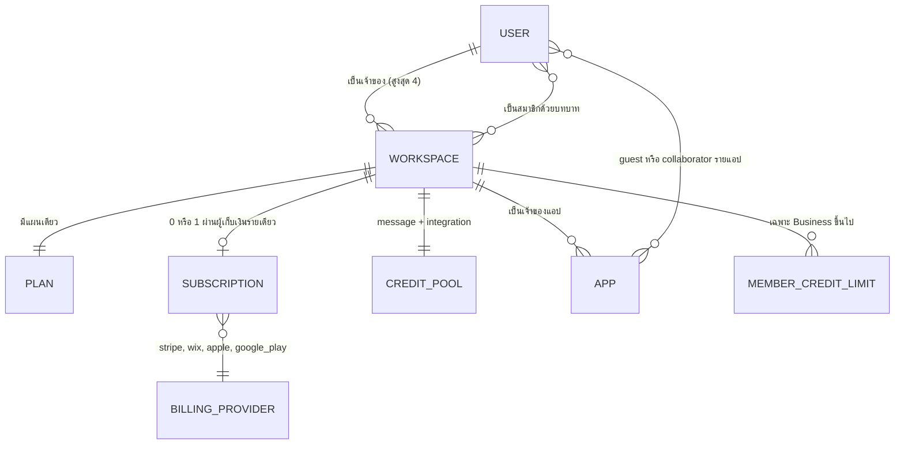
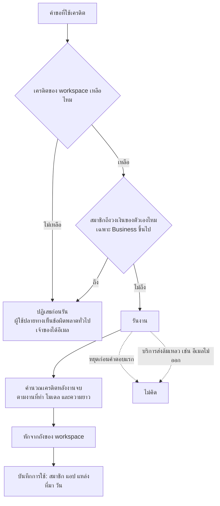
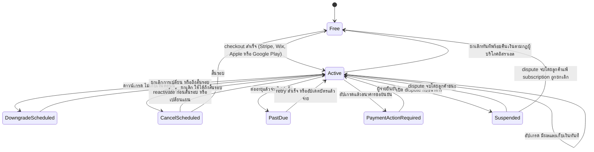

# แกะระบบธุรกิจหลังบ้านของ Base44 เพื่อออกแบบแพลตฟอร์ม Open Source ที่เป็นเจ้าของเองได้ฟรี

วันที่ตรวจหลักฐาน: 11 พฤศจิกายน 2026 (UTC)
โครงการตั้งต้น: `michoder26-cloud/web-end` ที่ commit `ff0d568a2a7bbb91090e4e4c2679fdd193c9762b` (เวอร์ชัน 0.23.0)

## 1. Executive summary

รายงานนี้แกะระบบ billing, เครดิต, สิทธิ์ตามแผน และวงจรการสมัครสมาชิกของ Base44 จากหลักฐานสาธารณะ 4 ชนิด: แพ็กเกจ SDK ที่เผยแพร่ (วิเคราะห์ด้วย REA), endpoint แผนราคาที่เอกสารระบุว่าเรียกได้โดยไม่ต้องล็อกอิน, เอกสาร API ทางการ และข้อกำหนดการใช้บริการ ไม่มีการล็อกอิน สมัครแผน หรือเรียก API ที่ต้องใช้สิทธิ์

ข้อค้นพบหลัก:

1. **หน่วยที่จ่ายเงินคือ workspace** แต่ละ workspace มีแผนและถังเครดิตของตัวเอง เจ้าของ workspace คนเดียวเท่านั้นที่ซื้อ เปลี่ยน หรือยกเลิกแผนได้ สมาชิกทุกคนใช้เครดิตจากถังเดียวกัน [D2][D3]
2. **มีเครดิต 2 ชนิดที่แยกต้นทุน 2 ช่วง** message credits สำหรับตอนสร้าง และ integration credits สำหรับตอนแอปทำงานจริง ทั้งสองรีเซ็ตรายเดือนและไม่สะสม [D1]
3. **เครดิตถูกคำนวณหลังงานเสร็จ ไม่มีราคาล่วงหน้า** เอกสารและข้อกำหนดระบุตรงกัน และ Base44 สงวนสิทธิ์เปลี่ยนวิธีวัดได้ทุกเมื่อ [D1][T1]
4. **สิทธิ์ตามแผนเป็นตาราง "ความสามารถ → แผนขั้นต่ำ"** endpoint สาธารณะคืนความสามารถ 103 รายการ พร้อมข้อยกเว้นตามวันที่สมัคร (cohort) และโปรไฟล์ที่ปิดความสามารถบางอย่าง [P1]
5. **ราคาเป็นเส้นตรงตามเครดิต** Starter, Builder และ Pro คิด 0.20 ดอลลาร์ต่อ message credit เท่ากันหมด แผนรายปีถูกกว่า 20% [P1]
6. **วงจร subscription มีสถานะชัดเจน** อัปเกรดมีผลและเก็บเงินทันที ดาวน์เกรดและยกเลิกมีผลสิ้นรอบ จ่ายไม่สำเร็จเข้าสถานะ past due และ chargeback ทำให้ workspace ถูกระงับ [D3][A2–A7]
7. **มีผู้เก็บเงิน 4 ราย** Stripe, Wix, Apple App Store และ Google Play โดยแผนหนึ่งอยู่ได้บนแพลตฟอร์มเดียวเท่านั้น [D3][A1][A8]
8. **ต้นทุนถูกคุมด้วยหลายชั้น** เพดานรายวันของแผนฟรี, เครดิตหมดอายุ, rate limit ที่คูณตามแผน, การปฏิเสธคำขอ AI ก่อนรันเมื่อเครดิตหมด และวงเงินต่อสมาชิกในแผน Business [D1][D5][R3][A9]

ข้อเสนอสำหรับเรา: **ไม่สร้างระบบเครดิตใน core** เพราะเครดิตมีไว้ขายต่อค่า AI ที่แพลตฟอร์มจ่ายแทนลูกค้า ถ้าผู้ใช้นำ key ของตัวเองมา (BYOK) หรือใช้โมเดลในเครื่อง ต้นทุนนั้นไม่ผ่านเรา core ควรมีแค่การบันทึกการใช้และเพดานงบที่ผู้ใช้ตั้งเอง ซึ่ง `selfhost/builder` ของ web-end มีแล้วบางส่วน รายได้ควรมาจากบริการที่แยกออกจาก core ได้: ค่าติดตั้ง ค่าดูแลรายเดือนแบบคงที่ และ managed hosting ภายหลัง

สิ่งที่ยังไม่ทราบและไม่ได้เดา: โครงสร้างฐานข้อมูลจริง, ledger ฝั่งเซิร์ฟเวอร์, การจองเครดิตก่อนรัน, การจัดการคำขอพร้อมกัน, dunning หลังจ่ายไม่สำเร็จ, ต้นทุนจริง และจำนวนลูกค้าที่จ่ายเงิน

## 2. วิธีทำงานและขอบเขต

| ประเภท | สิ่งที่ทำ | สิ่งที่ไม่ได้ทำ |
| --- | --- | --- |
| A — Shipped artifact (REA) | รัน REA CLI 6.8.0 กับ `@base44/sdk@0.8.59` ทั้งแพ็กเกจ แล้วอ่านโมดูล payments, connectors, ai-gateway, integrations และ client ด้วยเครื่องมือปกติ | ไม่ได้รันโค้ด SDK ไม่ได้เรียก endpoint ที่ SDK ชี้ไป |
| P — Public endpoint | เรียก `GET https://app.base44.com/api/billing/tiers` 1 ครั้ง เอกสารระบุว่า "You can call this without credentials" | ไม่ได้เรียก endpoint อื่นใดของ `app.base44.com` |
| D — เอกสารทางการ | ดาวน์โหลด 67 หน้าจาก `docs.base44.com` (ดัชนี `llms.txt`) อ่านเต็มหน้า Credits และ Billing and plans ส่วนหน้าอื่นอ่านเฉพาะส่วนที่เกี่ยวกับ billing รวมคำอธิบายในเอกสาร API | ไม่ได้ยืนยันพฤติกรรมในบัญชีจริง และไม่ได้อ่านทุกหน้าครบทุกบรรทัด |
| T — ข้อกำหนด | อ่าน Terms of Service (ปรับปรุง 22 มิถุนายน 2026) และหน้า Affiliate Program | ไม่ได้อ่าน Partner Terms (URL ที่ลองคืน 404) |
| W — web-end | อ่าน repository ที่ commit `ff0d568` ด้วย git และ grep | ไม่ได้รันชุดทดสอบของ commit นี้ซ้ำ |

ข้อจำกัดสำคัญ:

- ไม่มีบัญชี Base44 จึงไม่เห็น billing UI, network capture หรือ usage dashboard จริง ทุกข้อเกี่ยวกับพฤติกรรมหลังล็อกอินมาจากเอกสาร
- เอกสาร API ทุกหน้าติดป้าย beta และเตือนว่า response มีฟิลด์ที่ไม่ได้บันทึกไว้
- สัญญา API บอกว่าเซิร์ฟเวอร์ **รับปากว่าจะตอบอย่างไร** ไม่ได้พิสูจน์ว่าข้างในทำงานอย่างไร
- เครื่องมือดึงหน้าเว็บในเซสชันนี้ถึงโควตารายสัปดาห์ จึงใช้ `curl` ดึงไฟล์ดิบแทน

### Investigation checklist

| # | คำถาม | หลักฐานที่ต้องใช้ | สถานะ |
| --- | --- | --- | --- |
| 1 | ใครเป็นเจ้าของ subscription | เอกสาร workspace และ API billing | ตอบได้: workspace |
| 2 | ใครจ่าย ใครใช้โควตา | เอกสาร roles และ credits | ตอบได้ |
| 3 | เครดิตรวมหรือแยก | เอกสาร credits, API member limit | ตอบได้ |
| 4 | สิทธิ์ถูกตรวจที่ไหน | รหัสตอบของ API (402/403/409), ข้อความใน SDK | ตอบได้บางส่วน |
| 5 | AI และ integration ถูกวัดอย่างไร | เอกสาร credits, ชนิดข้อมูลใน SDK | ตอบได้ระดับหน่วย ไม่ถึงสูตร |
| 6 | หักก่อนหรือหลังงานสำเร็จ | เอกสาร, ToS, คำอธิบายใน SDK | ตอบได้บางส่วน |
| 7 | งานล้มเหลวหรือ retry คิดอย่างไร | เอกสาร FAQ, SDK connectors | ตอบได้บางกรณี |
| 8 | อัปเกรดเปลี่ยนสิทธิ์เมื่อไร | เอกสาร billing, API change-plan | ตอบได้ |
| 9 | ดาวน์เกรด/ยกเลิกกระทบแอปอย่างไร | API cancellation impact | ตอบได้ |
| 10 | จ่ายไม่สำเร็จเข้าสถานะใด | API retry-payment, subscription-status | ตอบได้บางส่วน |
| 11 | Export ได้อะไร | API export, CLI eject, ToS | ตอบได้ |
| 12 | กลไกใดเพื่อรายได้ กลไกใดกันต้นทุน | สังเคราะห์จากข้อ 1–11 | อนุมาน ระบุระดับหลักฐาน |

## 3. Evidence ledger

| ID | หลักฐาน | ตัวระบุ |
| --- | --- | --- |
| R1 | REA Evidence ของ SDK | `ev_036472ebf8efd5f8a77b129a0aab534a99822761b6d0213c45555122229ac217`; subject sha256 `b55f8cd9a7209dd4a5ab75d7263c7d3add0edb8deba5e3254e402da3ee416657`; provider `rea-javascript-application` v1; authority `shipped-artifact`; confidence `derived` |
| R2 | แพ็กเกจที่วิเคราะห์ | `@base44/sdk@0.8.59`; tarball sha256 `3f4fb6c43bc12b03280ae8592079a7a4e9aab21cf93d6ca23692ba209cffef70`; npm shasum `3976e05e2e21b08d51346c3706f00e459331e63b` |
| R3 | ไฟล์ใน SDK ที่ใช้อ้าง | `dist/modules/connectors.js` (sha256 `72b70bec…`), `connectors.types.d.ts` (`2d5a1e95…`), `payments.js` (`67b8e963…`), `ai-gateway.js` (`3c691190…`), `ai-gateway.types.d.ts`, `client.js` |
| P1 | คำตอบของ `/api/billing/tiers` | sha256 `8610ee7248beb362e4007bd2341b62abd7d9213fd3716ae90581e4c7a97e7f2c`; ดึงเมื่อ 2026-11-11 11:36 UTC; สกุลเงินที่ได้คือ USD |
| D1 | Credits | `docs.base44.com/Account-and-billing/Credits.md` |
| D2 | About workspaces | `docs.base44.com/documentation/account-and-billing/about-workspaces.md` |
| D3 | Billing and plans | `docs.base44.com/Account-and-billing/Billing-and-plans.md` |
| D4 | Managing workspace members | `docs.base44.com/Account-and-billing/Managing-your-workspaces.md` |
| D5 | Rate limits | `docs.base44.com/developers/references/apps-api/get-started/rate-limits.md` |
| D6 | Enterprise member credit limits | `docs.base44.com/Enterprise/managing-enterprise-members.md` |
| D7 | Referral program | `docs.base44.com/Community-and-support/Referral-program.md` |
| D8 | Partner program, Hiring a partner | `…/Community-and-support/partner-program.md`, `…/Getting-Started/Hiring-a-partner.md` |
| D9 | Backup & restore | `docs.base44.com/Enterprise/backup-and-restore.md` |
| D10 | CLI `eject`, `workspace move` | `docs.base44.com/developers/references/cli/commands/…` |
| D11 | Stripe ในแอป, GitHub sync, Student discount | หน้าเอกสารตามชื่อ |
| A1–A12 | เอกสาร API ของ billing | List plans (A1), Change plan (A2), Preview plan change (A3), Cancel subscription (A4), Get cancellation impact (A5), Retry failed payment (A6), Reactivate (A7), Get mobile subscription status (A8), Set member credit limit (A9), Create plan checkout (A10), Change Wix plan (A11), Preview ILS refund (A12) |
| T1 | Terms of Service | `base44.com/terms-of-service`; sha256 ของ HTML `213f8395…`; ปรับปรุง 22 มิถุนายน 2026 |
| T2 | Affiliate Program | `base44.com/affiliate-program`; sha256 ของ HTML `198e0f9b…` |

ข้อจำกัดที่ REA รายงานเอง: โค้ดถูกอ่านเป็นข้อความนิ่งโดยไม่รัน, ความสัมพันธ์ที่พบไม่พิสูจน์ว่าถูกเรียกจริงตอนทำงาน และกราฟไม่ครบ สถิติของการรัน: อ่าน 93 ไฟล์, parse JavaScript 92 ไฟล์ไม่มี failure, 309 nodes, 510 edges

## 4. Account และ billing ownership

### คำถาม
subscription และเครดิตผูกกับอะไร ใครจ่าย ใครใช้

### หลักฐาน
D2, D3, D4, D6, D10, A2, A9, เอกสาร API "Start ownership transfer"

### สิ่งที่ยืนยันได้

- ทุกบัญชีได้ personal workspace 1 แห่งตอนสมัคร เป็นเจ้าของได้สูงสุด 4 workspace และเข้าร่วม workspace อื่นได้ไม่จำกัด [D2]
- "Each workspace has its own plan and a shared pool of credits" เครดิตไม่แชร์ข้าม workspace [D2]
- แอปเป็นของ workspace ที่สร้าง และใช้แผนกับเครดิตของ workspace นั้น ไม่ว่าใครจะทำงานอยู่ [D2]
- บทบาทมี 5 แบบ: Owner (1 คนต่อ workspace จัดการ billing), Admin (เฉพาะ Business/Enterprise ไม่จัดการ billing), Editor, Viewer (ใช้เครดิตไม่ได้) และ Guest (เชิญรายแอป) [D2]
- เฉพาะ Owner ซื้อ เปลี่ยน ยกเลิกแผน และดูใบแจ้งหนี้ได้ API ตอบ 403 ถ้าผู้เรียกไม่ใช่ owner [D3][A2][A4]
- Owner และ Admin เห็นการใช้เครดิตทั้ง workspace, Editor เห็นเฉพาะของตัวเอง, Viewer เปิดหน้า Credit usage ไม่ได้ [D1]
- วงเงินเครดิตต่อสมาชิกมีในแผน Business ขึ้นไป มี 2 ระดับคือค่าเริ่มต้นของ workspace และค่าเฉพาะคน เจ้าของไม่ถูกจำกัด และวงเงินตั้งเกินเครดิตรายเดือนของ workspace ไม่ได้ [D6][A9]
- สมาชิกที่ออกจาก workspace แอปที่เขาเป็นเจ้าของย้ายไปเป็นของ owner [D4 หน้า Managing a workspace]
- ย้ายแอปข้าม workspace ได้ด้วย CLI แอปคง ID ข้อมูล และเจ้าของไว้ "Purchased apps cannot be moved" [D10]
- โอนเจ้าของแอปทางอีเมลได้ ผู้รับเลือก workspace ปลายทาง ถ้าเป็น workspace อื่น ผู้ร่วมงานเดิมเสียสิทธิ์และประวัติแชต AI ถูกล้าง [เอกสาร API]
- พาร์ตเนอร์มีเครื่องมือ "Credit delegation" คือใช้เครดิตของตัวเองขณะทำงานใน workspace ของลูกค้า [D8]
- ลบ workspace โดยตรงไม่ได้ ลบได้เมื่อลบบัญชี [D4]

### แผนผังความสัมพันธ์ (เฉพาะที่มีหลักฐาน)



### สิ่งที่อนุมานได้

- การผูก subscription กับ workspace แทนผู้ใช้ ทำให้คนเดียวจ่ายได้หลายแผน และทีมขยายได้โดยไม่ต้องคิดเงินรายที่นั่ง รายได้โตตามเครดิตที่ใช้ ไม่ใช่ตามจำนวนคน
- การให้ personal workspace เท่านั้นที่ได้ message credits ฟรี [D1] น่าจะมีไว้กันการสร้าง workspace ฟรีหลายแห่งเพื่อเก็บเครดิต

### สิ่งที่ยังไม่ทราบ

- ตารางและคีย์จริงในฐานข้อมูล
- การย้ายแอปข้าม workspace มีผลกับเครดิตที่ใช้ไปแล้วในรอบนั้นอย่างไร
- "Purchased apps" หมายถึงอะไรแน่ชัด (น่าจะเป็นแอปจากเทมเพลตที่ซื้อ แต่ไม่มีหลักฐานยืนยัน)
- Credit delegation ของพาร์ตเนอร์ทำงานระดับคำขอหรือระดับเซสชัน

### ผลต่อการออกแบบของเรา

web-end เป็นแบบ 1 ฐานข้อมูลต่อ 1 เว็บ (`cloud/src/owner.ts:15` ใช้ `LIMIT 1`) จึงไม่มีและไม่จำเป็นต้องมี workspace ใน core ผู้ใช้ที่ติดตั้งเองคือเจ้าของ runtime ทั้งหมดอยู่แล้ว แนวคิด workspace ควรอยู่เฉพาะใน commercial control plane ที่ดูแลหลายเว็บของลูกค้ารายเดียว

## 5. Plan และ entitlement engine

### คำถาม
แผนกำหนดอย่างไร สิทธิ์ผูกกับอะไร และถูกบังคับที่ไหน

### หลักฐาน
P1, A1, A2, A9, D3, D5, R3

### ราคาและโควตา (USD จาก P1 ณ วันที่ตรวจ)

| แผน | รายเดือน | รายปี (จ่ายทั้งปี) | เทียบต่อเดือนเมื่อจ่ายรายปี | Message credits/เดือน | Integration credits/เดือน | ราคาต่อ message credit (รายเดือน) |
| --- | ---: | ---: | ---: | ---: | ---: | ---: |
| Free | 0 | – | – | 25 (ไม่เกิน 5/วัน) | 100 | – |
| Lite (ซ่อน) | 9 | ไม่ขาย | – | 25 | 100 | 0.36 |
| Starter | 20 | 192 | 16 | 100 | 2,000 | 0.20 |
| Builder | 50 | 480 | 40 | 250 | 10,000 | 0.20 |
| Pro | 100 | 960 | 80 | 500 | 20,000 | 0.20 |
| Elite (ขั้น 1) | 200 | 1,920 | 160 | 1,200 | 50,000 | 0.167 |
| Elite (ขั้น 11) | 1,200 | 11,520 | 960 | 8,200 | 300,000 | 0.146 |
| Business (ขั้น 1) | 800 | 7,680 | 640 | 2,400 | 96,000 | 0.333 |
| Business (ขั้น 6) | 1,800 | 17,280 | 1,440 | 5,400 | 216,000 | 0.333 |
| Edu (ซ่อน) | ไม่มีราคา | ไม่มีราคา | – | 2,400 | 96,000 | – |
| Enterprise | สัญญาเฉพาะ | สัญญาเฉพาะ | – | ค่าในระบบ 1,000,000 | 100,000 | – |

ข้อสังเกตจากตัวเลข:

- Starter ถึง Pro ราคาต่อ message credit เท่ากันที่ 0.20 ดอลลาร์ ส่วนลดปริมาณเริ่มที่ Elite
- Elite เพิ่มขั้นละ 100 ดอลลาร์ ได้ message credits เพิ่ม 700 (0.143 ดอลลาร์ต่อเครดิตส่วนเพิ่ม)
- Business แพงกว่า Elite ต่อเครดิตเท่าตัว ส่วนต่างคือค่าความสามารถด้านการกำกับดูแล ไม่ใช่ค่า AI
- ราคารายปีเท่ากับรายเดือนคูณ 9.6 คือลด 20% ทุกแผน
- มีราคา 6 สกุลเงิน (USD, ILS, EUR, GBP, BRL, AUD) และ "plan stays in the currency you first paid in" [D3]

การแยกประเภทราคา:

| ประเภท | สิ่งที่พบ | หลักฐาน |
| --- | --- | --- |
| Monthly | มีทุกแผนที่ขาย | P1 |
| Annual | จ่ายทั้งปีครั้งเดียว เปลี่ยนกลับเป็นรายเดือนไม่ได้ | D3, A2 |
| ราคาต่อเดือนที่แสดงสำหรับแผนรายปี | คือยอดรายปีหาร 12 | P1 |
| Promotional | โค้ดส่วนลดที่ checkout, ส่วนลดนักศึกษา 50%, แบนเนอร์ "30% Off Code: BASE30" บนหน้า affiliate | D3, D11, T2 |
| Legacy/ซ่อน | `lite` และ `edu` มี `hidden: true`; แอป private เดิมของผู้ใช้ฟรีก่อน 6 ก.พ. 2026 ยังใช้ได้ | P1, D3 |
| Enterprise | สัญญาเฉพาะ ไม่มีปุ่มจัดการแผนในหน้าจอ | D3 |

### กลไก entitlement ที่ยืนยันได้

P1 คืนโครงสร้าง 4 ส่วนที่รวมกันเป็น entitlement engine ฝั่งข้อมูล:

1. **`capabilities`** แผนที่ 103 ความสามารถไปยังแผนขั้นต่ำ เช่น `custom_domains: starter`, `github_integration: builder`, `code_export: builder`, `member_credit_limits: business_1`, `byom: enterprise`
2. **`hierarchy`** ลำดับแผน 24 ขั้นจากเล็กไปใหญ่ ใช้เทียบว่าแผนปัจจุบันถึงขั้นต่ำหรือไม่
3. **`capability_cohort_overrides`** ข้อยกเว้นตามวันที่มีผล เช่น ตั้งแต่ 2026-10-01 `sso` ขยับจาก `free` เป็น `business_1` แปลว่าลูกค้าเก่าและใหม่ได้สิทธิ์ต่างกันตามวันที่
4. **`designation_profiles`** โปรไฟล์ที่ปิดความสามารถ เช่น `ferpa` ปิด 12 รายการ รวม `referral_code_generation` และ `app_payment_management`
5. **`rate_limit_multipliers`** ตัวคูณ rate limit ต่อแผน: Free/Starter 1x, Builder 2x, Pro 3x, Elite/Business 5x, Enterprise 10x

### Entitlement matrix (ตัวอย่างที่มีผลต่อรายได้มากที่สุด)

| ฟีเจอร์ | แผนขั้นต่ำ | ขอบเขตสิทธิ์ | เงื่อนไข | ผลเมื่อสิทธิ์หมด | หลักฐาน |
| --- | --- | --- | --- | --- | --- |
| จำนวนแอป | Free ได้ 5, Starter ขึ้นไปไม่จำกัด | workspace | นับแอปที่เข้าเกณฑ์ | ตอนยกเลิก เจ้าของเลือก 5 แอปที่ยัง publish ที่เหลือถูก unpublish | P1, A4, A5 |
| แอป private | Starter | workspace | แอปเดิมก่อน 6 ก.พ. 2026 ใช้ต่อได้ | สลับ public แล้วกลับ private ไม่ได้ถ้าไม่อัปเกรด | P1, D3 |
| โดเมนของตัวเอง | Starter | แอป | – | ช่วง dispute โดเมนถูกปิด; ยกเลิกแล้วโดเมนหยุดทำงาน | P1, D3 |
| ลบป้าย Base44 | Starter | แอป | – | ไม่ระบุ | P1 |
| แก้โค้ดในแอป | Starter | workspace | – | ไม่ระบุ | P1 |
| Workflows | Builder | workspace | – | ช่วง dispute "workflows … stop working" | P1, D3 |
| GitHub sync 2 ทาง | Builder | แอป | ซิงก์อัตโนมัติ ไม่มีปุ่ม push เอง | ไม่ระบุ | P1, D11 |
| Export โค้ด | Builder | แอป | – | ไม่ระบุ | P1 |
| เลือกโมเดลเอง | Builder | workspace | – | ช่วง dispute "model picker stop working" | P1, D3 |
| Backup ข้อมูล | Elite (7 วัน), Business/Enterprise (28 วัน) | workspace | เริ่มนับเมื่อแผนมีผล | ไม่ระบุ | D9, P1 |
| วงเงินเครดิตต่อสมาชิก | Business | workspace | ไม่เกินเครดิตรายเดือน | API ตอบ 402 | A9 |
| บทบาท Admin | Business | workspace | – | ออกจากแผนแล้ว Admin ถูกปรับเป็น Editor อัตโนมัติ | D2 |
| นำโมเดลมาเอง (BYOM) | Enterprise | workspace | – | ไม่ระบุ | P1 |
| ไม่ใช้ข้อมูลฝึกโมเดล | Edu/Enterprise | workspace | – | ไม่ระบุ | P1, D3 |
| Backend functions, connectors | Free | workspace | ใช้ integration credits | เครดิตหมดแล้วการเรียกล้มเหลว | P1, D1 |

### สิทธิ์ถูกบังคับที่ไหน

- **ยืนยันได้ว่าเซิร์ฟเวอร์รับปากบังคับ** อย่างน้อยกับ: วงเงินสมาชิก (402 เมื่อแผนไม่ถึง), การเปลี่ยนแผน (403 ถ้าไม่ใช่ owner หรือมี dispute, 409 ถ้าเก็บเงินผ่าน Wix), rate limit (429 ตามตัวคูณของแผน) [A2][A9][D5]
- **AI gateway** คำอธิบายใน SDK ระบุว่า "A request is rejected before the model runs if the app is out of credits" [R3: `ai-gateway.types.d.ts:115–119`]
- **ยังไม่ทราบ** ว่าความสามารถทั้ง 103 รายการถูกตรวจที่เซิร์ฟเวอร์ทุกจุดหรือบางรายการตรวจแค่ที่หน้าจอ การที่ endpoint ส่งตารางนี้ให้ client แปลว่า client ใช้มันแสดงผล ไม่ได้พิสูจน์การบังคับฝั่งเซิร์ฟเวอร์

### สิ่งที่อนุมานได้

- ตาราง capability → แผนขั้นต่ำ ทำให้ย้ายฟีเจอร์ข้ามแผนได้โดยแก้ข้อมูล ไม่ต้องแก้โค้ด และ cohort override ทำให้ขึ้นราคาหรือย้ายฟีเจอร์ได้โดยไม่กระทบลูกค้าเดิม
- `code_export` และ `github_integration` อยู่ที่ Builder (50 ดอลลาร์/เดือน) แปลว่าการนำโค้ดออกเป็นฟีเจอร์เสียเงิน

### ผลต่อการออกแบบของเรา

core ของเราไม่ควรมี entitlement ตามแผนเลย ทุกความสามารถเปิดให้ทุกคนที่ติดตั้งเอง ตาราง capability แบบนี้มีประโยชน์เฉพาะฝั่งบริการ managed (เช่น จำนวนเว็บที่ดูแล, ระดับ SLA) และควรเก็บเป็นข้อมูลแบบเดียวกัน ไม่ฝังในโค้ด

## 6. Credit, metering และ usage accounting

### คำถาม
เครดิตมีกี่ชนิด จัดสรร รีเซ็ต หัก และรายงานอย่างไร

### หลักฐาน
D1, T1, R3, A9, เอกสาร API "Get agent usage" และ monitoring

### ประเภทและการจัดสรร

| หัวข้อ | สิ่งที่ยืนยันได้ | หลักฐาน |
| --- | --- | --- |
| ชนิดเครดิต | message credits (ตอนสร้าง) และ integration credits (ตอนแอปทำงาน) | D1 |
| ขอบเขต | ถังเดียวต่อ workspace ใช้ร่วมกันทุกสมาชิกและทุกแอป | D1, D2 |
| รอบ | แผนเสียเงินรีเซ็ตรายเดือน ตรงเวลาที่ซื้อตาม UTC | D1 |
| แผนฟรี | 25/เดือน ไม่เกิน 5/วัน เฉพาะ personal workspace; รายวันรีเซ็ตเที่ยงคืนตามเขตเวลาของเจ้าของ | D1 |
| สะสมข้ามรอบ | ไม่สะสม ยกเว้นอัปเกรดจากรายเดือนไปรายเดือนที่สูงกว่า เครดิตเหลือยกไปได้ 1 รอบ ไม่เกินเครดิต 1 เดือนของแผน | D1 |
| โบนัส | "Bonus credits never carry over"; เครดิต referral หมดอายุ 40 วัน | D1, D7 |
| เติมเครดิต | ไม่พบการขายเครดิตเพิ่มแยก ทางเดียวที่เอกสารระบุคืออัปเกรดแผน | D1, D3 |
| คูปอง | โค้ดคูปองเพิ่มเครดิตได้ เฉพาะ owner/admin และไม่มีในแผน Enterprise | D1 |
| Gift card | เลิกขายแล้ว บัตรเก่าก่อน 12 เม.ย. 2026 เป็น message credits บัตรหลังจากนั้นเป็นส่วนลดค่าแผน อายุ 5 ปี | D1 |
| สถานะทางกฎหมาย | "AI Credits are not money… have no cash or monetary value… non-refundable" | T1 ข้อ 10.4 |

### การใช้เครดิต 2 ช่วง

**Build-time (message credits)** ตัวเลขเป็นค่าประมาณที่เอกสารให้ไว้ [D1]:

| การกระทำ | เครดิตโดยประมาณ |
| --- | --- |
| แก้ภาพหรือข้อความง่ายๆ | ~0.5 |
| ปรับฟีเจอร์เล็ก | ~1 |
| เพิ่มโมดูลซับซ้อน | ~2 |
| เปลี่ยนทั้งแอป | ~3–4 |
| ข้อความในโหมด Discuss | ~0.3 |
| แก้ด้วยมือในตัวแก้ไข | 0 |
| แก้อัตโนมัติด้วย AI | แผนฟรีเสียเครดิต แผนเสียเงินฟรี |

**Run-time (integration credits)** [D1]:

| การกระทำ | เครดิตโดยประมาณ |
| --- | --- |
| ส่งอีเมล | ~1 (โดเมนตัวเอง ~2) |
| อัปโหลดไฟล์ / ดึงข้อมูลจากไฟล์ / สร้างรูป | ~1 ต่อครั้ง |
| สร้างวิดีโอ | ~5 ต่อวินาที |
| สร้างเสียง | ~1 ต่อ 50 ตัวอักษร |
| เรียก LLM (อัตโนมัติ) | ~1 ต่อครั้ง; โมเดลอื่นเริ่ม ~3 |
| ข้อความถึง agent ในแอป | เริ่ม ~3 |
| ขั้นตอน workflow | 10 ขั้น ~1 |
| เรียก backend function | 100 ครั้ง ~1 |
| อ่านเขียนฐานข้อมูล | 0 |
| เรียกบริการภายนอกด้วย key ของตัวเอง | 0 |
| Connector แบบ metered | แล้วแต่ endpoint "can charge a hundred times more for one endpoint than for another" |

### คำถามเชิงบัญชี

| คำถาม | สิ่งที่เห็นจริง | ความหมายที่สรุปได้ | สิ่งที่ยังสรุปไม่ได้ | วิธีตรวจเพิ่ม |
| --- | --- | --- | --- | --- |
| หักก่อนหรือหลัง | "calculated after the action runs" [D1]; "calculated only after Customer has taken the corresponding AI action" [T1] | ยอดที่หักคำนวณหลังงานจบ | มีการจองยอดก่อนเริ่มหรือไม่ | สังเกตยอดคงเหลือระหว่างงานยาวในบัญชีที่ได้รับอนุญาต |
| ตรวจยอดก่อนรัน | AI gateway "rejected before the model runs if the app is out of credits" [R3]; ไม่มี message credits แล้วส่งข้อความใหม่ไม่ได้ [D1] | มีการตรวจว่ายอดเหลือมากกว่าศูนย์ก่อนเริ่ม | ตรวจว่า "พอ" สำหรับงานนั้นหรือแค่ "ไม่เป็นศูนย์" | ส่งงานใหญ่ตอนเครดิตเหลือน้อย |
| ใช้เกินยอดได้ไหม | ไม่มีเอกสารระบุ; ToS พูดถึง "overage" ในประโยคเดียว [T1] | เป็นไปได้ว่างานสุดท้ายทำให้ยอดติดลบ เพราะต้นทุนรู้หลังจบ | พฤติกรรมจริงและการจัดการคำขอพร้อมกัน | ทดสอบคำขอพร้อมกันในบัญชีทดสอบ |
| งานผิดพลาด | "Credits are non-refundable for tool behavior and AI mistakes" [D1]; อีเมลที่ส่งไม่ออกไม่ถูกคิด [D1] | ความผิดพลาดของ AI เสียเครดิต ความล้มเหลวของบริการส่งไม่เสีย | เกณฑ์แยก "ล้มเหลว" กับ "ผลไม่ตรงใจ" ในงานประเภทอื่น | ไม่มีทางตรวจจากภายนอก |
| หยุดกลางทาง | คิดเฉพาะคำตอบที่ AI ทำเสร็จก่อนหยุด คำตอบที่ถูกตัดกลางคันไม่คิด หยุดก่อนคำตอบแรกไม่คิด [D1] | หน่วยการคิดคือ "คำตอบที่เสร็จ" ภายในข้อความ | – | – |
| Timeout และ retry | Connector คืน `phase`; "Only `phase: 'not_sent'` proves the provider didn't execute the request"; มี `timed_out` และ `sent_unconfirmed` [R3] | แพลตฟอร์มยอมรับว่ารู้ไม่แน่ชัดว่าผู้ให้บริการทำงานหรือไม่ และผลักการตัดสินใจ retry ให้ผู้เรียก | timeout แล้วถูกคิดเครดิตหรือไม่ | ดู `creditsCharged` ในคำตอบ timeout |
| Idempotency | เปลี่ยนแผนผ่าน Wix รับ header `Idempotency-Key`; ฝั่ง Stripe "Each call creates a new checkout page, including a retry" [A10][A11]; ตั้งวงเงินซ้ำ "changes nothing, so retrying is safe" [A9] | มี idempotency บางจุดของ billing | idempotency ของการหักเครดิต | – |
| Reconciliation | ไม่พบหลักฐาน | – | ทั้งหมด | – |
| ความล่าช้าของ dashboard | "wait and check again later in the day" สำหรับการรีเซ็ต [D1] | การรีเซ็ตอาจไม่ทันทีตามเวลา | ความล่าช้าของยอดใช้ | – |
| ข้อมูลต่อคำขอ | `creditsCharged` ต่อการเรียก connector [R3]; "Credits Used" ต่อข้อความ [D1]; การใช้แยกตาม member, app, branch, source และวัน [D1] | มีบันทึกการใช้ระดับการกระทำ พร้อมมิติ ผู้ใช้ แอป แหล่งที่มา และเวลา | มี request ID, model, token count ใน ledger หรือไม่ | ดู network response ของหน้า Credit usage |

### เส้นทางการคิดเครดิต (เฉพาะที่มีหลักฐาน)



กล่อง "สมาชิกถึงวงเงิน" มาจากเอกสารที่ระบุว่าวงเงินคือ "the most credits a member can use" ลำดับการตรวจก่อนหลังเป็นการอนุมาน

### สิ่งที่อนุมานได้

- การไม่บอกราคาล่วงหน้าและคำนวณหลังจบ ทำให้แพลตฟอร์มส่งผ่านความผันผวนของต้นทุนโมเดลไปยังลูกค้าได้ทั้งหมด
- แก้อัตโนมัติฟรีในแผนเสียเงิน แปลว่าต้นทุนการแก้ซ้ำของลูกค้าที่จ่ายเงินตกอยู่กับ Base44 ส่วนผู้ใช้ฟรีรับเอง
- โหมด "Automatic" ที่แพลตฟอร์มเลือกโมเดลเอง พร้อมข้อความใน ToS ว่าเปลี่ยนการ route ได้ทุกเมื่อ เป็นคันโยกคุมต้นทุนที่ลูกค้ามองไม่เห็น

### ผลต่อการออกแบบของเรา

เครดิตเป็นชั้นแปลงระหว่างต้นทุนจริง (token, การเรียก API) กับราคาขาย ถ้าผู้ใช้จ่ายผู้ให้บริการโดยตรง ชั้นนี้ไม่มีอะไรให้แปลง สิ่งที่ควรนำมาคือ **การมองเห็น**: การใช้ต่อคำขอ แยกตามแหล่งที่มา และการเตือนเมื่อพุ่งผิดปกติ โดยแสดงเป็น token และเงินจริงของผู้ให้บริการ

## 7. Subscription และ payment lifecycle

### คำถาม
subscription เปลี่ยนสถานะอย่างไร และแต่ละเหตุการณ์มีผลกับเงินและสิทธิ์เมื่อไร

### หลักฐาน
D3, A2–A8, A10–A12, T1

### State machine



ชื่อสถานะเป็นของรายงานนี้ ชื่อที่เอกสารใช้จริงมี: `active`, `past_due` (สถานะ Stripe ที่ API คืน), "Payment Problem" (ป้ายในหน้าจอ), "Disputed" (ป้ายบนใบแจ้งหนี้) และ "free migration trial" (สถานะที่ API อ้างถึงแต่ไม่อธิบาย)

### รายละเอียดแต่ละเหตุการณ์

| เหตุการณ์ | เงิน | สิทธิ์และเครดิต | หลักฐาน |
| --- | --- | --- | --- |
| Checkout ครั้งแรก | หน้า checkout ของ Stripe หรือ Wix; "Nothing is charged until they pay on that page" | – | A10 |
| อัปเกรด รายเดือน→รายเดือน | เก็บส่วนต่างราคาเต็ม ไม่ prorate | ได้เครดิตแผนใหม่ทันที เครดิตเหลือยกไป 1 รอบ | D1, A3 (`full_diff`) |
| อัปเกรดที่เกี่ยวกับรายปี | prorate: ราคาแผนใหม่ลบเครดิตเวลาที่เหลือ | เครดิตเหลือหมดอายุตามปกติ | D1, A3 |
| อัปเกรดที่ต้องยืนยันกับธนาคาร | ใบแจ้งหนี้ค้างจนกว่าจะจ่าย | "The upgrade is already applied" แม้ `success: false` | A2 |
| ดาวน์เกรด | ไม่เก็บเงิน | มีผลสิ้นรอบ ผ่าน Stripe subscription schedule ยกเลิกการเปลี่ยนได้ | A2 |
| รายปี→รายเดือน | ไม่อนุญาต | – | A2 |
| ต่ออายุ | อัตโนมัติ ราคา ณ ตอนนั้น ไม่รวมส่วนลดโปรโมชั่นรอบก่อน | เครดิตรีเซ็ต | T1 |
| ยกเลิก | ไม่คืนเงินรอบปัจจุบัน | ใช้ได้ถึงสิ้นรอบ แล้วเป็น Free: แอปเกิน 5 ถูก unpublish, โดเมนหยุด, เบอร์โทรของ agent ถูกปล่อย, backend functions ยังทำงาน | D3, A4, A5 |
| Reactivate | ต่ออายุตามเดิม | ทำได้ก่อนสิ้นรอบเท่านั้น | A7 |
| จ่ายไม่สำเร็จ | มีใบแจ้งหนี้ค้าง retry ได้ด้วยตนเอง | ห้ามอัปเกรดจนกว่าจะจ่าย ดาวน์เกรดยังทำได้ `is_active: false` | A2, A6, A8 |
| Dispute/chargeback | ธนาคารดึงเงินทันที | workspace เป็น Free ชั่วคราว เครดิตใช้ไม่ได้ โดเมนถูกปิด ซื้อหรือเปลี่ยนแผนไม่ได้ | D3 |
| คืนเงิน | ไม่คืนตามข้อกำหนด มีข้อยกเว้นรายกรณีผ่าน support (prorate หักค่าธรรมเนียม) และตามกฎหมายอิสราเอล | – | D3, A12, T1 |
| หยุดชั่วคราว | "You can't pause a subscription" | – | D3 |
| App Store | Apple เก็บเงินและคืนเงินเอง ราคาอาจต่างจากเว็บ ใช้ส่วนลดเว็บไม่ได้ | ซื้อได้เฉพาะตอนอยู่แผน Free | D3 |
| Google Play | ขายเฉพาะ Starter, Builder, Pro | เหมือนกัน | D3 |
| ภาษี | ค่าบริการไม่รวมภาษี; เปลี่ยน tax ID หลังซื้อไม่ได้ | – | T1, D3 |

### แยกการชำระเงิน 2 ระบบ

| | A. ลูกค้าจ่าย Base44 | B. ผู้ใช้ปลายทางจ่ายแอปที่สร้าง |
| --- | --- | --- |
| ผู้เก็บเงิน | Stripe หรือ Wix (เว็บ), Apple, Google Play | บัญชี Stripe ของเจ้าของแอป, Wix Payments หรือ PayPal |
| หลักฐาน | A1–A12, D3 | D11; SDK `payments.js` มี `createCheckout`, `refund`, `cancelSubscription`, `pauseSubscription`, `resumeSubscription` ใต้ `/apps/{appId}/payments` [R3] |
| เงินเข้าใคร | Base44 | เจ้าของแอป |
| ความสามารถตามแผน | – | `app_payment_management: free` [P1] |

ข้อสังเกต: ระบบ B รองรับ pause ได้ ขณะที่ระบบ A ไม่ให้ pause ไม่พบหลักฐานว่า Base44 หักส่วนแบ่งจากระบบ B

### สิ่งที่ยังไม่ทราบ

- หลัง past due นานเท่าไรจึงถูกลดเป็น Free มีช่วงผ่อนผันหรือไม่ และมีการ retry อัตโนมัติกี่ครั้ง
- "free migration trial" คืออะไร (น่าจะเกี่ยวกับการย้ายผู้เก็บเงินไป Wix แต่ไม่มีหลักฐาน)
- การจัดการ webhook ซ้ำหรือมาผิดลำดับจาก Stripe

### ผลต่อการออกแบบของเรา

ถ้าเรามีบริการ managed กฎที่ควรนำมาใช้คือ: อัปเกรดมีผลทันที, ลดระดับและยกเลิกมีผลสิ้นรอบ, แสดงผลกระทบก่อนยืนยัน (`cancellation impact`) และ preview ยอดก่อนเก็บเงิน ส่วนที่ต้องต่างคือ เมื่อบริการ managed หมดอายุ เว็บของลูกค้าต้องยังทำงานต่อบนโครงสร้างของเขาเอง หรือส่งมอบ backup ที่กู้คืนได้

## 8. กลไก upgrade, retention และ switching costs

| เหตุการณ์ | Trigger | ระบบแสดงหรือเสนออะไร | ทางเลือกของผู้ใช้ | ผลต่อสิทธิ์และ runtime | ผลทางรายได้ (อนุมาน) | หลักฐาน |
| --- | --- | --- | --- | --- | --- | --- |
| เครดิตสร้างใกล้หมด | ยอดใช้เข้าใกล้เพดาน | ป้าย "Near limit" / "Limit reached"; แชตแจ้งว่าเครดิตหมดและวิธีได้เพิ่ม | รอรีเซ็ต หรืออัปเกรด (ได้เครดิตทันที) | ส่งข้อความใหม่ไม่ได้ | เส้นทางเดียวที่เร็วคืออัปเกรด เพราะไม่ขายเครดิตแยก | D1, D3 |
| เครดิต integration หมด | แอปที่ใช้งานจริงเรียกบริการในตัว | อีเมลถึงเจ้าของ | อัปเกรด หรือเปลี่ยนไปใช้ key ของตัวเอง | การกระทำของผู้ใช้ปลายทางล้มเหลวด้วยข้อผิดพลาดทั่วไป | แอปที่มีผู้ใช้จริงสร้างแรงกดดันให้อัปเกรด | D1 |
| เพดานรายวันของแผนฟรี | ครบ 5 เครดิตในวันนั้น | ฟีเจอร์ที่ใช้เครดิตหยุดถึงวันถัดไป | รอ หรือซื้อแผน | – | จำกัดต้นทุนผู้ใช้ฟรีต่อวัน | D1 |
| ใช้ฟีเจอร์เกินแผน | เลือกบทบาท Admin, ตั้งวงเงินสมาชิก ฯลฯ | ตัวเลือกถูกล็อกพร้อมข้อความชวนอัปเกรด; API ตอบ 402 | อัปเกรด | – | – | D4, A9 |
| ต้องการแอป private หรือโดเมน | – | ต้อง Starter | อัปเกรด | – | เป็นเหตุผลจ่ายเงินครั้งแรกของแอปที่ใช้จริง | P1 |
| หลายคนใช้งาน | เชิญสมาชิก | สมาชิกไม่ต้องมีแผนของตัวเอง | – | ทุกคนใช้ถังเดียว | คนมากขึ้นทำให้เครดิตหมดเร็วขึ้น | D2 |
| ต้องการกำกับดูแล | SSO, audit, วงเงินสมาชิก | แผน Business ซื้อเองได้ไม่ต้องคุยฝ่ายขาย | อัปเกรด | – | Business ราคาต่อเครดิตสูงกว่า Elite เท่าตัว | P1, D3 |
| ต้องการ backup | – | Elite ขึ้นไป | อัปเกรด | – | – | D9 |
| การใช้พุ่งผิดปกติ | 7 วันล่าสุดเทียบ 7 วันก่อน | การ์ด "Unusual spend" (owner/admin) | ตรวจสาเหตุ | – | ลดการยกเลิกจากบิลที่ไม่คาดคิด | D1 |
| จะยกเลิก | กดยกเลิก | รายการสิ่งที่จะเสีย เรียงแอปที่รับเงิน แอปที่มีโดเมน และแอปที่ผู้ใช้เยอะไว้บนสุด | ยกเลิกต่อ หรือกลับ | ตามตารางในข้อ 7 | – | A5 |
| ต้องการย้ายออก | – | Export zip, GitHub sync (Builder), `base44 eject` | ดูด้านล่าง | – | – | D10, D11, เอกสาร API |

### แยก retention จากคุณค่า ออกจาก switching costs

**คุณค่าที่ลูกค้าได้จริง** (ทำให้อยู่ต่อเพราะได้ประโยชน์): ระบบรวมฐานข้อมูล ล็อกอิน โฮสต์ และ AI ในที่เดียว, การเห็นการใช้เครดิตละเอียด, การเตือนค่าใช้จ่ายผิดปกติ, backup, การกำกับดูแลทีม

**Switching costs ทางเทคนิคที่มีหลักฐาน**:

- `base44 eject` ดาวน์โหลดโค้ดหน้าบ้านและ schema แต่ "creates a new backend project with a unique ID" และ "The ejected project has an empty database" โปรเจกต์ที่ได้ยังทำงานกับ backend ของ Base44 [D10]
- SDK ตั้งค่าเริ่มต้นให้เรียก `https://base44.app` และทุกโมดูลประกอบคำขอไปยัง `/api/apps/{appId}/…` [R3: `client.js`] แอปที่สร้างจึงพึ่ง API ของแพลตฟอร์มสำหรับข้อมูล ล็อกอิน ฟังก์ชัน และ AI
- Export โค้ดและ GitHub sync ต้องแผน Builder [P1]
- ToS ระบุว่าข้อมูลที่ export "at Customer's sole risk" และไม่รับประกันว่า "will operate properly in any other environment" และสงวนสิทธิ์ลบข้อมูลหลังสิ้นสุด subscription [T1 ข้อ 11.5]
- เครดิต โดเมนฟรี และเบอร์โทรของ agent หายเมื่อยกเลิก

รายงานนี้ไม่มีหลักฐานเรื่องเจตนา ความพึ่งพาเหล่านี้อธิบายได้ด้วยสถาปัตยกรรมแบบ backend-as-a-service โดยไม่ต้องสมมติว่าจงใจล็อกลูกค้า

### ผลต่อการออกแบบของเรา

คำสัญญาที่ตรวจสอบได้ของเราควรเป็น: export แล้วรันต่อได้โดยไม่ต้องมีเรา web-end มี backup ที่กู้คืนได้ทั้งระบบแล้ว (`cloud/src/backup.ts`) และ host แบบ Node + SQLite (`selfhost/`) สิ่งที่ยังต้องพิสูจน์คือ backup จาก Cloudflare กู้บน selfhost ได้

## 9. Referral, affiliate, partner และ enterprise

| หัวข้อ | Referral (ผู้ใช้ชวนเพื่อน) | Affiliate (นักการตลาด) | Partner (รับจ้างสร้าง) |
| --- | --- | --- | --- |
| Attribution | ลิงก์ส่วนตัว "A referral can't be added, changed, or moved after they sign up" | ลิงก์ส่วนตัว cookie 30 วัน | โปรไฟล์และไดเรกทอรี |
| ผู้มีสิทธิ์ | บัญชีใหม่ที่ไม่เคยมีบัญชี | ต้องสมัครและผ่านการตรวจ | ถึงระดับ Maker (Level 2) หรือ workspace แผน Pro ขึ้นไปสปอนเซอร์ |
| Conversion event | 3 ขั้น: สมัคร, publish แอปแรก, อัปเกรดเป็นแผนเสียเงิน | "convert to paid users within a month from the lock in day" | – |
| รางวัล | เครดิตโบนัส (จำนวนแสดงในหน้าต่าง ไม่ระบุในเอกสาร) เข้า personal workspace | 100 ดอลลาร์คงที่ต่อราย "High-performing affiliates … earn even more" | ไม่มีค่าคอมมิชชั่น ลูกค้าจ่ายพาร์ตเนอร์โดยตรง |
| Payout | – | รายเดือน ผ่านบริการจ่ายเงินภายนอก ขั้นต่ำ 300 ดอลลาร์ | – |
| อายุรางวัล | 40 วัน | UNKNOWN | – |
| การปรับเมื่อคืนเงินหรือ chargeback | UNKNOWN | UNKNOWN | – |
| กันการชวนตัวเองหรือซ้ำ | เฉพาะ "บัญชีใหม่"; กลไกตรวจ UNKNOWN | UNKNOWN | – |
| การปิดความสามารถ | โปรไฟล์ `ferpa` ปิด `referral_code_generation` [P1] | – | `partners_participation` ถูกปิดใน `ferpa` |
| หลักฐาน | D7 | T2 | D8 |

รางวัลอื่น: โพสต์ลง LinkedIn หรือ X ได้ 20 message credits ครั้งเดียวต่อบัญชี มีเงื่อนไขตรวจโพสต์ (แท็ก @base44, 200 ตัวอักษรขึ้นไป, ผู้ติดตามเกิน 100) [D1]

**Enterprise**:

| หัวข้อ | สิ่งที่ยืนยันได้ | หลักฐาน |
| --- | --- | --- |
| เจ้าของ billing | สัญญาเฉพาะ จัดการผ่านทีม Base44 ไม่มีปุ่มในหน้าจอ; API เรียก "external contract" | D3, A10 |
| ถังเครดิต | "A tailored credit package"; ค่าในระบบ 1,000,000 message credits | D3, P1 |
| วงเงินต่อสมาชิก | ค่าเริ่มต้นและรายคน ตั้งผ่าน SCIM ได้ | D6 |
| ใบแจ้งหนี้ | UNKNOWN (วิธีจ่ายของสัญญาเฉพาะไม่เปิดเผย) | – |
| การเข้าถึง | Business ซื้อเองได้ 6 ขนาดเครดิต Enterprise ต้องคุยฝ่ายขาย | D3 |

กลไกเหล่านี้ทำงานต่างชั้นกัน: referral จ่ายเป็นเครดิตที่หมดอายุ (ต้นทุนส่วนเพิ่มต่ำและเกิดเมื่อถูกใช้เท่านั้น) และผูกรางวัลกับการ publish ซึ่งเป็น activation; affiliate จ่ายเงินสดเมื่อเกิดลูกค้าจ่ายเงิน; partner ไม่มีเงินผ่านมือ Base44 แต่เพิ่มการใช้เครดิตใน workspace ของลูกค้า รายงานนี้ไม่มีตัวเลข conversion หรือต้นทุนการได้ลูกค้า

## 10. Revenue และ cost model

### รายได้ที่มีหลักฐาน

| แหล่ง | หลักฐาน | หมายเหตุ |
| --- | --- | --- |
| Subscription รายเดือน/รายปี | P1, D3 | รายได้หลักที่ยืนยันได้ |
| ขั้นเครดิตของ Elite และ Business | P1 | ทำหน้าที่เป็น usage pricing แบบขั้นบันได |
| Enterprise | D3 | ราคาไม่เปิดเผย |
| โดเมน, อีเมลธุรกิจ | เอกสาร API (domain checkout, business email) | ขายเพิ่ม; ส่วนแบ่งหรือกำไร UNKNOWN |
| Google Ads ผ่านแพลตฟอร์ม | เอกสาร API (workspace debt, invoices) | มีการเก็บเงินค่าโฆษณา; ส่วนต่าง UNKNOWN |
| เทมเพลตเสียเงิน | `paid_template_purchase`, `paid_listings` [P1] | ส่วนแบ่ง UNKNOWN |
| ขายเครดิตเพิ่มแยก | ไม่พบ | – |
| ส่วนแบ่งจากการชำระเงินในแอป | ไม่พบ | – |

### ต้นทุน: สิ่งที่ทราบและไม่ทราบ

ต้นทุนจริงทุกรายการของ Base44 **ไม่ทราบ** สิ่งที่บอกได้คือประเภทต้นทุนและกลไกที่น่าจะคุมมัน:

| ต้นทุน | กลไกคุมที่พบ | ระดับหลักฐาน |
| --- | --- | --- |
| AI ตอนสร้าง | message credits, เพดานรายวันของแผนฟรี, โหมด Automatic ที่แพลตฟอร์มเลือกโมเดล, สิทธิ์เปลี่ยนการ route | เอกสาร + ToS |
| AI ตอนแอปทำงาน | integration credits, ปฏิเสธก่อนรันเมื่อเครดิตหมด, โมเดลแพงคิดหลายเท่า | เอกสาร + SDK |
| บริการภายนอกที่คิดเงินต่อครั้ง | connector แบบ metered คิดเครดิตต่อ endpoint, ไม่ให้ token แก่โค้ดลูกค้า | SDK |
| Compute และ workflow | คิดเครดิตต่อ invocation และต่อขั้น | เอกสาร |
| ฐานข้อมูล | เพดานขนาดต่อแอปตามแผน (200 MB ที่ Free) | เอกสาร |
| การเรียก API ถี่ | rate limit ต่อ workspace คูณตามแผน | เอกสาร + P1 |
| การใช้ฟรีในทางที่ผิด | เครดิตฟรีเฉพาะ personal workspace, เป็นเจ้าของได้ 4 workspace, แก้อัตโนมัติเสียเครดิตในแผนฟรี, เพดาน support รายวัน (`daily_support_conversation_limit`) | เอกสาร + P1 |
| Support | เพดานบทสนทนา support ต่อวันตามแผน (2 ที่ Free ถึง 1000 ที่ Business) | P1 |
| ค่าธรรมเนียมการชำระเงินและ chargeback | ไม่คืนเงิน, ระงับเมื่อ dispute, เรียกเก็บค่าธรรมเนียม chargeback | ToS |
| ค่าคอมมิชชั่น | จ่ายเมื่อเกิดลูกค้าจ่ายเงิน ขั้นต่ำ 300 ดอลลาร์ | หน้า affiliate |
| เครดิตที่ไม่ได้ใช้ | หมดอายุทุกรอบ | เอกสาร + ToS |

### แบบจำลองความไว (สมมติฐานของรายงานนี้ ไม่ใช่ตัวเลขของ Base44)

จุดประสงค์คือแสดงว่ากำไรต่อลูกค้าไวต่อตัวแปรใด ไม่ใช่ประมาณกำไรจริง ตัวอย่างคือแผน Starter รายเดือน รายได้ 20 ดอลลาร์ เครดิต 100

สมมติฐาน:

| ตัวแปร | ต่ำ | กลาง | สูง |
| --- | ---: | ---: | ---: |
| สัดส่วนเครดิตที่ใช้จริง | 30% | 60% | 90% |
| ต้นทุน AI ต่อ message credit (ดอลลาร์) | 0.03 | 0.08 | 0.15 |
| งานแก้อัตโนมัติที่ไม่คิดเครดิต (เพิ่มจากการใช้) | 5% | 15% | 30% |
| ต้นทุน runtime และ integration ต่อเดือน (ดอลลาร์) | 0.30 | 1.00 | 3.00 |
| เวลา support ต่อเดือน (นาที) ที่ 0.50 ดอลลาร์/นาที | 2 | 6 | 15 |
| ค่าธรรมเนียมการชำระเงิน | 2.9% + 0.30 ดอลลาร์ (สมมติฐานทั่วไปของบัตร) | เท่ากัน | เท่ากัน |

ผล:

| รายการ (ดอลลาร์/เดือน) | ต้นทุนต่ำ | กลาง | ต้นทุนสูง |
| --- | ---: | ---: | ---: |
| Revenue | 20.00 | 20.00 | 20.00 |
| ต้นทุน AI ตอนสร้าง | 0.95 | 5.52 | 17.55 |
| ต้นทุน runtime | 0.30 | 1.00 | 3.00 |
| ค่าธรรมเนียมการชำระเงิน | 0.88 | 0.88 | 0.88 |
| **Gross profit** (หลัง AI, runtime, ค่าธรรมเนียม) | 17.87 | 12.60 | -1.43 |
| Support | 1.00 | 3.00 | 7.50 |
| **Contribution** | 16.87 | 9.60 | -8.93 |

ข้อสังเกตจากแบบจำลอง:

- ตัวแปรที่แรงที่สุดคือผลคูณของ "สัดส่วนที่ใช้" กับ "ต้นทุนต่อเครดิต" เครดิตที่หมดอายุโดยไม่ถูกใช้คือส่วนต่างที่ใหญ่ที่สุด
- อัตราแก้ซ้ำที่ไม่คิดเงินขยายต้นทุน AI ตรงๆ จาก 5% เป็น 30% เพิ่มต้นทุน AI ราว 24%
- เวลา support 15 นาทีกินรายได้ 37% ของแผน 20 ดอลลาร์ จึงมีเหตุผลที่จะจำกัดบทสนทนา support ตามแผน
- ค่าคอมมิชชั่น affiliate 100 ดอลลาร์เท่ากับรายได้ 5 เดือนของ Starter แบบจำลองนี้ไม่รวมค่านี้ และไม่มีข้อมูลว่าลูกค้าอยู่นานเท่าไร

## 11. แปลงบทเรียนเป็นแพลตฟอร์ม Open Source

### การจัดประเภทกลไกของ Base44

| กลไก | การตัดสิน | เหตุผล |
| --- | --- | --- |
| แสดงการใช้ต่อการกระทำ แยกตามแหล่งที่มา | ควรนำหลักการมาใช้ | ช่วยผู้ใช้คุมค่า AI ของตัวเอง |
| เตือนค่าใช้จ่ายพุ่งผิดปกติ (7 วันเทียบ 7 วัน) | ควรนำหลักการมาใช้ | ป้องกันบิลไม่คาดคิดจากผู้ให้บริการ |
| ปฏิเสธก่อนรันเมื่อถึงเพดาน | ควรนำหลักการมาใช้ | เพดานเป็นของผู้ใช้ตั้งเอง |
| แสดงผลกระทบก่อนยกเลิกหรือลบ | ควรนำหลักการมาใช้ | web-end ทำแล้วกับ restore และ test mode |
| รายงาน `phase` ของการเรียกบริการภายนอก (ส่งแล้วหรือยัง) | ควรนำหลักการมาใช้ | บอกผู้ใช้ตรงๆ ว่า retry ปลอดภัยหรือไม่ |
| ตาราง capability เป็นข้อมูล | ควรปรับ | ใช้เฉพาะกับระดับบริการ managed ไม่ใช่ core |
| วงเงินต่อสมาชิก | ควรปรับ | เป็นเพดานงบต่อพนักงานที่เจ้าของตั้งเอง ไม่ผูกกับแผน |
| อัปเกรดทันที ลดระดับสิ้นรอบ | ควรปรับ | ใช้กับ subscription ของบริการ managed |
| Referral เป็นเครดิต | ควรปรับ | เราไม่มีเครดิต ใช้ส่วนลดค่าบริการ managed หรือไม่ทำ |
| เครดิต 2 ชนิดที่หมดอายุ | ไม่ควรนำมาใช้ใน core | มีไว้ขายต่อต้นทุนที่แพลตฟอร์มจ่ายแทน BYOK ไม่มีต้นทุนนั้น |
| ไม่บอกราคาล่วงหน้า และสงวนสิทธิ์เปลี่ยนวิธีวัด | ไม่ควรนำมาใช้ | ขัดกับคำสัญญาเรื่องความโปร่งใสของต้นทุน |
| Export โค้ดเป็นฟีเจอร์เสียเงิน | ไม่ควรนำมาใช้ | ขัดกับ "ผู้ใช้ถือโค้ดและข้อมูลเอง" |
| Eject แล้วยังพึ่ง backend ของแพลตฟอร์ม | ไม่ควรนำมาใช้ | export ต้องรันต่อได้เอง |
| ระงับ workspace เมื่อ dispute | ไม่ควรนำมาใช้กับ core | ปัญหาการเงินของบริการ managed ต้องไม่ทำให้เว็บที่ผู้ใช้โฮสต์เองหยุด |
| ผู้เก็บเงินหลายรายพร้อมกัน | ยังไม่มีหลักฐานพอ | ไม่รู้เหตุผลทางธุรกิจและภาระงานจริง |
| Affiliate จ่ายเงินสด | ยังไม่มีหลักฐานพอ | ไม่รู้ต้นทุนต่อลูกค้าและอัตราการอยู่ต่อ |

### ขอบเขต core กับ commercial

```mermaid
flowchart LR
    subgraph Core["Open Source Core — ทำงานได้เองทั้งหมด"]
        O[เจ้าของและพนักงานในเครื่อง]
        P[สิทธิ์ตามบทบาท]
        U[บันทึกการใช้ผู้ให้บริการ AI]
        B[เพดานงบที่เจ้าของตั้ง]
        J[ประวัติงานและการเปลี่ยนแปลง]
        K[Backup, restore, export, import]
        S[ที่เก็บ secret แบบเข้ารหัส]
    end
    subgraph Control["Commercial Control Plane — ถอดออกได้"]
        C1[ลูกค้าและสัญญาดูแล]
        C2[Subscription ค่าดูแล]
        C3[การจัดสรร hosting]
        C4[ใบแจ้งหนี้]
        C5[Backup ที่ดูแลให้]
    end
    Control -- "อ่านสถานะผ่าน API ของเว็บ<br/>ด้วย key ที่เจ้าของออกให้" --> Core
    Core -. "ไม่เรียก control plane เลย" .-> Control
```



กฎของขอบเขตนี้: core ไม่มีโค้ดที่เรียก control plane ไม่มี license check และไม่มี feature flag ที่ขึ้นกับการจ่ายเงิน control plane เป็นแค่ลูกค้ารายหนึ่งของ API ที่เว็บมีอยู่แล้ว ถ้า control plane ล่ม เว็บทุกเว็บทำงานต่อ

## 12. DESIGN: schema และ API contracts ของเรา

ทุกอย่างในหัวข้อนี้เป็น **DESIGN ที่เสนอ** ไม่ใช่สิ่งที่พบใน Base44

### หลักการเลือก: ทำน้อยที่สุดก่อน

1. **Core ไม่มี credit ledger** มีแค่ usage events ที่บันทึก token และค่าใช้จ่ายโดยประมาณ กับเพดานงบ
2. **บริการเชิงพาณิชย์ขั้นแรกคิดค่าดูแลคงที่** ไม่คิดตามการใช้ จึงไม่ต้องมี metering ฝั่งเรา ไม่ต้องมี reconciliation กับผู้ให้บริการ AI
3. **Credit ledger เกิดขึ้นเฉพาะเมื่อ** เราเริ่มจ่ายค่า AI แทนลูกค้า (managed AI) ซึ่งไม่อยู่ใน MVP

### DESIGN: ตารางใน core (ต่อเว็บ)

```sql
-- DESIGN. การใช้ผู้ให้บริการ AI และบริการภายนอก เพื่อให้เจ้าของเห็นต้นทุนของตัวเอง
CREATE TABLE usage_events (
  id INTEGER PRIMARY KEY,
  request_id TEXT NOT NULL UNIQUE,       -- idempotency: บันทึกซ้ำไม่ได้
  at TEXT NOT NULL,
  actor TEXT NOT NULL,                   -- owner | staff:<id> | automation:<id> | visitor
  source TEXT NOT NULL,                  -- build | runtime
  provider TEXT NOT NULL,                -- anthropic | openai | ollama | resend | ...
  model TEXT,
  input_units INTEGER NOT NULL DEFAULT 0,
  output_units INTEGER NOT NULL DEFAULT 0,
  estimated_cost_micros INTEGER,         -- ค่าประมาณจากตารางราคาที่เจ้าของแก้ได้; NULL ถ้าไม่รู้
  phase TEXT NOT NULL,                   -- not_sent | sent_unconfirmed | completed | failed
  outcome TEXT NOT NULL
);

-- DESIGN. เพดานที่เจ้าของตั้ง ไม่ใช่ paywall
CREATE TABLE budgets (
  id INTEGER PRIMARY KEY,
  scope TEXT NOT NULL,                   -- site | staff:<id> | automation:<id>
  period TEXT NOT NULL,                  -- day | month
  limit_micros INTEGER,                  -- อย่างใดอย่างหนึ่ง
  limit_units INTEGER,
  UNIQUE (scope, period)
);

-- DESIGN. จองงบก่อนเรียก เพื่อกันคำขอพร้อมกันทะลุเพดาน
CREATE TABLE budget_reservations (
  request_id TEXT PRIMARY KEY,
  scope TEXT NOT NULL,
  reserved_micros INTEGER NOT NULL,
  created_at TEXT NOT NULL,
  settled_at TEXT                        -- NULL = ยังค้าง; งานเก็บกวาดปล่อยรายการที่ค้างเกิน 15 นาที
);
```

### DESIGN: ตารางใน control plane (แยกฐานข้อมูล แยกบริการ)

```sql
-- DESIGN. ลูกค้าของบริการ managed
CREATE TABLE accounts (id TEXT PRIMARY KEY, email TEXT NOT NULL UNIQUE, name TEXT, created_at TEXT NOT NULL);
CREATE TABLE managed_sites (id TEXT PRIMARY KEY, account_id TEXT NOT NULL REFERENCES accounts(id),
  site_url TEXT NOT NULL, api_key_ref TEXT NOT NULL, created_at TEXT NOT NULL);

-- DESIGN. แผนบริการเป็นข้อมูล ไม่ฝังในโค้ด
CREATE TABLE service_plans (id TEXT PRIMARY KEY, name TEXT NOT NULL, monthly_price_minor INTEGER NOT NULL,
  currency TEXT NOT NULL, entitlements TEXT NOT NULL);     -- JSON เช่น {"sites":3,"backup_days":30,"response_hours":24}

-- DESIGN. สำเนาสถานะจากผู้เก็บเงิน; ผู้เก็บเงินคือ source of truth ของเงิน
CREATE TABLE subscriptions (id TEXT PRIMARY KEY, account_id TEXT NOT NULL REFERENCES accounts(id),
  plan_id TEXT NOT NULL REFERENCES service_plans(id), provider TEXT NOT NULL, provider_subscription_id TEXT NOT NULL UNIQUE,
  status TEXT NOT NULL,                  -- active | past_due | cancel_scheduled | ended
  current_period_end TEXT, scheduled_plan_id TEXT, updated_from_event_at TEXT NOT NULL);

-- DESIGN. เหตุการณ์จากผู้เก็บเงิน เก็บดิบและไม่แก้
CREATE TABLE payment_events (provider_event_id TEXT PRIMARY KEY, provider TEXT NOT NULL, type TEXT NOT NULL,
  occurred_at TEXT NOT NULL, received_at TEXT NOT NULL, payload TEXT NOT NULL, processed_at TEXT);

-- DESIGN. การปรับยอดและคืนเงิน เพิ่มอย่างเดียว
CREATE TABLE adjustments (id TEXT PRIMARY KEY, account_id TEXT NOT NULL, kind TEXT NOT NULL,   -- refund | goodwill | correction
  amount_minor INTEGER NOT NULL, currency TEXT NOT NULL, reason TEXT NOT NULL, actor TEXT NOT NULL,
  provider_ref TEXT, created_at TEXT NOT NULL);

CREATE TABLE referral_rewards (id TEXT PRIMARY KEY, referrer_account_id TEXT NOT NULL, referred_account_id TEXT NOT NULL UNIQUE,
  status TEXT NOT NULL,                  -- pending | earned | reversed
  earned_at TEXT, reversed_reason TEXT);

CREATE TABLE audit_log (id INTEGER PRIMARY KEY, at TEXT NOT NULL, actor TEXT NOT NULL, action TEXT NOT NULL,
  target TEXT NOT NULL, detail TEXT NOT NULL);
```

### DESIGN: API contracts หลัก

| Endpoint | ฝั่ง | พฤติกรรม |
| --- | --- | --- |
| `GET /api/v1/usage?from&to&group=source\|provider\|actor` | core | สรุปการใช้และค่าประมาณ อ่านอย่างเดียว |
| `PUT /api/v1/budgets/{scope}/{period}` | core | ตั้งหรือล้างเพดาน ตั้งค่าเดิมซ้ำไม่เปลี่ยนอะไร |
| `POST /internal/usage/reserve` → `POST /internal/usage/settle` | core (ภายใน) | จองด้วย `request_id` ก่อนเรียกผู้ให้บริการ ปิดด้วยยอดจริงหลังจบ |
| `GET /v1/plans` | control plane | แผนบริการและสิทธิ์ เรียกได้โดยไม่ล็อกอิน |
| `POST /v1/subscriptions/preview` | control plane | ยอดที่จะเก็บตอนนี้และตอนต่ออายุ ไม่เปลี่ยนอะไร |
| `POST /v1/subscriptions/change` (ต้องมี `Idempotency-Key`) | control plane | อัปเกรดทันที ลดระดับสิ้นรอบ |
| `GET /v1/subscriptions/cancel-impact` | control plane | สิ่งที่บริการจะหยุดทำ และยืนยันว่าเว็บยังทำงานต่อ |
| `POST /v1/webhooks/{provider}` | control plane | รับเหตุการณ์ ตรวจลายเซ็น บันทึกดิบ ตอบ 200 แล้วประมวลผลแยก |

### คำอธิบายการทำงาน

| หัวข้อ | DESIGN |
| --- | --- |
| Source of truth ของเงิน | ผู้เก็บเงิน (เช่น Stripe) ตาราง `subscriptions` เป็นสำเนาที่สร้างใหม่ได้จาก `payment_events` |
| Source of truth ของสิทธิ์บริการ | `service_plans.entitlements` คูณกับ `subscriptions.status` คำนวณตอนอ่าน ไม่เก็บซ้ำ |
| Source of truth ของการใช้ | `usage_events` ใน core ของแต่ละเว็บ control plane ไม่เก็บ |
| Idempotency | `request_id` ของ usage, `provider_event_id` ของ webhook และ header `Idempotency-Key` ของคำสั่งเปลี่ยนแผน เป็นคีย์ unique ทั้งหมด |
| Webhook ซ้ำ | แทรกลง `payment_events` ด้วยคีย์หลัก ถ้าซ้ำให้ข้าม |
| Webhook ผิดลำดับ | อัปเดต `subscriptions` เฉพาะเมื่อ `occurred_at` ใหม่กว่า `updated_from_event_at` ถ้าไม่แน่ใจให้ดึงสถานะล่าสุดจากผู้เก็บเงิน |
| Ledger ไม่ถูกแก้ | `usage_events`, `payment_events`, `adjustments`, `audit_log` เพิ่มอย่างเดียว การแก้ไขคือแถวใหม่ที่อ้างแถวเดิม (web-end ใช้ trigger ห้าม UPDATE/DELETE กับประวัติการอนุมัติอยู่แล้ว: `cloud/migrations/0025_approvals.sql:57–65`) |
| Reconciliation | งานรายวันเทียบ `subscriptions` กับผู้เก็บเงิน และรายงานความต่าง ไม่แก้เองอัตโนมัติ |
| Race conditions | เพดานงบ: แทรก reservation พร้อมเงื่อนไขยอดรวมในคำสั่ง SQL เดียว (แบบเดียวกับการกันจองเกินที่นั่งใน `cloud/src/data.ts` ที่ใช้ `INSERT … SELECT … WHERE`) |
| Retry | เรียกผู้ให้บริการซ้ำอัตโนมัติเฉพาะเมื่อ `phase = not_sent` กรณีอื่นรายงานให้ผู้ใช้ตัดสินใจ |
| กู้คืนหลัง process ตาย | reservation ที่ค้างเกินเวลาถูกปล่อย และ usage event ถูกบันทึกเป็น `sent_unconfirmed`; webhook ที่ `processed_at` ว่างถูกประมวลผลใหม่ |
| Secrets | เข้ารหัสด้วย master key ในเครื่อง แสดงแค่ 4 ตัวท้าย (ทำแล้วใน `selfhost/builder/store.mjs`); control plane เก็บแค่ตัวอ้างอิง key ไม่เก็บข้อมูลบัตร |
| การลบและ retention | usage events เก็บ 13 เดือนแล้วสรุปรายเดือน; ข้อมูลการเงินเก็บตามกฎหมายภาษีของประเทศที่ให้บริการ (ต้องตรวจกับผู้เชี่ยวชาญก่อนกำหนดตัวเลข) |
| Billing ล่ม | core ไม่มีเส้นทางโค้ดไป control plane จึงไม่มีอะไรให้ล่มตาม บริการ managed ที่อ่านสถานะไม่ได้ให้คงสิทธิ์เดิมไว้ ไม่ตัด |

## 13. Gap analysis ของ web-end

ตรวจที่ commit `ff0d568a2a7bbb91090e4e4c2679fdd193c9762b`

### ความต่างของ commerce ปัจจุบันกับ subscription billing ของแพลตฟอร์ม

การชำระเงินทั้งหมดใน web-end ตอนนี้คือ **ระบบ B**: ลูกค้าของร้านจ่ายเงินให้เจ้าของร้าน ผ่านบัญชี Stripe ของเจ้าของเอง, โอนธนาคาร, PromptPay หรือเก็บเงินปลายทาง (`cloud/src/shop.ts:163` `paymentChoices`, `cloud/src/stripe.ts:7` `startCardPayment`, `cloud/src/stripe.ts:55` `stripeWebhook`) ไม่มี **ระบบ A** คือการที่ผู้ใช้จ่ายเงินให้ผู้ดูแลแพลตฟอร์ม และ core ไม่ควรมี

### สิ่งที่มี implementation แล้ว

| ความสามารถ | ที่อยู่ | สถานะเทียบข้อเสนอ |
| --- | --- | --- |
| เจ้าของและพนักงานในเครื่อง พร้อมสิทธิ์ 9 ด้าน | `cloud/src/staff.ts:5`, `cloud/src/admin.ts:76` | ครบสำหรับ core |
| Backup และ restore ทั้งระบบ | `cloud/src/backup.ts:13`, `:109` | ครบ ยังไม่พิสูจน์ข้าม host |
| ประวัติการเปลี่ยนแปลงของ AI และ undo, หยุดเมื่อวนแก้ | `cloud/src/changes.ts:43`, `:13` | ครบ |
| โหมดทดลองที่ไม่มีผลจริง | `cloud/src/test-mode.ts:23` | ครบ |
| การ์ดการใช้งานเทียบเพดานฟรี | `cloud/src/cms-platform.ts:424` | มี แต่เป็นทรัพยากรโฮสต์ ไม่ใช่ค่า AI |
| Idempotency ของคำสั่งซื้อ | `cloud/src/shop.ts:221` | ใช้เป็นแบบอย่างได้ |
| Webhook outbox พร้อม retry | `cloud/src/webhooks.ts:163` | ใช้เป็นแบบอย่างได้ |
| API พร้อม key ที่หมดอายุได้ | `cloud/src/api.ts:324` | ใช้เป็นช่องทางให้ control plane อ่านสถานะ |
| อัปเดตที่ไม่ทับโค้ดที่แก้เอง | `cloud/scripts/update.mjs:18` | ครบ |
| BYOK หลายผู้ให้บริการ และโมเดลในเครื่อง (Ollama) | `selfhost/builder/providers.mjs:11–14` | ครบสำหรับ MVP |
| Secret เข้ารหัส | `selfhost/builder/store.mjs:11`, `:76–93` | ครบ |
| บันทึกการใช้ token ต่อการเรียก | `selfhost/builder/store.mjs:16`, `:133` | มี ยังไม่มีค่าเงินประมาณและไม่มี `request_id` |
| เพดาน token รายวัน | `selfhost/builder/studio.mjs:182` | มี เพดานเดียว ระดับเว็บ |
| สัญญาอนุญาต MIT | `LICENSE` | ตรงกับคำสัญญา |

### สิ่งที่มีเฉพาะเอกสาร

- คู่มือติดตั้ง (`docs/install.md`) และหลักฐาน stack (`docs/stack-proof.md`) ไม่มีเอกสารโมเดลธุรกิจหรือบริการ managed

### สิ่งที่ยังไม่พบในขอบเขตค้น

ค้นคำว่า subscription, workspace, tenant, license ใน `cloud/src/*.ts` พบเฉพาะในข้อความและบริบทอื่น ไม่พบ:

- ตาราง plan, subscription, invoice หรือ credit
- control plane หรือบริการกลางใดๆ
- ค่าประมาณเป็นเงินของการใช้ AI
- เพดานงบแยกตามพนักงานหรือ automation
- การบันทึกการใช้ AI ฝั่ง `cloud/` (ฝั่งนี้ใช้ Claude ของผู้ใช้ผ่าน MCP จึงไม่มีการเรียกผู้ให้บริการ AI จากเซิร์ฟเวอร์)

### สิ่งที่ต้องปรับ

| รายการ | เหตุผล |
| --- | --- |
| เพิ่ม `request_id`, `phase` และค่าประมาณเป็นเงินใน `usage` ของ Studio | ให้เจ้าของเห็นต้นทุนจริง และรู้ว่า retry ปลอดภัยไหม |
| เพดานงบรายเดือนและการเตือนเมื่อใช้พุ่ง | เพดานรายวันอย่างเดียวไม่กันบิลรายเดือน |
| ทดสอบ backup ข้าม host (Cloudflare ↔ selfhost) | เป็นหลักฐานของคำสัญญา "export แล้วรันต่อได้" |
| หน้า "ค่าใช้จ่ายของคุณ" ที่รวมค่าโฮสต์ ค่า AI อีเมล และโดเมน | รายงานคู่แข่งก่อนหน้าแนะนำ และยังทำแค่ส่วนโฮสต์ |

### สิ่งที่ไม่จำเป็นต่อโมเดลธุรกิจของเรา

- ระบบเครดิต 2 ชนิด, entitlement ตามแผนใน core, ผู้เก็บเงินหลายราย, App Store billing, workspace หลายชั้น, วงเงินสมาชิกที่ผูกกับแผน, เครดิต referral

## 14. MVP ที่ไม่สร้าง billing เกินความจำเป็น

ลำดับของรายได้ที่เสนอ เรียงจากภาระดูแลน้อยไปมาก:

| ขั้น | บริการ | ต้องสร้างอะไร | ภาระประจำ |
| --- | --- | --- | --- |
| 0 | Core ฟรี | มีแล้ว | ดูแลโค้ด |
| 1 | ค่าติดตั้งครั้งเดียว และแพ็กเกจ "ย้ายจาก Wix" | หน้ารับงานและลิงก์จ่ายเงินของผู้ให้บริการชำระเงิน ไม่มีโค้ด billing | ตามงาน |
| 2 | ค่าดูแลรายเดือนคงที่ (อัปเดต, ตรวจ backup, ตอบคำถามภายในเวลาที่ตกลง) | subscription ของผู้ให้บริการชำระเงินแบบสำเร็จรูป และตาราง `accounts`, `managed_sites` | ต่อเนื่อง ขนาดตามจำนวนลูกค้า |
| 3 | Managed hosting | control plane เต็มตามข้อ 12 | สูง ต้องมีคนเฝ้าระบบ |
| 4 | Managed AI (เราจ่ายค่า AI แทน) | credit ledger และ reconciliation | สูงที่สุด |

MVP คือขั้น 0–2 ขั้น 2 ใช้หน้า checkout และ customer portal ของผู้ให้บริการชำระเงินโดยตรง จึงไม่ต้องเขียน state machine เอง เจ้าของโครงการเคยระบุว่าดูแลบริการโฮสต์กลางไม่ไหว ขั้น 3 และ 4 จึงควรรอจนมีรายได้จากขั้น 2 พอจ้างคนดูแล

## 15. งาน 10 ข้อแรก พร้อม acceptance criteria

| # | งาน | Acceptance criteria |
| --- | --- | --- |
| 1 | เพิ่ม `request_id` และ `phase` ในบันทึกการใช้ของ Studio | เรียกผู้ให้บริการ 1 ครั้งได้ 1 แถวเสมอ แม้ process ถูกปิดกลางทาง แถวที่ค้างถูกปิดเป็น `sent_unconfirmed` ตอนเริ่มใหม่ มีชุดทดสอบ |
| 2 | ตารางราคาผู้ให้บริการที่เจ้าของแก้ได้ และค่าประมาณเป็นเงินต่อการเรียก | หน้า usage แสดง token และค่าประมาณ โมเดลที่ไม่มีราคาแสดงว่า "ไม่ทราบ" ไม่แสดงเป็นศูนย์ |
| 3 | เพดานงบรายวันและรายเดือน ระดับเว็บ พนักงาน และ automation | คำขอที่จะเกินเพดานถูกปฏิเสธก่อนเรียกผู้ให้บริการ คำขอพร้อมกัน 20 รายการไม่ทำให้เกินเพดาน |
| 4 | การ์ด "การใช้พุ่งผิดปกติ" เทียบ 7 วันกับ 7 วันก่อน | แสดงเมื่อมีข้อมูล 14 วัน ชี้แหล่งที่เปลี่ยนมากที่สุด |
| 5 | หน้า "ค่าใช้จ่ายของคุณ" รวมโฮสต์ AI อีเมล และโดเมน | ทุกรายการระบุว่าใครเก็บเงิน และเพดานฟรีอยู่ที่ไหน ไม่มีรายการใดจ่ายให้ web-end |
| 6 | ทดสอบ backup ข้าม host | backup จาก `cloud/` กู้บน `selfhost/` แล้วจำนวนแถวตรงทุกตาราง ลูกค้าล็อกอินได้ รูปตรงทุกไบต์ และทำกลับทิศได้ |
| 7 | เอกสาร "คำสัญญา Open Source" | ระบุเป็นข้อว่า core ไม่มี license check ไม่เรียกบริการกลาง และ export รันต่อได้ พร้อมชุดทดสอบที่ยืนยันแต่ละข้อ |
| 8 | ชุดทดสอบ "ไม่มีการโทรกลับบ้าน" | รันเว็บโดยปิดเครือข่ายขาออกทั้งหมด หน้าเว็บ หลังบ้าน ล็อกอิน และคำสั่งซื้อทำงานครบ |
| 9 | หน้ารับงานติดตั้งและดูแล (ขั้น 1–2) | หน้าเดียว ระบุขอบเขต ราคา และสิ่งที่ลูกค้ายังเป็นเจ้าของ ไม่มีโค้ดใน core เปลี่ยน |
| 10 | แบบร่าง control plane ขั้นต่ำ (เฉพาะ `accounts`, `managed_sites`, `payment_events`) ใน repository แยก | รับ webhook ซ้ำ 3 ครั้งได้ 1 แถว เหตุการณ์ผิดลำดับไม่ย้อนสถานะ ปิด control plane แล้วเว็บที่ดูแลยังผ่านชุดทดสอบข้อ 8 |

## 16. Source register

| แหล่ง | URL | วันที่ตรวจ |
| --- | --- | --- |
| REA README และ SKILL.md | `github.com/morluto/rea` (branch main; skill metadata version 62) | 2026-11-11 |
| REA CLI | `rea-agents@6.8.0` จาก npm | 2026-11-11 |
| Base44 SDK | `registry.npmjs.org/@base44/sdk/-/sdk-0.8.59.tgz` | 2026-11-11 |
| Base44 CLI (ดาวน์โหลด ไม่ได้วิเคราะห์ด้วย REA) | `registry.npmjs.org/base44/-/base44-0.3.2.tgz`; sha256 `8dfce4ab…` | 2026-11-11 |
| List plans endpoint | `app.base44.com/api/billing/tiers` | 2026-11-11 11:36 UTC |
| ดัชนีเอกสาร | `docs.base44.com/llms.txt`; sha256 `9537d9a3…` | 2026-11-11 |
| เอกสารตาม Evidence ledger (D1–D11, A1–A12) | `docs.base44.com/…` | 2026-11-11 |
| Terms of Service | `base44.com/terms-of-service` (ปรับปรุง 22 มิ.ย. 2026) | 2026-11-11 |
| Affiliate Program | `base44.com/affiliate-program` | 2026-11-11 |
| web-end | `github.com/michoder26-cloud/web-end` commit `ff0d568a2a7bbb91090e4e4c2679fdd193c9762b` | 2026-11-11 |

ราคา เงื่อนไข และเอกสารของ Base44 เปลี่ยนได้ ตัวเลขทั้งหมดเป็นของวันที่ตรวจ

## 17. คำตอบสุดท้าย

> ถ้าเราจะสร้างระบบแบบ Base44 ที่ทุกคนเป็นเจ้าของเองฟรี เราต้องนำกลไกหลังบ้านอะไรมาใช้ ต้องเปลี่ยนอะไร และควรเก็บเงินจากบริการส่วนไหนจึงจะอยู่ได้โดยไม่ขัดกับคำสัญญา Open Source

**นำมาใช้** กลไกที่ทำให้ผู้ใช้เห็นและคุมต้นทุนของตัวเอง: บันทึกการใช้ต่อการกระทำแยกตามแหล่งที่มา, การปฏิเสธก่อนรันเมื่อถึงเพดาน, การเตือนเมื่อค่าใช้จ่ายพุ่ง, การบอกตรงๆ ว่าคำขอถึงผู้ให้บริการแล้วหรือยัง และการแสดงผลกระทบก่อนทำสิ่งที่ย้อนไม่ได้ สำหรับบริการ managed ให้ใช้กฎวงจร subscription ของเขา: อัปเกรดทันที ลดระดับสิ้นรอบ preview ยอดก่อนเก็บ และเก็บแผนเป็นข้อมูล

**เปลี่ยน** สามอย่าง หนึ่ง ตัดเครดิตออกจาก core เพราะเครดิตมีไว้ขายต่อค่า AI ที่แพลตฟอร์มจ่ายแทน เมื่อผู้ใช้นำ key มาเองหรือใช้โมเดลในเครื่อง สิ่งที่เหลือคือ token และเงินจริงของผู้ให้บริการ ซึ่งควรแสดงตรงๆ สอง เพดานทุกอย่างเป็นของเจ้าของตั้งเอง ไม่ผูกกับการจ่ายเงินให้เรา สาม export ต้องรันต่อได้โดยไม่มีเรา และไม่มีความสามารถใดใน core ที่ปิดไว้หลังแผน

**เก็บเงิน** จากงานที่ต้องใช้คนและความรับผิดชอบ ซึ่งผู้ใช้เลือกไม่ซื้อแล้วทำเองได้เสมอ: ค่าติดตั้งและย้ายระบบ ค่าดูแลรายเดือนแบบคงที่ และ managed hosting เมื่อมีกำลังดูแล ทั้งหมดอยู่ใน control plane ที่แยกจาก core และถอดออกได้ การคิดค่าดูแลคงที่ทำให้ไม่ต้องสร้าง metering, credit ledger หรือ reconciliation ในช่วงแรก และไม่มีแรงจูงใจให้เราได้เงินมากขึ้นเมื่อ AI ของผู้ใช้ทำงานพลาดแล้วต้องแก้ซ้ำ
